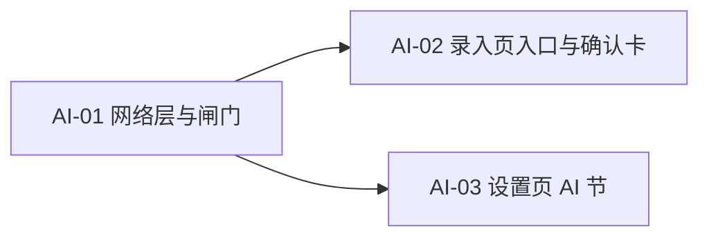

# 收纳助手（Shouna）架构规划 · AI 一句话录入

> 版本：**v1.0** ｜ 上游：[docs/PRD.md](PRD.md) ｜ 相关：[prd/14-分期与V2-AI规划.md](prd/14-分期与V2-AI规划.md)（V2 的能力、成本、预留位与待拍板项的**真源**）｜ 路径基准：工程根 `shouna/`
> 本页**只描述「AI 一句话录入」**的规划。**搜索侧（`V2-FR-05` 自然语言搜索）不在本页范围**——不规划、不预留代码路径、不占 UI。
> **何时读**：要动 AI 录入相关代码（网络层、密钥存储、调用闸门、设置页 AI 节）时。
> **不适用**：只回答「V2 要做什么」（读 `prd/14`）、只跑构建或测试。

**一句话结论**：在录入页**名称框尾部加一个 AI 按钮**；用户把一句口语打进名称框，点它即调用 DeepSeek 取回结构化 JSON；本地把位置与分类**映射到已有数据**（位置映射不上的层标「待新建」、分类映射不上则一律置空），再以**页内列表确认卡**让用户确认或忽略；**AI 结果永不直接落库**，落库仍走原有保存路径。全程**零新增依赖、零迁移、零新增页面与路由**，只多一个 `INTERNET` 权限。

**与 V1 / P2 的关系（读前必看）**：本页**不改任何既有数据结构与主流程**——`version` 保持 2、仍是 5 张表、路由仍是 9 条、`domain/search/*` 一行不改。它是 `prd/14` §14.5「V1 要留的缝」在**已实现代码上的落位说明**：`V2-SEAM-02`（文本 → 草稿）落在 `QuickAddViewModel`，`V2-SEAM-03`（确认位）落在 P-ADD 自身，`V2-SEAM-05`（配置位）落在 P-SETTINGS，`V2-SEAM-06`（闸门位）落在新增的 `AiGate`。

> ⚠️ **范围与授权记录（2026-09-30，用户逐项拍板）**
> - **联网**：`prd/14` §14.9 的 **U-9** 裁定为**路线乙（云端 AI）**、**U-10** 裁定为**用户自备 Key**。这是打破 V1「零网络」承诺的正式授权。
> - **交付载体**：本页**独立成文**（用户原话「全新文档」）⇒ `prd/14` 与 `prd/05` **一字不改**；**不新增 `FR-50`**（守 `prd/14` §14.7 的编号纪律：`FR-01`～`FR-49` 不重排、不合并、不新增）。
> - **本地优先**：用户裁定**不做本地预解析器**——「本地和云端两套，专门有一个 AI 按钮，如果启动，那么直接走 AI」。这是对 `prd/14` **`V2-COST-02` ②** 的**放宽**，理由与代价见 §8.1-3。
> - **确认形态**：**页内列表确认卡**（用户原话「列表确认卡」）。
> - **密钥与设置页**：加密存储；设置页 AI 节 = **开关 + Key + 用量**。
> - **三条 NFR 与 `实现约束.md` §7 的改写、以及版本号升级**：本页**只提出要求**（§8.2），**均未执行**，须单独授权。

## 0. 关键决策

| 决策点 | 结论 |
|---|---|
| 范围 | **只有「输入」侧**：一句话 → 结构化草稿 → 人工确认。**搜索侧不做**（`V2-FR-05`） |
| 入口 | **复用录入页名称框**：尾部加一个 AI 按钮（与既有 FR-18 的 🎤 同位置、同形态），**零新增输入框** |
| 触发 | **手动点击即走云端**；不做本地预解析、不做自动触发、不做「输入停顿后自动解析」 |
| 落库 | **AI 结果永不直接落库**（`prd/14` `V2-FR-04` 的硬约束）；确认位 = **P-ADD 自身**，不新增页面 |
| 确认形态 | **页内列表确认卡**（逐字段一行，标注命中 / 待新建），点「填入」才写主表单 |
| 位置映射 | 逐层归一化匹配**已有位置节点**；**未命中标「待新建」，用户点「填入」后才 `create`** |
| 分类映射 | 分类名单进 prompt；返回名**必须精确命中**现有分类，**否则置空**；**AI 绝不新建分类** |
| 密钥存储 | **Android Keystore 生成密钥 + AES-256-GCM 加密**，密文与 IV 存 SharedPreferences；**不用 `EncryptedSharedPreferences`**（该 API 已于 2025-04 / `security-crypto:1.1.0-alpha07` 被官方废弃） |
| 闸门 | **唯一一处在 `AiGate`**（`prd/14` `V2-SEAM-06`）：总开关 → 进程内缓存 → 调用；**配额不做**（理由见 §8.1-5） |
| 存储 | **零迁移**：不改表、不加列、不加表；开关与用量走 `app_config` 既有 KV，密钥走 SharedPreferences |
| 依赖 | **零新增**：`HttpURLConnection` + 既有 `kotlinx-serialization-json` + 平台 Keystore |
| 权限 | **+1**：`android.permission.INTERNET`（**工程首个网络权限**） |
| 导航 | **不变（9 条）**；不新增页面 |
| 任务 | **3 个**（AI-01 网络层与闸门 → AI-02 录入页入口与确认卡；AI-03 设置页 AI 节） |

## 1. 范围与需求映射

| 本页实现 | `prd/14` 对应 | 落地形态 | 落点 |
|---|---|---|---|
| 一句话送 AI | `V2-FR-02` | 名称框尾部 AI 按钮 → `AiGate` → `AiClient.parse()` | P-ADD |
| 文本 → 结构化草稿 | `V2-FR-03` | 云端返回 JSON → 本地映射与校验 → 草稿（**只是草稿**） | `domain/ai/*` |
| 人工确认 / 修改 | `V2-FR-04` | 页内列表确认卡 → 点「填入」回填主表单 → 用户改后点「保存并继续」 | P-ADD |
| 开关与配置 | `V2-FR-06` / `V2-SEAM-05` | 设置页 AI 节：总开关（默认关）+ API Key | P-SETTINGS |
| 失败人工回退 | `V2-FR-07` / `V2-COST-03③` | 未开启 / 超时 / 报错 → 静默降级 + 行内提示，**不阻塞**手动录入 | P-ADD |
| 用量可见与可关 | `V2-FR-08` / `V2-COST-04` | 设置页显示本周期调用次数；随时一键关闭 | P-SETTINGS |
| 调用闸门 | `V2-SEAM-06` / `V2-COST-03②` | `AiGate`：开关 → 缓存 → 调用 | `data/repository/` |

**草稿字段（4 个）**：名称 / 位置 / 分类 / 备注。

> **为什么没有「数量」**：`prd/14` `V2-FR-03` 列出了数量，但 **P-ADD 当前没有数量输入框**（数量字段在 P-ITEM-EDIT 里维护），而 `prd/14` §14.5 `V2-SEAM-02` 明确「**不得新增物品字段**」。给 P-ADD 加数量输入框属**改动主流程**，须单独授权 ⇒ 本页**不解析数量**，登记为落差（§8.3）。

**本次不做**：搜索侧全部（`V2-FR-05`）、语音 → 文本（`V2-FR-01`；V1 已有 FR-18 简化形态的语音弹窗，归属 P1）、本地规则解析器（`V2-COST-02` ②，见 §8.1-3）、配额（`V2-COST-03` ①，见 §8.1-5）、**V2 之外的全部**。

## 2. 分层与数据流

### 2.1 新增 `data/remote/` 层（工程首个网络层）

| 层 | 本次变化 |
|---|---|
| `data/remote/` | **新增**：`AiClient`（接口）、`DeepSeekAiClient`（实现）、`NoopAiClient`（未开启时的绑定）、`AiDto`（`@Serializable` 请求 / 响应）、`AiPrompt`（prompt 组装，纯函数）、`AiHttp`（`HttpURLConnection` 封装） |
| `data/repository/` | **新增** `AiGate`（唯一闸门）、`AiSettingsRepository`（开关 / 密钥 / 用量） |
| `domain/ai/` | **新增**纯函数：`DraftParser`（JSON → 草稿 + 分类白名单校验）、`LocationPathMatcher`（路径数组 → 命中 id / 待新建）。**不依赖 Android 框架**（守 `实现约束.md` §2-8），故可在 JVM 单测直跑 |
| `ui/screen/add/` | 名称框尾部 +1 个按钮；**页内列表确认卡**（页面私有组件） |
| `ui/screen/settings/` | +1 个 AI 节 |
| `di/` | **新增** `AiModule`：按「是否已配置」绑定 `DeepSeekAiClient` / `NoopAiClient` |

> ⚠️ `data/remote/` 是本工程**第一次出现网络层**。实现时须在 `docs/code-map/00-索引.md` §2 的**分层与依赖方向**表补这一层，否则「依赖只能自上而下」这条检查会缺一环（登记在 §8.2）。

### 2.2 数据流（7 步）

1. 用户在名称框输入整句（例「客厅抽屉里的充电器」）→ 点尾部 AI 按钮
2. `QuickAddViewModel.onAiParse(input)` → `AiGate.run(input, categoryNames)`
3. 闸门：**总开关关 / 无 Key → 直接返回「不可用」**（按钮此时本就不显示，见 §3.4）；**进程内缓存命中 → 直接返回**，不产生请求
4. `AiClient.parse()` → HTTPS 单次请求 → JSON
5. `DraftParser`（纯函数）：字段裁剪 + **分类白名单校验**（不在名单内 → `null`）
6. `LocationPathMatcher`（纯函数）：路径数组逐层匹配位置树 → 命中 id / **待新建标记**
7. 结果进 `QuickAddUiState` → 渲染**页内列表确认卡** → 用户点「填入」→ 回填主表单 → 点「保存并继续」走**原有**保存路径

### 2.3 网络层为什么用 `HttpURLConnection`

本次只需**一次 POST + 一次 JSON 反序列化**，没有连接池复用、拦截器、多路复用等需求。引入 OkHttp / Retrofit / Ktor 的代价：

- 新依赖，且会推高方法数——本工程刚把 release 方法数从 138,930 压到 18,338，不宜再造增量；
- 与「零新增依赖」的既有取向冲突（`实现约束.md` §5-3）。

而 `kotlinx-serialization-json` **已在依赖里**（F1-01 引入，供路由键序列化），直接复用即可。

> **`minSdk 24` 已满足**：`HttpURLConnection` 在 API 24 上默认启用 TLS 1.2；`android:usesCleartextTraffic` 保持默认（不允许明文）⇒ 端点**必须 HTTPS**。

## 3. 数据契约与本地映射

### 3.1 请求

| 项 | 取值 |
|---|---|
| 端点 | `https://api.deepseek.com/chat/completions`（**硬编码常量**，不暴露给用户） |
| 模型 | `deepseek-chat`（**硬编码常量**；本页不做模型选择，见 §8.1-7） |
| 鉴权 | `Authorization: Bearer <用户自填 Key>` |
| 响应格式 | `response_format = {"type": "json_object"}` |
| 超时 | 连接 5s / 读取 15s（`connectTimeout` / `readTimeout`） |

### 3.2 输出（**唯一契约**）

```json
{
  "name": "充电器",
  "location_path": ["客厅", "抽屉"],
  "category": "电子配件",
  "note": "白色 65W"
}
```

| 字段 | 类型 | 约束 |
|---|---|---|
| `name` | string \| null | 物品名；无法识别时为 null |
| `location_path` | string[] \| null | **从根到叶的层级数组**；无法识别时为 null |
| `category` | string \| null | **必须从 prompt 给定的名单中选**；无合适项时为 null |
| `note` | string \| null | 备注；没有时为 null |

> **`location_path` 为什么是数组**：本工程的位置是**树**（`LocationRepositoryImpl.create(name, parentId)` 逐层建节点），而中文里的层级切分符不固定（「客厅的抽屉」/「客厅-抽屉」/「客厅抽屉」都可能）。让模型承担**分段**、本地只做**逐层匹配**，比本地猜切分点可靠得多。`AiPrompt` 里显式要求「从根到叶分段，每层一个元素」，并对「返回单个字符串」的降级情形做兜底（当作单元素数组处理）。

### 3.3 本地映射（四个字段四种策略）

| 字段 | 本地真源 | 命中策略 | 未命中时 |
|---|---|---|---|
| `name` | — | 原样填入名称框 | — |
| `location_path` | `locationRepository.observeTree()` | 逐层归一化匹配（复用 `util/TextNormalizer` + `util/PinyinUtil`），命中取 `location.id` | 标**「待新建」**；**用户点「填入」后才 `create(name, parentId)`** |
| `category` | `categoryRepository.observeCategories()` | 名单进 prompt；返回名归一化后**必须精确命中** | **置空**（`null`），**绝不自动建分类** |
| `note` | — | 原样填入备注框 | — |

**匹配算法的三条口径**

1. **逐层下沉**：从树的根层开始，在**当前层的候选子节点**里找与路径元素归一化后相等者；命中则下钻，未命中则该层记为「待新建」，**其后所有层一并记为待新建**（因为父节点尚不存在）。
2. **只认精确相等**：不做模糊、不做包含、不做拼音首字母缩写（避免把「客厅」匹配到「客厅储物柜」）。归一化用既有 `TextNormalizer`（大小写、空白、全半角），拼音用 `PinyinUtil`（处理「客厅」/「keting」这类同音输入）。
3. **同一层多命中时取第一个**：位置树的同级不重名由应用层软校验保证（`prd/08` 的 A-3），实际不会出现分歧。

**两条硬边界**

1. **AI 绝不新建分类**。分类由 `BuiltInData` 提供内置名单且内置项**受保护（不可删）**；由 AI 造分类等于让模型污染用户的数据结构，也违背「不为功能而功能」的既定原则。
2. **AI 绝不直接新建位置**。「待新建」只是**确认卡上的一个标记**；真正的 `create` 发生在用户点「填入」之后，且仅针对**路径中未命中的那些层**（按父链顺序逐层建）。理由：位置树是用户手动维护的层级结构，猜错会留下垃圾节点，而位置树没有「批量清理」入口。

### 3.4 交互形态（页内列表确认卡）

**入口**：**名称框尾部**的 AI 按钮——与既有 FR-18 的 🎤 同位置、同形态（`QuickAddScreen` 已有「输入框 + 尾部按钮」的模式），**零新增输入框、零新增弹层、零新增页面**。

**确认卡**（**页内一段，不是弹层**）：

| 行 | 展示例 |
|---|---|
| 名称 | 充电器 |
| 位置 | 家 › 客厅 › 抽屉　（✓ 已存在）／（＋ 将新建「抽屉」） |
| 分类 | 电子配件　（✓ 已匹配）／（未匹配，留空） |
| 备注 | 白色 65W |

底部两个动作：**「填入」**（回填主表单）与**「忽略」**（关闭卡片，主表单不动）。

**为什么不做成弹层**：① 守 `实现约束.md` §4-4「连续录入期间不得弹出任何位置 / 分类对话框」——卡片虽属展示而非输入，但同一取向：连续录入过程中不得有东西挡住页面；② 本工程实测**按需创建的新弹层冷首帧约 700ms**（`LocationPickerSheet` 冷 734.6 / 温 520.7ms），页内卡片只承担重组成本，不付建窗与测量代价。

**四条状态规则**

- **未开启或未配置 Key → 按钮不显示**（而非显示后报错）——不给用户一条走不通的路。
- **解析中**：按钮转进度态；**不锁定其他输入**（用户可以继续打字）。
- **失败**：卡片位置显示一行行内提示（「解析失败，可直接手工录入」），**不弹窗**（守 §4-1），主表单内容不动、用量不计数。
- **填入后**：卡片自行消失；**未点「保存并继续」前不落库**。

## 4. 任务分解

> 3 个任务。**AI-01 是唯一前置**（AI-02 / AI-03 都依赖它），后两者相互独立、可任意顺序。

### AI-01 网络层、领域纯函数与闸门（无依赖）

- **新建 11**：
  - `data/remote/ai/AiClient.kt`（接口：`suspend fun parse(input: String, categoryNames: List<String>): AiDraft?`）
  - `data/remote/ai/DeepSeekAiClient.kt`
  - `data/remote/ai/NoopAiClient.kt`（恒返 null）
  - `data/remote/ai/AiHttp.kt`（`HttpURLConnection` 封装：超时、状态码、UTF-8 读写）
  - `data/remote/ai/AiDto.kt`（请求 / 响应 `@Serializable`）
  - `data/remote/ai/AiPrompt.kt`（system prompt 组装，纯函数）
  - `domain/ai/AiDraft.kt`（草稿模型）
  - `domain/ai/DraftParser.kt`（JSON → 草稿 + 分类白名单校验，纯函数）
  - `domain/ai/LocationPathMatcher.kt`（路径数组 → 命中 id / 待新建，纯函数）
  - `data/repository/AiGate.kt`（唯一闸门，`@Singleton`）
  - `data/repository/AiSettingsRepository.kt`（`@Singleton`：开关、密钥读写、用量计数）
- **新建测试 3**：`DraftParserTest.kt`、`LocationPathMatcherTest.kt`、`AiGateTest.kt`（均纯 JVM，假 client 不触网）
- **新建 DI 1**：`di/AiModule.kt`
- **触及 2 个既有文件**：`app/src/main/AndroidManifest.xml`（+`INTERNET`）、`di/AppModule.kt`（提供 `SharedPreferences`）
- **子步骤**
  ① `AndroidManifest` 加 `INTERNET`（**本页唯一的权限变更**），并在权限声明处写注释说明「仅用于用户显式开启后的 AI 解析」；
  ② `AiSettingsRepository`：开关与用量读写（走 `app_config` 既有 KV）；密钥的 Keystore + AES-GCM 加解密（§5）；
  ③ `AiPrompt`：system prompt 声明「只输出 JSON」「分类只能从给定名单里选、没有合适的就 null」「位置从根到叶分段」「识别不出的字段一律 null」「不得编造」；
  ④ `DeepSeekAiClient`：POST + `response_format: json_object` + 两组超时；**非 2xx 一律返 null**（不区分异常类型，降级路径只有一条）；
  ⑤ `DraftParser`：**容错解析**（先直接解析 → 失败则截取首个完整 `{...}` 再解析 → 再失败返 null）+ 分类白名单校验 + `location_path` 非数组时降级为单元素数组；
  ⑥ `LocationPathMatcher`：逐层匹配 + 返回「命中链 + 待新建层」；
  ⑦ `AiGate`：`开关 → 无 Key 判空 → 进程内缓存（键 = 输入 + 分类名单）→ 调用`；**调用成功才 `+1` 用量**。
- **验收**（**全部由 JVM 单测覆盖，不需要网络**）
  - `DraftParser`：合法 JSON ✅；markdown 代码块包裹 ✅；前后有多余文本 ✅；字段缺失 ✅；分类不在名单 → **置空** ✅；`location_path` 为字符串而非数组 → 降级为单元素数组 ✅；完全非 JSON → 返 null ✅
  - `LocationPathMatcher`：逐层全命中 ✅；部分命中（末层待新建）✅；全未命中 ✅；同名节点取归一化后完全相等者 ✅；空树 ✅
  - `AiGate`：开关关 → **不调用** client ✅；无 Key → 不调用 ✅；同输入二次调用 → **命中缓存、不二次调用** ✅；调用失败 → 不 `+1` 用量 ✅
- **PRD 承接**：`prd/14` `V2-FR-02` / `V2-FR-03` / `V2-FR-06` / `V2-FR-07` / `V2-SEAM-02` / `V2-SEAM-06` / `V2-COST-03②` / `V2-COST-05`

### AI-02 录入页 AI 按钮与页内列表确认卡（依赖 AI-01）

- **新建 1**：`ui/screen/add/QuickAddAiCard.kt`（页面私有，无状态：接草稿行数据 + 两个回调）
- **触及 2 个既有文件**：`ui/screen/add/QuickAddScreen.kt`（名称框尾部 +1 按钮、卡片渲染位）、`ui/screen/add/QuickAddViewModel.kt`（AI 状态机 + 回填）
- **子步骤**
  ① `QuickAddUiState` 增 `aiState: AiState`（`Hidden` / `Idle` / `Parsing` / `Draft(rows)` / `Failed`）与 `aiEnabled: Boolean`；
  ② `QuickAddViewModel.onAiParse()`：读名称框当前串 → `AiGate.run()` → `DraftParser` → `LocationPathMatcher` → **在 VM 组装卡片行文案与「已存在 / 待新建」判定**（守 §2-2：展示类派生一律在 VM）；
  ③ `onAiApply()`：回填四个字段 + 对「待新建」层按父链顺序调 `locationRepository.create()`；**回填后清 `aiState`**；
  ④ `onAiDismiss()`：清 `aiState`，主表单不动；
  ⑤ 按钮可见性 = `aiEnabled`（订阅 `AiSettingsRepository`），**默认 false**；
  ⑥ **回填一律走既有 setter**（`onNameChange` / `onNoteChange` / `onCategorySelected` / `onLocationSelected`），不直接改 `state` —— 与 FR-18 的 `onVoiceResult` 同一取向：那些 setter 上挂着「清 FR-14 相似提示」「重算 `canSave`」等副作用，绕过会让 AI 填入与手打行为不一致。
- **验收**：未开启时按钮不出现；开启后点按钮 → 进度态 → 卡片；卡片四行与识别结果一致；「待新建」仅在位置未命中的层出现；点「填入」后名称 / 位置 / 分类 / 备注四处在主表单可见，且**未点「保存并继续」前不落库**；点「忽略」主表单不变；断网时出**行内提示**且主表单不变；**连续录入流程不受影响**（卡片不是对话框，守 §4-4）
- **PRD 承接**：`prd/14` `V2-FR-04` / `V2-SEAM-03`、`prd/07` §P-ADD、`实现约束.md` §2-2 / §3-3 / §4-1 / §4-4

### AI-03 设置页 AI 节（依赖 AI-01）

- **触及 4 个既有文件**：`ui/screen/settings/SettingsViewModel.kt`、`ui/screen/settings/SettingsScreen.kt`、`res/values/strings.xml`、`docs/`（登记见 §8.2）
- **子步骤**
  ① 设置页新增「AI 一句话录入」节：**总开关**（默认关）+ **API Key**（`PasswordVisualTransformation`，**只写入不回显明文**）+ **本周期用量**（次数）；
  ② 关闭开关时**不删除已保存的 Key**（再开启时不必重填）；
  ③ 隐私说明补一条：**仅在开关开启时，你输入的那句话与现有分类名称会发往你配置的 AI 服务商**；顺带说明「位置树与物品数据不上传」；
  ④ 文案集中 `strings.xml`（守 §5-1，不新增 `values-night/`）。
- **验收**：开关默认关；关闭状态下录入页**无 AI 按钮、无任何网络请求**；填写 Key 并开启后按钮出现；用量随调用递增（失败不计）；关闭开关后立刻停止一切请求
- **PRD 承接**：`prd/14` `V2-SEAM-05` / `V2-FR-06` / `V2-FR-08` / `V2-COST-01` / `V2-COST-04`



## 5. 密钥存储（`EncryptedSharedPreferences` 已废弃，本页的替代方案）

**为什么不能用 `EncryptedSharedPreferences`**：`androidx.security:security-crypto` 的该 API **已于 2025 年 4 月随 `1.1.0-alpha07` 被 Google 官方废弃**，官方明确「无后续版本计划」，建议改用 **Android Keystore + 显式 AES/GCM**（或 DataStore + Tink）。引一个已停止维护的加密库，安全性反而不如直接用平台 API。

**本页方案（零新增依赖）**

| 环节 | 做法 |
|---|---|
| 生成密钥 | `KeyGenerator.getInstance("AES", "AndroidKeyStore")` + `KeyGenParameterSpec`（`BLOCK_MODE_GCM` / `ENCRYPTION_PADDING_NONE` / **`setUserAuthenticationRequired(false)`**） |
| 加密 | `Cipher.getInstance("AES/GCM/NoPadding")`；IV 由 `Cipher` 随机生成 |
| 落盘 | **Base64(密文) + Base64(IV)** 两个键存应用私有 `SharedPreferences` |
| 解密 | 取 IV → `GCMParameterSpec(128, iv)` → 解出明文 Key，**仅内存持有** |
| 密钥别名 | 固定常量；`AndroidKeyStore` 中的密钥**不可导出** |

**三条硬边界**

1. Key **不进日志、不进崩溃上报、不上传**（`AiHttp` 与 `AiDto` 都不打印请求头）。
2. 解密失败（系统清除密钥、换机后 Keystore 失效）按**「未配置」**处理 → 按钮不显示，**不崩溃**、不弹窗。
3. 开关关闭**不删 Key**——避免用户每次开启都要重填（守「不增加使用成本」）。

## 6. 文件规模

**新建 15**；**修改 6**；**删除 0**。

| 新建 | 数量 | 清单 |
|---|---|---|
| 网络层 | 6 | `data/remote/ai/` 的 `AiClient` / `DeepSeekAiClient` / `NoopAiClient` / `AiHttp` / `AiDto` / `AiPrompt` |
| 领域纯函数 | 3 | `domain/ai/` 的 `AiDraft` / `DraftParser` / `LocationPathMatcher` |
| 仓库 | 2 | `data/repository/AiGate.kt`、`AiSettingsRepository.kt` |
| DI | 1 | `di/AiModule.kt` |
| UI | 1 | `ui/screen/add/QuickAddAiCard.kt`（页面私有组件） |
| 测试 | 3 | `DraftParserTest` / `LocationPathMatcherTest` / `AiGateTest`（JVM 单测） |

**修改 6** = `app/src/main/AndroidManifest.xml`（+`INTERNET`）+ `di/AppModule.kt`（提供 `SharedPreferences`）+ `ui/screen/add/QuickAddScreen.kt` + `ui/screen/add/QuickAddViewModel.kt` + `ui/screen/settings/SettingsScreen.kt` + `ui/screen/settings/SettingsViewModel.kt`（`strings.xml` 随 AI-03 计入）。

> **工程量分布**：主要成本在 **`DraftParser` 的容错**与 `LocationPathMatcher` 的逐层匹配（两者都是纯函数、全 JVM 可测、不需要网络），以及**确认卡的状态机**。**没有任何新表、没有任何新依赖、没有新增页面与路由**；唯一的结构性变化是**多了一个权限**与**多了一层 `data/remote/`**。

## 7. 与既有代码的接缝（触及的既有文件，去重清单）

| 既有文件 | 本次改动 |
|---|---|
| `app/src/main/AndroidManifest.xml` | **+`android.permission.INTERNET`**（工程首个网络权限）；注释写明「仅用于用户显式开启后的 AI 解析」 |
| `di/AppModule.kt` | 提供 `SharedPreferences`（供 `AiSettingsRepository` 存密钥密文与 IV） |
| `ui/screen/add/QuickAddScreen.kt` | 名称框尾部 +1 个 AI 按钮；+1 个卡片渲染位 |
| `ui/screen/add/QuickAddViewModel.kt` | +`AiState` 状态与 3 个动作（`onAiParse` / `onAiApply` / `onAiDismiss`）+ 订阅 `aiEnabled`；**`canSave` 口径不变** |
| `ui/screen/settings/SettingsScreen.kt` / `SettingsViewModel.kt` | +1 节（开关 / Key / 用量）；**`thresholdMonths` 既有逻辑不变** |
| `res/values/strings.xml` | +AI 节与确认卡文案（集中管理，**不新增 `values-night/`**） |

> **反向不动（本页明确不碰）**：
> - `data/local/**` —— **零迁移**：`version` 保持 2、不加列、不加表、不改 `Migrations.kt`、不新增 schema JSON。开关与用量走 `app_config` 既有 KV。
> - `domain/search/**` —— **检索侧一行不改**（搜索相关需求不在本页）。
> - `util/TextNormalizer.kt` / `util/PinyinUtil.kt` —— **只读复用**，不改（改动会连带影响检索单测与 `SearchScorer.highlightRange`）。
> - `ui/theme/**`、`MainActivity.kt`、`ui/navigation/**`、`RouteHandler.kt` —— 永久浅色、字号锁定、容器级避让、9 条路由**全部不变**。
> - `data/repository/ItemRepository*` / `LocationRepository*` / `CategoryRepository*` —— **一行不改**：AI 只是新的**调用方**，不动既有写入口径。
> - `ShounaApplication.kt` —— 不用它做 AI 初始化。与 P2 的每日清理不同：AI 是**按需**能力，没有「每次启动都要做的事」。

## 8. 本次裁决与落差登记

### 8.1 本次裁决（本页定的口径）

| # | 事项 | 结论与理由 | 止损（要改回时动哪里） |
|---|---|---|---|
| 1 | 编号 | **不新增 `FR-50`**。守 `prd/14` §14.7：`FR-01`～`FR-49` 不重排、不合并、不新增；本页只在正文里**引用** `V2-*` 编号 | 若要新增编号 = 改 `prd/05` 编号纪律 + 重算「V1 交付 28 条」 |
| 2 | 交付载体 | **本页独立成文**；`prd/14` 与 `prd/05` **一字不改**（用户 2026-09-30 裁定「全新文档」） | 并入 `prd/14` = 迁移本页内容并加交叉引用 |
| 3 | **不做本地预解析器** | 用户 2026-09-30 原话：「**本地和云端两套，专门有一个 AI 按钮，如果启动，那么直接走 AI**」。⇒ 这是对 `prd/14` **`V2-COST-02` ②**（「本地规则 / 关键词 / 别名表能解析出的字段不得送云端」）的**放宽**。理由：① 显式点击本身即用户意图的最强表达，不存在「误触发云端」的场景；② 「一句话」的形态（口语、省略、隐含意图）本地规则基本解析不出，写一个只对固定句式生效的解析器属**为功能而功能**；③ 省下一套本地解析器与它的单测 | 要恢复本地优先 = 在 `AiGate` 前插一层本地规则解析（纯函数、可独立测试），调用方无需改动 |
| 4 | 密钥存储 | **Keystore + AES-256-GCM**（§5）。原计划的 `EncryptedSharedPreferences` **已于 2025-04 官方废弃**，不可采用 | 换方案 = 只改 `AiSettingsRepository` 一个文件 |
| 5 | **不做配额** | 用户 2026-09-30 的选择（设置页范围 = 开关 + Key + 用量）⇒ `prd/14` `V2-COST-03` ① 的「每周期最多 N 次 / N 字符」**不做**。理由：本页是 **BYO Key**（`V2-COST-05`）——费用由用户与供应商**直接结算**，用户在供应商侧设限额更直接；应用内再加一道配额属重复管控，且要多维护一套周期账（`ai_usage_period_start` 的跨月归零逻辑） | 要做 = `AiSettingsRepository` 加 2 个键 + `AiGate` 加一段判定 + 设置页加一行 |
| 6 | 保留进程内缓存 | `V2-COST-03` ② 保留：同输入（且同分类名单）在**进程存活期内**命中缓存直接返回，不重复计费。实现 = `AiGate` 内一个 LRU（上限 20 条），**不落盘**（重启即失效，避免把用户输入长期留存） | 去掉 = 删 `AiGate` 内一处分支 |
| 7 | 供应商与模型硬编码 | 端点 `api.deepseek.com` 与模型 `deepseek-chat` 为**常量**，不做模型选择 UI。理由：用户表述是「**调用 deepseek 大模型**」，没有多供应商需求；暴露模型选择等于引入用户不需要的新概念（违 `prd/02` §1.3 的简易度判据 B） | 要开放 = 设置页 +1 项、`AiSettingsRepository` +1 键、`DeepSeekAiClient` 改读配置 |
| 8 | 入口复用名称框 | 不新增输入框、不新增弹层、不新增页面。既有 FR-18 的 🎤 **已经**是「输入框尾部按钮」这一模式，AI 按钮同位置同形态 | 换落点 = 改 `QuickAddScreen` 一处 |
| 9 | 确认卡是「页内一段」 | 见 §3.4 的两条理由（守 §4-4 + 规避弹层冷首帧 ≈700ms） | 改弹层 = `QuickAddScreen` 一处 + 承担首帧成本 |
| 10 | 回填走既有 setter | 见 §4 AI-02 子步骤 ⑥ | 改法 = `QuickAddViewModel` 一处 |
| 11 | AI 不新建分类、不直接新建位置 | 见 §3.3 两条硬边界 | — |
| 12 | 超时口径 | 连接 5s / 读取 15s。**失败只有一条降级路径**（返 null → 行内提示），不区分异常类型、不做重试 | 调数值 = 两个常量 |

### 8.2 需要另行授权的事项（**本页只提出，一律未执行**）

| # | 事项 | 为什么必须单独授权 | 建议口径 / 落点 |
|---|---|---|---|
| 1 | **改写 `实现约束.md` §7-1 / §7-3** | 现行 §7-1 =「不申请 `INTERNET`」、§7-3 =「零网络三条 V1 期间全文有效、一字不改；**V2 若走云端 AI 须先由用户拍板再改写**」。U-9 已拍板，但**改写动作本身**须单独授权 | 新增 **§7-5「AI 联网的唯一出口」**：出网只允许发生在 `data/remote/ai/`；未开启开关时零请求 |
| 2 | **改写 `prd/10` 的 NFR-01 / NFR-02 / NFR-17** | 同源于 §7-3 | 见下方建议表 |
| 3 | **`prd/12` 的 U-9 / U-10 结案** | `prd/12` 是「待用户确认清单」，结案需改该页 | U-9 → 路线乙；U-10 → 用户自备 Key |
| 4 | **`prd/07` §6.1 的 P-SETTINGS 表述** | 该处写着 AI 设置节「在 V1 **完全不出现**（连灰置入口都不给）」。本页实现后该节**首次出现**，原表述对 V2 失效 | 就地补注「V2 起该节出现，见 `ARCHITECTURE-AI.md`」 |
| 5 | **`prd/14` 加一行指针** | §14.7 末尾写着「架构侧 V2 的接口契约由架构师另立文档承载（**待重出**）」——本页正是那份文档 | 在 §14.7 影响面表内加一行指向本页 |
| 6 | **`code-map/00-索引.md` 登记 `data/remote/` 分层** | 该页 §2 的「分层与依赖方向」表是目前唯一的层级清单，缺这一层则依赖方向检查失效 | 层号插在「仓库」与「持久化」之间；同时 §1 任务索引加一行「改 AI 录入」 |
| 7 | **`AGENTS.md` 索引表登记本页** | 该页登记规则：「入口页新增、改名或内容变化时同步本表」 | 已在 **2026-09-30 本次落盘时登记**（见 §8.4） |
| 8 | **版本号升级的落点** | 用户裁定升 **v1.6**，但落点横跨 `docs/PRD.md` 的版本行与变更记录、以及 `prd/` 14 份分册头部的「所属：PRD **v1.5**」 | 待授权后一次性同步；**本页自身版本为 v1.0**，不随 PRD 升版 |

**建议的 NFR 改写口径**（供授权时直接采用）

| 编号 | 现行（V1 有效） | 建议改为 |
|---|---|---|
| NFR-01 | 100% 功能离线可用，**不申请网络权限** | **核心链路（记录 / 查找 / 浏览 / 归纳）100% 离线可用**；AI 一句话录入为**可选增强**，出厂关闭，**未开启时不产生任何网络请求** |
| NFR-02 | 无任何网络请求、无第三方统计 / 埋点 SDK | 不向任何第三方统计 / 埋点 SDK 上报；**唯一的网络请求是用户显式开启 AI 后，把一句话与分类名单发往用户自己配置的供应商** |
| NFR-17 | 应用自身不采集、不上报、不共享任何用户数据 | 应用自身不采集、不上报任何用户数据；**仅在用户开启 AI 时，其主动提交的那句话与分类名单会离开设备**；我方不接收、不留存、无中间服务器 |

### 8.3 落差（本页不做，留待后续）

- **数量字段**：`prd/14` `V2-FR-03` 列了「数量」，但 P-ADD 无数量输入框，且 `V2-SEAM-02` 禁止新增物品字段 ⇒ 本页**不解析数量**。要支持须先给 P-ADD 加输入框（属**改动主流程**，须单独授权）。
- **`V2-FR-01` 语音 → 文本**：不在本页。V1 已有 FR-18 简化形态的语音弹窗（`ui/component/VoiceInputDialog`，归属 P1），但它只做「语音 → 文本 → 追加写入字段」，**不含 AI 结构化**。两者若要串联（说话 → AI 整理），属 V2 的完整链路，须另行规划。
- **`V2-FR-05` 自然语言搜索**：用户明确不做（原话「别管」）。
- **`V2-COST-02` 本地优先解析器**：见 §8.1-3。
- **`V2-COST-03` ① 配额**：见 §8.1-5。
- **模型 / 供应商选择**：见 §8.1-7。
- **多物品拆解**：一句话里提到多个物品（「充电器和耳机」）时，本页**只取主物品**，其余忽略。理由：批量录入是另一个功能，且会破坏「一次一条」的连续录入节奏（守 `实现约束.md` §4-4）。

### 8.4 本次落盘的文档改动

| 动作 | 文件 |
|---|---|
| **新建** | `docs/ARCHITECTURE-AI.md`（本页） |
| **修改** | `shouna/AGENTS.md` 文档索引表 **+1 行**（入口页登记，属该页「登记规则」的强制要求） |
| **一字未改** | `docs/PRD.md`、`docs/prd/*`（14 份）、`docs/实现约束.md`、`docs/code-map/*`（6 份）、`docs/ARCHITECTURE{,-P0,-P1,-P2}.md` |

> **为什么只加一行索引**：`AGENTS.md` 的登记规则要求「入口页新增、改名或内容变化时同步本表」，否则本页在工程内**不可发现**。这是一行指针，不是内容改动。

## 9. 整体验收

| 项 | 口径 |
|---|---|
| 构建 | `:app:assembleDebug` + `:app:testDebugUnitTest` 成功；androidTest 通过；**无新增依赖**（`gradle/libs.versions.toml` 零改动） |
| 权限 | `AndroidManifest.xml` **只多 `INTERNET` 一条**；`RECORD_AUDIO` 与 FileProvider 不变 |
| 迁移 | **零迁移**：`version` 仍为 2、仍 5 张表、`app/schemas/` **不新增文件**；`MigrationsTest` 既有用例**不动且必须仍通过** |
| 默认态 | 全新安装：设置页 AI 开关**默认关**、录入页**无 AI 按钮**、**零网络请求** —— 行为与 v1.5 **完全一致** |
| 开启后 | 填 Key + 开开关 ⇒ 按钮出现；点按钮 ⇒ 一次 HTTPS 请求；返回后卡片四行与识别结果一致；「待新建」只在位置未命中的层出现 |
| 落库 | **未点「保存并继续」前，数据库无任何新行**（`prd/14` `V2-FR-04`）；确认卡可「忽略」，忽略后主表单与库均不变 |
| 回退 | 断网 / 超时 / 非 2xx / JSON 非法 ⇒ **行内提示**、主表单不变、**不弹窗**、**用量不计数**；用户可继续手工录入 |
| 分类与位置 | 分类**只能**命中现有分类（不在名单内即为空，**库中分类数量不变**）；位置未命中**不自动新建**，只在用户点「填入」后按父链逐层建 |
| 密钥 | Key 以**密文 + IV** 落 SharedPreferences；**日志与代码中不出现明文**；换机后 Keystore 失效 ⇒ 按「未配置」处理，**不崩溃** |
| 不回归 | F1 / P0 / P1 既有单测全部通过；**连续录入 5 件 ≤ 40 秒**（AI 是可选旁路，守 `prd/10` NFR-08）；**1000 件搜索 ≤ 300ms**（检索侧一行未改，守 NFR-05）；永久浅色、字号锁定、系统栏与 IME 避让三项不变；路由仍是 9 条 |

---

*本文档为「AI 一句话录入」的架构规划与任务分解，不含代码文件。它遵守 `prd/14` §14.7 的编号纪律（不新增 `FR-50`、不动 `prd/05`），也不含搜索侧（`V2-FR-05`）的任何规划。三条 NFR 与 `实现约束.md` §7 的改写、版本号升级，均登记在 §8.2，**均未执行**。*
