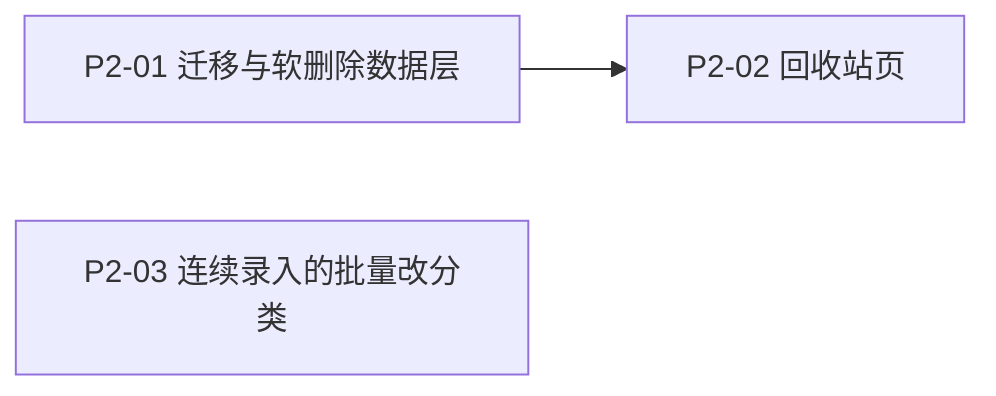

# 收纳助手（Shouna）架构规划 · P2

> 版本：**v1.0** ｜ 上游：[docs/PRD.md](PRD.md) ｜ 前置：[docs/code-map/02-数据与领域.md](code-map/02-数据与领域.md)（P1 已落地） ｜ 路径基准：工程根 `shouna/`
> 本页**只描述 P2 的 3 条交付**的实现。V2 **一律不在本页范围**——不规划、不预设方案、不预留代码路径。
> **何时读**：要动 P2 涉及的代码（软删除迁移、回收站页、连续录入的批量改分类）时。

**一句话结论**：P2 只做三件事 —— 给 `item` 加一个 `deleted_at` 列实现**软删除**（90 天后由 App 打开时清理）、把**「已不在」与「已删除」合到同一页回收站**、把录入页已有的「已连续录入 N 件」那一行**变成批量改分类的入口**。迁移 `version 3 → 4` **仅 +1 列**。

**与 P1 的关系（读前必看）**：P1 已交付位置树深化、归纳统计页、物品编辑页、分类管理、设置页，`version = 3`、5 张表、`ItemRepository` / `LocationRepository` / `CategoryRepository` 均为扩展过的接口。本页在**同一套分层与同一批仓库接口**上继续扩：**不新增表**，只加 **1 列**；新增 **1 页 + 1 路由**（**11 → 12**；原写「9 → 10」，基线已随 2026-10-09 两条 AI 页独立成页而上移，见下方订正块）。

> ⚠️ **2026-10-08 订正（不升版本号）**：本页原写的迁移编号 `version 2 → 3` / `MIGRATION_2_3` **已被照片功能占用** —— `Migrations.MIGRATION_2_3` 实为 `item.photo_path`（随 `2fa3a57` 落地，**当前代码 `version = 3`**）。故本页的软删除迁移**顺延为 `version 3 → 4` / `MIGRATION_3_4`**，`app/schemas/` 新增的是 **`4.json`**。正文各处编号已按此**就地订正**（判据见 `code-map/00-索引.md` §1）。

> ⚠️ **2026-10-09 订正（不升版本号）**：V2 AI 已落地，**导航基线由 10 条升到 11 条** —— 首页两个 AI 入口不再内联，各自独立成页（语音 `VoiceAiIntake`（`V2-FR-10`）/ 拍照 `PhotoAiIntake`（`V2-FR-11`））。故本页 P2 的 `RecycleBin` 由原写「10 → 11」顺延为 **「11 → 12」**（§0 决策表、§7 接缝表已同步）。另：§8.2「V2 全部」一条只表**本页（P2）范围**，V2 现状已与当时不同（AI-01～AI-03 均已实现）。

> ⚠️ **范围重裁记录（2026-09-30）**：P2 原登记为「顺延 16 条」（FR-08/15/16/17/18/24/30/31/32/34/35/36/37/39/45/49）。经用户按「**更简便地使用、不为功能而功能**」原则重新裁决：**10 条删除**（FR-08 / 17 / 24 / 30 / 31 / 32 / 34 / 35 / 39 / 45）、**1 条留作下一期候选**（FR-16 拍照）、**2 条不属本池**（FR-18 由 `V2-FR-01` 承接、FR-36 已并入 FR-29），**只剩 3 条交付**。本页**取代** P1 架构页（已于 2026-10-09 移除）§8.2 的 P2 落差登记；裁决依据与逐条理由见 `PRD.md §4.12` 与 `PRD.md 附录`。

## 0. 关键决策

| 决策点 | 结论 |
|---|---|
| 范围 | **3 条**：FR-49（软删除 / 回收站）、FR-37（已失效清单，**并入回收站页**）、FR-15（同位置批量编辑） |
| 存储 | **仍是 5 张表，不新增表**；`version 3 → 4`，只加 `item.deleted_at` 一列，**不加索引** |
| 迁移 | `ALTER TABLE item ADD COLUMN deleted_at INTEGER`（可空、无默认值）；**不启用** `fallbackToDestructiveMigration`；老数据 `deleted_at` 全为 NULL = 全部未删除 |
| 软删除语义 | **字段标记**：`deleted_at` 非空即「已删除」；**不真删**；一切列表 / 搜索 / 统计 / 计数查询排除已删除；**满 90 天**后物理删除 |
| 清理时机 | **打开 App 时检查、一天只跑一次**（`app_config` 键 `last_purge_at`，**零迁移**）；**不引入 WorkManager**、不申请任何权限、不做后台常驻 |
| 「不在了」vs「删除」 | **两个概念、两条路径**：`status = gone` = 东西没了但记录留着（可补去向、可恢复）；`deleted_at` = 不想要这条记录了。UI 必须分层：前者是详情页 F1 大按钮，后者收在「⋯更多」+ 二次确认 |
| 回收站页形态 | **一页两节**：上节「已不在」（`status = gone`）／下节「已删除」（`deleted_at IS NOT NULL`，显示剩余天数）；两节共用行组件与「恢复」动作；**只占 1 条路由** |
| FR-15 落点 | **零 DB 变更**：入口 = P-ADD 已有的「已连续录入 N 件」行；批量对象 = **本会话在同一位置连续录入**的物品（ViewModel 内存列表，进程被杀即失效）；**只批量改分类**（FR-45 标签已删除，原描述里的「加标签」无对象） |
| 导航 | **11 条 → 12 条**（+`RecycleBin`）；首页「更多」**3 项 → 4 项** |
| 依赖 | **零新增**（不开 WorkManager 的直接收益）；工具链基线不动 |
| 任务 | **3 个**（P2-01 / P2-02 / P2-03） |

## 1. 范围与需求映射

| 编号 | 需求（PRD 原名） | 本页落地形态 | 落点页面 |
|---|---|---|---|
| FR-49 | 回收站 / 软删除 | `item.deleted_at` 字段标记；详情页「⋯更多」→「删除」（二次确认）→ 回收站；90 天后由 App 打开时清理 | P-ITEM-DETAIL / **P-RECYCLE** |
| FR-37 | 已失效物品统计 | **不建统计卡**：降为回收站页的「已不在」节（清单 + 条数徽标 + 逐条「恢复」） | **P-RECYCLE** |
| FR-15 | 同一位置批量编辑 | 从 P-ADD 的「已连续录入 N 件」行进入，批量改**分类**；页内两态，不新增路由 | P-ADD |

> **本次不做**：P2 其余 13 条（10 条已删除、FR-16 顺延下一期、FR-18 由 V2 承接、FR-36 已并入 FR-29）、V2 全部、统计卡片 C-2 / C-3 / C-6（C-2 / C-3 随 FR-34 / FR-35 删除；**C-6 由本页的回收站「已不在」节承接**）。**导出 / 导入（FR-40 / 42 / 43）已永久废弃**，本页不实现、不预留（见 `PRD.md §4.11` 第 6 项）。

**FR-37 为什么并入回收站页而不是做成统计卡**：「已不在」的物品与「已删除」的物品在交互上是同一种东西——**一份清单 + 一个恢复动作**。做成两张入口只会让用户在两处找同一件事；放进同一页则一处看全「我把哪些东西弄消失了」。代价是页面上同时存在两个概念，用**分段标题 + 一句说明**（上节标题写明「已不在（未删除）」）化解，见 §8.1-6。

## 2. 分层与数据流

沿用 P0 / P1 的分层与约定，本页无结构变化，只有接口与页面增补：

| 层 | 本次变化 |
|---|---|
| 数据源 | 仍 `data/local`；**+1 迁移**（`Migrations.kt` 追加 `MIGRATION_3_4`）；`ItemEntity` 加 `deletedAt`；`ItemDao` 补过滤并扩 6 个方法；`ConfigDao` **只加一个键常量**（不加方法——`get` / `put` / `observe` 已够用） |
| Repository | `ItemRepository` **扩展 6 个方法**（不改既有签名）；新增 `data/repository/DeletionCleaner.kt`（层 5，**唯一**持有「每日一次」判定与清理编排的地方） |
| domain | `StoredItem` 补 `deletedAt`（回收站要算剩余天数）；**不新增纯函数**（剩余天数用既有 `util/TimeUtil` 的天数换算） |
| UI | 新增 **1 页 + 1 组件**（`ui/screen/recycle/` 的 `RecycleBin{Screen,ViewModel}`、`ui/component/BatchEditSheet.kt`）；`P-ADD` 与 `P-ITEM-DETAIL` 各补一个入口 |
| 入口 / 调度 | `ShounaApplication` 注入 `DeletionCleaner`，在 `onCreate` 起一次后台协程（**只做一次调度，不写业务逻辑**；判定与清理全在层 5） |

**Repository（`ItemRepository` 扩展 6 个方法）**

- 读：`observeDeletedItems()`（回收站「已删除」节）、`observeGoneItems()`（回收站「已不在」节，FR-37）
- 写：`moveToRecycleBin(itemId)`（软删除，返回更新后的记录）、`restoreFromRecycleBin(itemId)`（清 `deleted_at`）、`setCategoryForItems(itemIds, categoryId)`（FR-15 批量改分类，返回受影响行数）
- 清理：`purgeDeletedBefore(cutoffMillis)`（物理删除，返回删除行数）

**新增 `data/repository/DeletionCleaner.kt`（`@Singleton`）**

- 只做一件事：`suspend fun runDailyIfDue(): Int` —— 读 `app_config` 的 `last_purge_at`，**若已是今天则直接返回 0**；否则调 `ItemRepository.purgeDeletedBefore(now - 90 天)`，成功后回写 `last_purge_at = today`。
- **为什么不在 `ItemDao` 里做「每日一次」判定**：这是**编排**（读配置 → 判日期 → 写数据 → 回写配置），属层 5；DAO 只该有 SQL。
- **为什么放 `ShounaApplication` 而不是 `MainActivity`**：数据清理与应用生命周期同长，与「界面」无关；`Application.onCreate` 起一次协程即可，**不与任何页面耦合**，也就不受导航与返回栈影响。

**清理的三条边界（写进实现的硬约束）**

1. **失败必须静默**：读配置 / 删除 / 回写任一步抛错都只吞掉，**绝不影响启动**——「打不开 App」的代价远大于「垃圾多留一天」。
2. **不是「每天必须跑」**：判定口径是「**今天还没跑就补跑一次**」。用户连续 10 天不开 App，第 11 天打开只跑一次；已超期的物品本来就是一次全删，不依赖中间每天都跑。
3. **`last_purge_at` 只在删除成功后回写**：先删后写，中途失败（进程被杀）时下次启动会重跑——清理是幂等的，重跑无副作用。

## 3. 数据模型（Room）

### 3.1 表清单（仍是 5）

表与 P1 完全一致（`item` / `location` / `category` / `recent_search` / `app_config`），**不新增表**。本轮两项新数据全部命中既有结构：

| 需求 | 落点 | 是否需要迁移 |
|---|---|---|
| 软删除（FR-49） | `item.deleted_at`（**新增**） | **是** |
| 清理节流（FR-49） | `app_config` 加键 `last_purge_at` | 否（key-value 表，P0 已建） |
| 已失效清单（FR-37） | 既有 `item.status = 'gone'` | 否 |
| 批量改分类（FR-15） | 既有 `item.category_id` | 否 |

### 3.2 本次变更（1 列，无索引）

| 对象 | 变更 | 说明 |
|---|---|---|
| `item.deleted_at` | **新增 `INTEGER`（可空、无默认值）** | `NULL` = 未删除；非空 = 该毫秒值即删除时刻。**不加索引**——回收站与清理都只判「非空 / 早于某值」，物品量为千级，全表扫可接受（`NFR-07` 的位置树规模与物品量同量级） |
| `version` | **3 → 4** | `ShounaDatabase(version = 4)` + `addMigrations(MIGRATION_3_4)` |
| `app/schemas/…/4.json` | **由 KSP 生成** | 构建后与 `1.json` / `2.json` / `3.json` 并存 |

**迁移 `MIGRATION_3_4`（一步）**

```sql
ALTER TABLE item ADD COLUMN deleted_at INTEGER
```

> **可空、无 `DEFAULT` 是刻意的**：`NULL` 才是「未删除」的语义载体。若写成 `NOT NULL DEFAULT 0`，就必须在每一条查询里区分「0 = 未删除」与「真实删除时刻为 0」，反而多一层约定（对照 P1 的 `location.path` —— 那一列必须 `NOT NULL DEFAULT ''`，因为它是查询前缀；**两列的取值域不同，不要照抄**）。
>
> **不需要回填**：升级库里旧行自动为 `NULL`，即「全部未删除」，与产品语义一致；**新建库**由 `SeedCallback.onCreate()` 走的是 `version = 4` 的建表语句，`deleted_at` 天然为空。**本次无需任何数据搬迁**，因此不必像 P1 那样写回填语句与 `COALESCE` 兜底。

### 3.3 种子（与 P1 一致，不新增）

| 内容 | 本次 |
|---|---|
| 哨兵 `未指定位置`（1 条，不外露） | 不变 |
| 默认位置树（`家` → 卧室 / 客厅 / 厨房 / 储物间 / 阳台）与 `path` | 不变 |
| 分类 8 条 / 配置 `threshold_months = 6` | 不变 |
| 配置 `last_purge_at` | **不预置**——`NULL` 即「从未清理过」，首次启动会补跑一次；**不参与首启种子**，避免把「今天」写死进常量表 |

### 3.4 不变量（新增 4 条，前 10 条沿用 P0 / P1）

11. **`deleted_at` 与 `status` 正交**：软删除**不写** `status`，恢复**不写** `status`。两列各表达一件事，禁止用 `gone` 兼作「已删除」。
12. **已删除优先于一切读取**：任何读取物品的查询（搜索 / 位置浏览 / 统计清单 / 计数 / 批量确认）都必须排除 `deleted_at IS NOT NULL`。**唯二例外**是回收站页的两个流与 `findById`（回收站要能取到详情、点「恢复」）。
13. **删位置时已删除物品一并迁移**：`ItemDao.moveItems` / `moveItemsAndSetStatus` **不加** `deleted_at` 过滤——回收站里的物品若被留在已删除位置上，`location_id` 就成了指向已删行的孤儿；跟随迁移后，恢复时自然落到迁移目标位置。
14. **软删除不改时间戳**：写 `deleted_at` 不刷新 `last_modified_at`，也不动 `last_confirmed_at`（见 §3.5）。

### 3.5 时间戳矩阵（P1 表 + 本次新增 2 行）

| 操作 | `last_modified_at` | `last_confirmed_at` |
|---|---|---|
| **移入回收站（软删除）** | 不动 | 不动 |
| **从回收站恢复** | 不动 | 不动 |
| **批量改分类（FR-15）** | 不动 | 不动 |

> 理由同 P1 §3.4-10：「删除 / 恢复 / 改分类」都不改变「东西在哪、还在不在」这个身份，因此**不是一次变动**；更不是一次确认。`deleted_at` 自身带时刻，不需要借 `last_modified_at` 表达。

## 4. 任务分解

> 3 个任务。**P2-01 是唯一前置**（P2-02 依赖它）；**P2-03 与两者无关**，零 DB 变更，可任意顺序。

### P2-01 迁移与软删除数据层（无依赖）

- **新建 2**：`data/repository/DeletionCleaner.kt`、`app/src/test/.../DeletionCleanerTest.kt`（JVM 单测，假 DAO 在既有 `data/local/FakeDaos.kt`）
- **触及 8 个既有文件**：`data/local/Migrations.kt`（追加 `MIGRATION_3_4`）、`data/local/ShounaDatabase.kt`（`version = 4`）、`di/DatabaseModule.kt`（`addMigrations` 链上追加）、`data/local/entity/ItemEntity.kt`（加 `deletedAt`）、`data/local/dao/ItemDao.kt`、`data/local/dao/ConfigDao.kt`（加键常量 `KEY_LAST_PURGE_AT`）、`data/repository/ItemRepository.kt` + `ItemRepositoryImpl`（6 个方法）、`ShounaApplication.kt`（注入 + 起协程）
- **子步骤** ① `MIGRATION_3_4`（§3.2 一步）+ `version = 4`；② `ItemEntity.deletedAt` 与 `domain/model/StoredItem` 的 `deletedAt` 及转换函数；③ **`ItemDao` 9 处补 `deleted_at IS NULL`**（8 个读：`observeAll` / `observeByLocation` / `observeActiveCounts` / `countIn` / `count` / `observeOverdue` / `observeToBePutBack` / `observeActiveCount`；1 个写：`confirmActiveInSubtree`）；④ **`ItemDao` 新增 6 个方法**：`observeDeleted` / `observeGone` / `markDeleted` / `clearDeleted` / `purgeDeletedBefore` / `updateCategoryForItems`；⑤ `DeletionCleaner.runDailyIfDue()`（含 §2 的三条边界）；⑥ `ShounaApplication` 起协程；⑦ 单测：日期闸门（同一天第二次返回 0）、无过期不删、跨天补跑、失败静默；⑧ androidTest：`MigrationsTest` 加 **v3 → v4** 用例（升级后 `deleted_at` 全空、`4.json` 可读）
- **验收** 存量库（`version 3`）升级后 `deleted_at` 全为 NULL 且数据不丢；新建库等价；`app/schemas/…/4.json` 生成；软删除后该物品从搜索 / 位置浏览 / C-1 计数 / C-4 / C-5 中**全部消失**；`findById` 仍可取到；`:app:assembleDebug` + 单测 + androidTest 通过
- **PRD 承接** FR-49、`PRD.md §7.3`「状态标记不删行」的延伸；NFR-07

### P2-02 回收站页（依赖 P2-01）

- **新建 2**：`ui/screen/recycle/RecycleBinScreen.kt` + `RecycleBinViewModel.kt`
- **触及 5 个既有文件**：`ui/navigation/ShounaRoute.kt`（+`RecycleBin`）、`ui/navigation/RouteHandler.kt`（+1 目的地、+1 个 `goRecycleBin`）、`ui/screen/home/HomeScreen.kt`（「更多」3 项 → 4 项）、`ui/screen/itemdetail/ItemDetailScreen.kt` + `ItemDetailViewModel.kt`（「⋯更多」补一条「删除」，二次确认后软删除并退出页面）
- **子步骤** ① 上节「已不在」：`observeGoneItems()` 清单 + 条数徽标 + 逐条「恢复」（调既有 `ItemRepository.restore`）；② 下节「已删除」：`observeDeletedItems()` 清单 + **剩余天数**（`(deleted_at + 90 天) - now`，向上取整，最小显示 1 天）+ 逐条「恢复」（`restoreFromRecycleBin`）；③ 两节共用既有行组件；节标题与说明文案见 §8.1-6；④ 详情页「⋯更多」的「删除」走**二次确认**（守 `实现约束.md` §4-2），确认文案须说明「可在回收站保留 90 天」；⑤ 空态：两节各自为空时不显示该节，两节全空显示一页空态
- **验收** 软删除后物品出现在「已删除」节且剩余天数正确（刚删除显示 90 天）；「不在了」的物品出现在「已不在」节；两节的「恢复」分别把物品还原为「未删除」与「`in_storage`」；恢复后回到搜索与位置浏览；删除位置时其下回收站物品跟随迁移、不产生孤儿；首页「更多」第 4 项可达
- **PRD 承接** FR-49 / FR-37、`PRD.md §8.2.2` 的 **C-6**（原「已失效物品」卡片改由本节承接）

### P2-03 连续录入的批量改分类（无依赖）

- **新建 1**：`ui/component/BatchEditSheet.kt`（多选清单 + 分类 chips，复用 `CategoryChips`）
- **触及 4 个既有文件**：`ui/screen/add/QuickAddScreen.kt`（「已连续录入 N 件」行变可点入口）、`QuickAddViewModel.kt`（会话批次列表 + 批量写入 + 页内两态开关）、`QuickAddRoute`（下发新回调）、`data/repository` 侧复用 P2-01 已加的 `setCategoryForItems`
- **子步骤** ① `QuickAddViewModel` 维护 `sessionItems: List<SessionItem(itemId, locationId)>`（**内存**，进程被杀即失效——连续录入本就是一次坐下来录一批，不为它建表）；② 入口条件：**本会话在「当前所选位置」录入的条目数 ≥ 2**（「批量」要有对象；切位置后入口按新位置重算）；③ `BatchEditSheet` 列出该批次的名称与当前位置，多选 → 点分类 chip → 调 `setCategoryForItems(ids, categoryId)`；④ 写后不刷 `last_modified_at`（§3.5）；⑤ 关闭弹层后清空选择、**不清空批次**（用户可能想改两次）
- **验收** 连续录入 3 件后，入口出现且点开恰好列出这 3 件；切到另一位置录入 2 件，入口只列后 2 件；批量改分类后到搜索页能按新分类筛出这些物品；`last_modified_at` 不变；**连续录入 5 件 ≤ 40 秒不受影响**（入口只是一行文字变可点，不加步骤）
- **PRD 承接** FR-15、`PRD.md §5.1` 的 M7（连续录入期间**不弹**位置 / 分类对话框——本入口是**保存之后**的页内两态，不在连续录入过程中打断）



## 5. 文件规模

**新建 6**；**修改约 20**（代码侧，不含 `docs/`）；**删除 0**。

| 新建 | 数量 | 清单 |
|---|---|---|
| 页面 | 2 | `ui/screen/recycle/RecycleBinScreen.kt` + `RecycleBinViewModel.kt` |
| 组件 | 1 | `ui/component/BatchEditSheet.kt` |
| 仓库 | 1 | `data/repository/DeletionCleaner.kt` |
| 测试 | 1 | `app/src/test/.../DeletionCleanerTest.kt`（JVM 单测） |
| schema | 1 | `app/schemas/com.dream.shouna.data.local.ShounaDatabase/4.json`（KSP 生成） |

**修改约 20** = 数据层 6（`Migrations` / `ShounaDatabase` / `DatabaseModule` / `ItemEntity` / `ItemDao` / `ConfigDao`）+ 仓库 2（`ItemRepository` + `Impl`）+ 领域 1（`StoredItem`）+ UI 8（`ShounaRoute` / `RouteHandler` / `HomeScreen` / `ItemDetailScreen` / `ItemDetailViewModel` / `QuickAddScreen` / `QuickAddViewModel` / `QuickAddRoute`）+ 入口 1（`ShounaApplication`）+ 既有测试 2（`FakeDaos`、`MigrationsTest`）。

> **工程量分布与 P1 相同取向**：主要成本在**数据层的过滤面**（`ItemDao` 9 处查询逐条补条件）与**一个页面的两节**，而不是新建表。**没有任何新表、没有任何新依赖、没有任何新权限。**

## 6. 依赖版本（无新增）

**本次不新增任何依赖**，也不动工具链基线（AGP 8.13.2 / Kotlin 2.2.21 / compileSdk 与 targetSdk 36 / minSdk 24 / Compose BOM 2025.12.01 / Room 2.8.4 / pinyin4j 2.5.1）。

- **不引入 `androidx.work`**：清理按「打开 App 时补跑一次」实现（§2），`Application` + 协程即可，**不必为一个每日任务引入整套 WorkManager**。
- 仍**不新增任何 `uses-permission`**，`INTERNET` 与 `POST_NOTIFICATIONS` 一概不申请（「到期提醒」类需求已随 FR-32 删除）。
- `settings.gradle.kts` **不新增仓库源**；KSP 参数不变，仅因 `version` 变更而**多生成一份 `4.json`**。

## 7. 与 P0 / P1 的接缝（触及的既有文件，去重清单）

| P0 / P1 文件 | 本次改动 |
|---|---|
| `data/local/Migrations.kt` | 追加 `MIGRATION_3_4`（1 条 `ALTER TABLE`） |
| `data/local/ShounaDatabase.kt` | `version = 4` |
| `di/DatabaseModule.kt` | `addMigrations(…, MIGRATION_3_4)` |
| `data/local/entity/ItemEntity.kt` | 加 `deletedAt: Long?`（可空，无默认值、无索引） |
| `data/local/dao/ItemDao.kt` | **9 处查询补 `deleted_at IS NULL`**；**新增 6 个方法**（18 → 24） |
| `data/local/dao/ConfigDao.kt` | 只加键常量 `KEY_LAST_PURGE_AT`（**不加方法**） |
| `data/repository/ItemRepository.kt` / `Impl` | 加 `observeDeletedItems` / `observeGoneItems` / `moveToRecycleBin` / `restoreFromRecycleBin` / `setCategoryForItems` / `purgeDeletedBefore`；`StoredItem` 转换补 `deletedAt` |
| `domain/model/StoredItem.kt` | 补 `deletedAt: Long?`（回收站算剩余天数） |
| `ShounaApplication.kt` | 注入 `DeletionCleaner`，`onCreate` 起一次后台协程（§2 三条边界） |
| `ui/navigation/ShounaRoute.kt` / `RouteHandler.kt` | +1 路由键 `RecycleBin`、+1 个 `goRecycleBin`（合计 **12 条路由 / 12 个动作**；**基线 = 11 条 / 11 个** —— 2026-10-09 首页「🎤 语音AI记」与「📷 拍照AI记」各自独立成页（`VoiceAiIntake` / `PhotoAiIntake`）后，本页原写「9 → 10」已随之订正） |
| `ui/screen/home/HomeScreen.kt` | 「更多」折叠区由 3 项 → **4 项**（+ 回收站） |
| `ui/screen/itemdetail/ItemDetailScreen.kt` / `ItemDetailViewModel.kt` | 「⋯更多」补一条「删除」+ 二次确认（守 `实现约束.md` §4-2） |
| `ui/screen/add/QuickAddScreen.kt` | 「已连续录入 N 件」行改为可点入口（新增回调） |
| `ui/screen/add/QuickAddViewModel.kt` | 会话批次列表（内存）+ `setCategoryForItems` + 页内两态开关；`sessionCount` 语义**不变** |
| `app/src/test/.../FakeDaos.kt` | 假 DAO 补 6 个新方法（**只加不删**） |
| `app/src/androidTest/.../MigrationsTest.kt` | 加 v3 → v4 用例（**只加不删**） |

> **反向不动**：`ui/theme/*`（永久浅色 + 字号锁定）、`MainActivity.kt`（`enableEdgeToEdge` 与容器级避让）、`di/{AppModule, RepositoryModule}.kt`（无新绑定）、`domain/search/*`（**检索侧一行不改**——已删除物品在 `observeAll` 就被过滤掉，索引里根本不会出现它们）、`util/*`、`data/memory/BuiltInData.kt`（除**新增一个保留期常量** `RECYCLE_RETENTION_DAYS = 90`）、`SeedCallback.kt`（不预置 `last_purge_at`）、`ui/screen/stats/*`（C-1 / C-4 / C-5 三块口径不变）、`ui/screen/{search,location,category,settings,itemedit}/*`。

> **为什么检索侧一行不改**：`SearchIndex` 的输入来自 `ItemRepository.observeSearchDocs()`，而它读的是 `ItemDao.observeAll()`（现已带过滤）。**过滤发生在唯一的数据出口**，因此搜索、位置浏览、统计、计数四条路径**同时**生效，不需要在四处各补一次——这也正是不变量 12 存在的意义。

## 8. 本次裁决与落差登记

### 8.1 本次裁决（本页定的口径）

| # | 事项 | 结论与理由 | 止损（要改回时动哪里） |
|---|---|---|---|
| 1 | 迁移策略 | `version = 3 → 4`；**只加 `item.deleted_at` 一列**；**不启用** `fallbackToDestructiveMigration`（那一句会让所有升级用户数据全丢，与 FR-41 正面冲突） | 新增 `MIGRATION_4_5` 链式追加 |
| 2 | `deletedAt` 类型 | **可空 `INTEGER`、无默认值**，`NULL` = 未删除。**刻意不写 `NOT NULL DEFAULT 0`**——取值域与 P1 的 `location.path` 不同，不要照抄 | 换成哨兵值 = 一次迁移重写该列 + 改全部 9 处过滤条件 |
| 3 | 不加索引 | 回收站与清理都只判「非空 / 早于某值」，千级数据全表扫可接受；加了也只是白占空间 | 加索引 = 一次迁移 |
| 4 | 清理触发点 | **`ShounaApplication.onCreate` 起协程 + `DeletionCleaner` 编排**；**不用 WorkManager** | 换 WorkManager = 加 1 个依赖 + 换触发点，判定逻辑可原样复用 |
| 5 | 「每天一次」的口径 | 语义是「**今天没跑就补跑一次**」，**不是「每天必须跑」**；`last_purge_at` 只在删除成功后回写（幂等，可重跑） | 改判定 = `DeletionCleaner` 一个方法 |
| 6 | 回收站页两节 | 上节「已不在」= `status = gone`（**未删除**）；下节「已删除」= `deleted_at IS NOT NULL`。**上节标题必须写明「已不在（未删除）」**——否则用户会以为它也占 90 天倒计时 | 改文案 = 一处字面量；拆两页 = +1 路由 |
| 7 | FR-37 形态 | **不建统计卡**，降为回收站页的上节（清单 + 条数 + 逐条恢复），顺带结清 `PRD.md §11` **U-6**（`gone` 跨会话无找回入口） | 恢复成卡片 = 改 `PRD.md §8` + `StatsViewModel` |
| 8 | FR-15 批次概念 | **不建持久「批次」**：`ViewModel` 内存列表，进程被杀即失效；切位置后入口按新位置重算 | 要跨会话 = 加列 / 加表 + 一次迁移 |
| 9 | FR-15 只改分类 | 原描述里的「加标签」随 **FR-45 删除**一并失去对象；位置不可批量改（同位置的一批，改位置无意义） | 扩到备注 = 复用同一条 `UPDATE` 加一列 |
| 10 | FR-15 入口 | 复用 P-ADD 已有的「已连续录入 N 件」行（**一行文字变可点**），页内两态，**零新增路由、零新增步骤** | 换落点 = 改 `QuickAddScreen` 一处 |
| 11 | 「不在了」vs「删除」的分层 | 前者留 F1 大按钮（记录留着、可补去向、可恢复）；后者收进「⋯更多」+ 二次确认。**两个概念必须在 UI 上分开**，否则用户会以为点「不在了」＝删掉 | 改 `ItemDetailScreen` 两处位置 |
| 12 | 回收站物品与删位置 | `moveItems` / `moveItemsAndSetStatus` **不加** `deleted_at` 过滤：回收站物品跟随迁移，**避免 `location_id` 变成指向已删行的孤儿** | 改两条 SQL 的 WHERE |

### 8.2 落差（本页不做，下一期 / V2 起）

- **FR-16 拍照**：**留在 P2 顺延位**（用户 2026-09-30 裁示「留，但仍顺延」）。本页不实现、不占 UI、不新增存储与权限。
- **V2 全部**：仅 `P-SETTINGS` 为 `V2-SEAM-05` 的 AI 设置节**留出文档级位置**，**不建任何 UI 元素**（连灰置入口都不给，守 `PRD.md §6.1` 的 v1.4 补注）。
- **统计卡片 C-2 / C-3**：随 **FR-34 / FR-35 删除**一并移出规划（不再是「顺延」）；`PRD.md §8.2.2` 的对应行按删除处理。**分类图标 / 颜色**（`PRD.md §7.4` 的可选字段）原交接给 FR-34，**FR-34 删除后不再属任何一期**。
- **`PRD.md §11` U-7（「显示完整功能」开关）**：P1 已裁定不做（P1 §8.1-13），本轮在 `PRD.md §11` 就地同步为已注销。

## 9. 整体验收

| 项 | 口径 |
|---|---|
| 构建 | `:app:assembleDebug` + `:app:testDebugUnitTest` 成功；androidTest 通过；`app/schemas/…/4.json` 生成 |
| 迁移 | 存量库（`version 3`）升级后**不丢数据**、`deleted_at` 全为 NULL；新建库形态等价。由 `androidTest/MigrationsTest` 的 v3→v4 用例覆盖 |
| FR-49 | 详情页「⋯更多」→「删除」有二次确认；删除后物品从搜索 / 位置浏览 / C-1 / C-4 / C-5 **全部消失**；回收站「已删除」节可见，剩余天数正确；「恢复」后重新出现在原位置；**90 天前的记录在打开 App 时被物理删除**，且「同一天不重复执行」 |
| FR-37 | 「已不在」的物品出现在回收站上节、带条数徽标；逐条「恢复」后状态回到 `in_storage` 并重新出现在常规搜索中 |
| FR-15 | 连续录入 N 件后入口出现，点开恰好列出**本会话在当前位置**的条目；批量改分类生效（搜索页按新分类可筛出）；`last_modified_at` 不变 |
| 不变量 | 软删除 / 恢复 / 批量改分类**均不刷新** `last_modified_at`；`status` 不被删除动作改写；删位置时回收站物品跟随迁移、无孤儿 |
| 不回归 | F1 / P0 / P1 既有单测全部保持通过；**连续录入 5 件 ≤ 40 秒**；1000 件搜索 ≤ 300ms；永久浅色、字号锁定、系统栏与 IME 避让三项不变；**零 `uses-permission`**、**零新增依赖** |

---

*本文档为 P2 的 3 条需求（FR-15 / 37 / 49）的架构规划与任务分解，不含代码文件。V2 不在本页范围，不构成对后续版本的承诺。*
