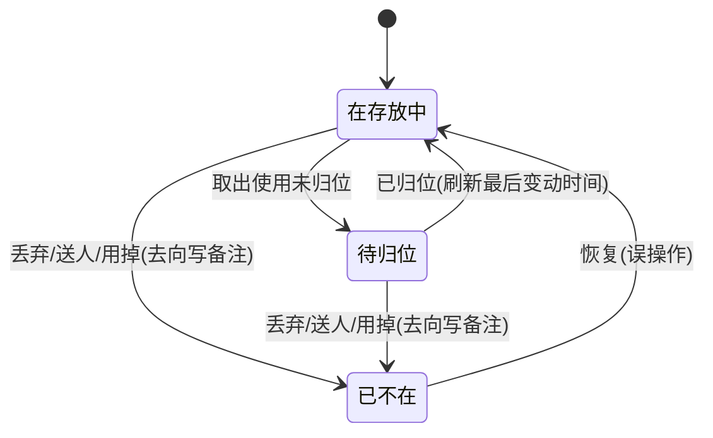
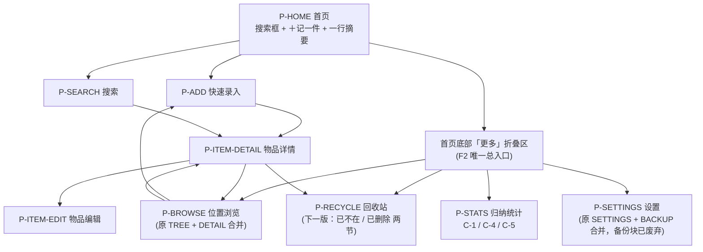

# 收纳助手（Shouna）产品需求文档 PRD · V1（已实现 · 冻结）

> 版本：**v1.5**（永久移除暗色模式与字号跟随） ｜ 语言：中文 ｜ 责任人：许清楚（产品经理） ｜ 交付总监：齐活林
> 类型：简单 PRD（单期交付，无竞品分析）。本文档只做**需求与业务语义定义**，不含代码、不定义表结构。
> **一句话结论**：做一个**纯离线的 Android 家庭物品收纳台账**——用最低的录入成本记住「这件东西有没有、放在哪个盒子哪一格」，需要时一次搜到。**默认只暴露「记一件 / 找一件」两件事，其余能力收在深层**，不把学习成本压给只想简单记录的用户。 本期（V1）只做离线台账、**不含任何 AI 能力**；AI 接入属 V2（规划与预留），见本文件 §14。

### 版本变更记录

| 版本 | 日期 | 变更摘要 | 依据来源 |
|---|---|---|---|
| v1.0 | 2026-09-23 | 首次交付：产品目标、场景、用户故事、需求池（49 条）、四大难点、页面结构与交互、数据字段业务语义、归纳汇总、非功能需求、待确认问题 | 用户需求 + 团队任务 #1 |
| **v1.1** | 2026-09-23 | ① 新增「系统自动备份与『仅存本机』的冲突」专节并修订 NFR-09/NFR-17 文案口径；② 把「待补详情/信息完整度」定义死为唯一判定规则；③ 明确检索键持久化边界（仅名称+别名派生键持久化）；④ 明确「同级不重名」为应用层软校验；⑤ 定义多处存放的数量语义；⑥ Q5 对齐为「本期仅 JSON」；⑦ 新增「待用户确认清单」 | 依据 架构 09 待明确事项 中的架构约束 **A-1～A-5** |
| **v1.2** | 2026-09-23 | 按章节拆分为 13 个文件，原文件降为总览页；内容无实质变更 | 用户反馈「文档太长，给谁看」+ 团队任务 |
| **v1.3** | 2026-09-24 | 分层优化：引入 F1/F2/F3 暴露层；本期 38→30 条；页面 11→8；统计卡片 7→3；状态 5 态→3 态；位置改为默认预置 + 可后补；删除 FR-07/FR-46 | 用户反馈「功能过多、学习成本高」+ 团队评审稿 |
| **v1.4** | 2026-09-24 | 新增 **V1/V2 分期定义**与 **V2（AI 接入）规划**：新增一节 **§14**（V2 能力拆解 / 成本约束 / 与 V1「零网络」承诺的冲突登记 / V2 预留六处「缝」/ V2 编号方案）；**U-1 落定：不做系统自动备份**，维持「仅存本机」；附录中「语音录入」由「下一期候选」改列为 **V2 规划项**。**V1 的 30 条需求一字未动** | 用户诉求「第一版跑通流程，第二版接入 AI，为第二版预留接口」+ 用户四次拍板 |
| **v1.5** | 2026-09-28 | **永久移除暗色模式**：删除 **FR-48**（连带删除 **NFR-16** 深色跟随、**NFR-13** 字号跟随）；P0 **16 → 15** 条，本期交付 **30 → 29** 条（**当版口径**；其后 2026-09-29 的 FR-13/40/42/43 废弃与 2026-09-30 的 P2 重裁，已把本期交付收至 **26 条**，见 §4.7）。**本版首次解除 §4.9「v1.4 不动 FR 行」的纪律**，FR-48 行按 §4.6 既有惯例改为「删除」；同步项见新增的 §4.10 | 用户诉求「永久移除暗色模式功能」+ 架构侧 v2.2 |

> **2026-09-30 追加（不升版本号，版本仍为 v1.5）**：按「**简易度**」原则重裁 **P2 范围** —— 16 条 → **删除 10 条**（FR-08 / 17 / 24 / 30 / 31 / 32 / 34 / 35 / 39 / 45）、**保留 3 条**（FR-15 / 37 / 49）、**顺延 1 条**（FR-16）、**2 条不属该池**（FR-18 / FR-36）。本期交付 **26 条不变**。判据见本文件 §1.3，逐条登记见本文件 **§4.12**，实现落点见 [ARCHITECTURE-P2.md](ARCHITECTURE-P2.md)。

> **2026-10-08 追加（不升版本号，版本仍为 v1.5）**：**V2（AI 接入版）口径同步** —— 本文件 §11 的 **U-9 / U-10 结案**（U-9 = **路线乙：允许云端 AI**；U-10 = **用户自备 Key**），据此**改写 NFR-01 / NFR-02 / NFR-17** 三条文案与验收口径（本文件 §9 / §9.3，保留决策留痕）；工程侧新增「**AI 联网的唯一出口**」（[实现约束.md](实现约束.md) §7-5）。**V2 的逐条需求另出增量文档**：[V2-AI-PRD.md](V2-AI-PRD.md)（`V2-FR-09`～`16`）。**V1 的 `FR-01`～`FR-49` 编号与行序、本期交付条数、页面清单（9 行）一字未动。**


> **2026-10-09 追加（不升版本号，版本仍为 v1.5）**：**文档结构规整** —— V1 需求整合为**本文件**（需求真源，**已实现 · 冻结**）；V2（AI 接入版）需求真源仍为 [V2-AI-PRD.md](V2-AI-PRD.md)。已实现的架构规划页 `docs/ARCHITECTURE{,-P0,-P1,-AI}.md` 同步移除（其实现口径由 [code-map/00-索引.md](code-map/00-索引.md) 承接）；**尚未实现**的 [ARCHITECTURE-P2.md](ARCHITECTURE-P2.md) 保留。**`FR-01`～`FR-49` 编号、行序与本期交付条数一字未动。**
### 章节索引（V1 需求）

| 节 | 内容 |
|---|---|
| §0 | 项目信息（平台 / 技术栈 / 数据边界 / 用户原话） |
| §1 | 产品目标（一句话定位 / 成功标准 / 硬指标） |
| §2 | 目标用户与核心场景 |
| §3 | 用户故事与验收要点（US-01～US-10） |
| §4 | 需求池（FR-01～FR-49、暴露层、优先级；同步项 §4.8～§4.12） |
| §5 | 必须正面处理的难点（M-x、物品状态机） |
| §6 | 页面结构与关键交互（P-xxx、跳转） |
| §7 | 数据字段业务语义（A-x） |
| §8 | 归纳汇总（统计卡片 C-x） |
| §9 | 非功能需求（NFR-xx） |
| §10 | 待确认问题清单（Q1～Q12） |
| §11 | 待用户确认清单（U-x） |
| 附录 | 本期明确「不做」清单 |
| §14 | 分期定义（V1 定稿 / V2 规划与预留） |

> **节号不重排**：本文件节号**沿袭既有编号**（含 `§12` / `§13` 为空的既有空档），`FR-01`～`FR-49` 编号与行序、
> 本期交付条数、页面清单均**未变**，以便既有交叉引用（`§N` / `§N.M`）继续成立。
> **V1 只读**：V1 已实现并冻结，本节号体系仅作需求留痕与追溯；改动需求须先立项。
> **V2 真源**：[V2-AI-PRD.md](V2-AI-PRD.md)（`V2-FR-09`～`16`）。
> **路径基准**：本页路径以**工作区根**为基准写作 `shouna/docs/…`；同目录文件用相对名（`V2-AI-PRD.md` / `实现约束.md` / `code-map/…`）。
>
> *阅读路径建议：§1（要做什么）→ §4（做哪些）→ §5 / §7（难点与数据口径）→ §11（需拍板的事）；工程同学按 §4 → §6 → §7 → §8 → §9 顺序读；关心 V2 的读者加读 §14。*

## 0. 项目信息

| 项目 | 内容 |
|---|---|
| Project Name | `shouna` |
| 目标平台 | Android 原生 App（唯一平台，不考虑 iOS / Web） |
| 技术栈（已锁定，不由本 PRD 变更） | Kotlin 2.2.21 + Jetpack Compose（BOM 2025.12.01）+ Material3；AGP 8.13.2 |
| SDK | compileSdk / targetSdk = 36，minSdk = 24（Android 7.0 起） |
| 包名 | `com.dream.shouna` |
| 数据边界 | **仅本机离线**（**V1 期间**；AI 能力属 V2，见 §14）。无账号体系、无后端、无云同步、无多人协作、无网络请求 |
| 工程现状 | 已有 Gradle 骨架与一个 Hello 页面；**无任何存储 / DI 依赖** |
| 本期交付范围 | 需求分析与架构设计；**不写代码、不创建 Gradle / 源码文件** |
| **交互分层** | **F1 直接暴露 / F2 深层（首页「更多」唯一入口）/ F3 后台自动**，详见 §4、§6 |

### 原始需求复述

> 有些东西长时间不用，收纳起来之后就忘记放在哪了。需要一个软件来记录——**到底有没有这件东西，有的话放在哪**。

需求拆成三个可验证的动作：

1. **记录**：把「我有一件 X，它在 Y 位置」这件事，用尽量低的成本记下来。
2. **查找**：若干月后，能快速回答「X 还在吗？在哪？」。
3. **归纳**：能整体看到「我家都有什么、放得怎么样、有哪些记录可能已经不可信」。

## 1. 产品目标

### 1.1 一句话定位

> **一个纯离线的「家庭物品收纳台账」**：用最低的录入成本，把「这件东西有没有、放在哪个盒子哪一格」记住，并在需要时一次搜到。

### 1.2 三条可衡量的成功标准

| 编号 | 成功标准 | 衡量口径 | 目标值 |
|---|---|---|---|
| G-1 | **录得进** | 连续录入 5 件物品（**位置已预填**）所耗时间 | ≤ 40 秒（中端机，熟练用户） |
| G-1 | **录得进**（**F1 指标**） | 从打开 App 到进入可录入状态所需点击数 | **≤ 2 次点击** |
| G-2 | **搜得到** | 录入 200 件物品后，对任意已录物品用「常用叫法」搜索，首次搜索命中率 | ≥ 95%，且搜索响应 ≤ 300ms |
| G-3 | **记得住、敢信** | 录入后仍在持续使用的用户，能区分「近期确认过」与「半年没动过」的记录 | 100% 物品记录在 **F1** 可见「最后确认时间」，**「最后变动时间」在 F2 可见**；统计页可一键列出超期未确认物品 |

> ⚠️ **风险记录（v1.3）**：『常用叫法』的主要载体是**别名**，而别名在 v1.3 已无 F1 录入入口（只在 F2 的 P-ITEM-EDIT 可补）。**G-2 的 ≥95% 目标值不变**，但其达成将更依赖用户主动补录别名；后续如命中率不达标，应优先考虑把『别名』放回 F1，而不是下调目标值。

**补充说明（非目标）**：本期不追求「全屋物品 100% 数字化」，不做社交、不做家庭共享、不追求跨设备。

### 1.3 简易度原则（2026-09-30 立 · 反向指标）

> 本节是**取舍规则**，不是功能。任何新需求先过这三条判据，**任一命中即不做**。

| 判据 | 含义 | 判定句式 |
|---|---|---|
| **A 多一步吗** | 要求用户在「记录 → 查找」主流程之外**多填一项 / 多做一次判断** | 「它会不会让我记一件东西更慢？」 |
| **B 新概念吗** | 引入主流程**不需要**的新名词 / 新筛选维度 / 新卡片 | 「不解释一句，用户看得懂吗？」 |
| **C 该我记吗** | 属于**别的 App 本来就该管的事** | 「**我可能会用这个 app 去记录吗？**」 |

**反向指标 G-4（与 G-1 / G-2 / G-3 并列，是「不许变差」的那一条）**

| 编号 | 指标 | 衡量口径 | 目标值 |
|---|---|---|---|
| **G-4** | **不许变复杂**（录入） | 完成一件记录所需的**强制输入项数** | **恒为 2（名称 + 位置）；任何版本不得增加** |
| **G-4** | **不许变复杂**（入口） | 从打开 App 到进入可录入状态所需点击数 | **恒为 ≤ 2 次；任何版本不得增加** |
| **G-4** | **不许变复杂**（概念） | F1（首页首屏）出现的**新名词数量** | **恒为 0** —— 新概念一律下沉 F2，或不做 |

> **判据 C 的来源**：用户 2026-09-30 原话「**例如借出归还，我可能会用这个 app 去记录吗？**」。该判据直接淘汰了 **FR-31 借出 / 归还**与 **FR-32 保质期 / 到期提醒**。
> **首次应用**：2026-09-30 对 P2 的 16 条逐条过判据 → **删除 10 条**（FR-08 / 17 / 24 / 30 / 31 / 32 / 34 / 35 / 39 / 45）、保留 3 条、顺延 1 条、另有 2 条不属该池。详见 **§4.12**。

## 2. 目标用户与核心场景

### 2.1 目标用户画像

| 画像 | 特征 | 核心诉求 |
|---|---|---|
| **换季收纳型（主力）** | 城市租房/自住家庭，有储物间、床底、顶柜等「黑洞空间」；每年 2 次换季大收纳 | 半年后还能找到电风扇、行李箱、羽绒服 |
| **重复购买型** | 记性一般，家里东西多且杂 | 买东西前先查「家里是不是已经有了」 |
| **搬家/整理型** | 搬家、装修、大扫除时集中整理 | 一次性批量录入，之后按箱查找 |
| **帮家人找物型** | 自己会记录，但家人更常问「胶带放哪了」 | 位置描述要直白、可读、可分享 |
| **简单记录者** | 只要「记下来 + 找得到」，不需要归纳、不要任何设置 | 用最少步骤把东西记进去，不问过程 |

### 2.2 核心场景（Scenario）

| 编号 | 场景 | 现状痛点 | 期望结果 |
|---|---|---|---|
| S-1 | 换季把电风扇收进储物间的纸箱，半年后想找 | 只记得「好像放储物间了」，翻 3 个箱子才发现 | 搜「电风扇」→ 直接显示「储物间 › 货架A › 纸箱-07」，并可看「3 个月前确认过」 |
| S-2 | 想买一卷新胶带，不确定家里有没有 | 忘记是否已买，可能重复买 | 搜「胶带」→ 命中已有记录，放弃购买 |
| S-3 | 大扫除一次收纳 30 件杂物 | 逐件填完整表单 → 太累，中途放弃 | **位置条已预填**（默认位置树的最近使用节点，也可另选「纸箱-07」）后连续录 30 条，每条只打名称 + 点「保存并继续录入」；**位置条沿用上次所选，无需每次决定放哪，一路点按钮即可连续记**（**位置必填**：未选位置则保存被拦下并提示原因；键盘回车/完成键只收键盘、不保存） |
| S-4 | 搬家后想知道「哪几箱最重/东西最多」 | 完全没概念，只能拆箱看 | 统计页按位置显示件数 Top，优先搬/优先拆。**⚠️ 本条所依赖的「位置件数 Top」卡片（C-3）与对应需求 FR-35 已于 2026-09-30 改判删除**（见 §4.12）；本条的实际动作（逐箱搬）改由 **FR-21 位置浏览逐层进**承担 |
| S-5 | 半年前记录「充电宝在床头柜」，现在怀疑早扔了 | 记录不可信，却无法表达 | 一键标记「已不在」，或点「确认还在」刷新可信度 |

## 3. 用户故事与验收要点

| 编号 | 用户故事 | 验收要点（Given / When / Then） |
|---|---|---|
| US-01 | As a 收纳者，I want 只填一个名称就能保存物品，so that 我不用被打断 | **Given** 我在「快速录入」页（**位置条已预填**；首次安装无使用史时为空，须先选或新建位置才能保存）<br>**When** 我输入「电风扇」后点「保存并继续录入」<br>**Then** 立即生成一条物品记录并归入该位置，不强制填写分类 / 备注（**标签已随 FR-45 于 2026-09-30 删除**），界面清空并保持焦点在同一输入框可继续录入下一件 |
| US-02 | As a 收纳者，I want 连续录入多件物品而不用每次重选位置，so that 一次收纳不被打断 | **Given** 我已选好位置「纸箱-07」<br>**When** 我连续输入 5 个名称并逐条点「保存并继续录入」<br>**Then** 5 条都归入「纸箱-07」，且过程中不出现任何位置选择弹窗；**位置条沿用上次所选、无需重复选择；位置为空时按钮被禁用并提示原因，不静默失败** |
| US-03 | As a 找东西的人，I want 搜索时用「我平时怎么叫它」就能命中，so that 不用记我当初怎么填的 | **Given** 我录入了「电风扇」<br>**When** 我搜「dfs」/「dianfengshan」/「风扇」<br>**Then** 都能命中该物品（拼音首字母、拼音全拼、名称子串均生效） |
| US-04 | As a 找东西的人，I want 一眼看到完整位置路径，so that 我能直接走过去拿 | **Given** 结果列表命中一条物品<br>**When** 我查看该条目<br>**Then** 显示完整面包屑「储物间 › 货架A › 纸箱-07」，并显示「最后确认时间」，长按可复制路径文本 |
| US-05 | As a 记录者，I want 判断一条记录还准不准，so that 我不被过期信息误导 | **Given** 某物品最后确认时间为 8 个月前<br>**When** 我打开物品详情<br>**Then** 明显提示「已有 8 个月未确认」，并提供「确认还在」按钮 |
| US-06 | As a 记录者，I want 表达「东西没了」而不是只能删记录，so that 保留历史并避免以后误搜到 | **Given** 一件物品实际已经不在了<br>**When** 我在物品详情页点「不在了」<br>**Then** 该物品状态置 `已不在`，默认不出现在常规搜索结果中。**F1 不追问去向，去向用备注兜底**。恢复有两条路径：① **当场就地撤回**（同页按钮转为「恢复」，V1 已可用）；② **跨会话集中找回** —— 落在下一版的 **P-RECYCLE 回收站页「已不在」节**（FR-37；**V1 期间该页尚未落地**，故 V1 只有路径 ①，见 §11 的 U-6） |
| US-07 | As a 整理者，I want 把物品从 A 位置移到 B 位置，so that 记录跟上现实 | **Given** 我在物品详情页<br>**When** 我选择「移动位置」并选新位置<br>**Then** 归属更新，`最后变动时间` 刷新为当前时间，旧位置不再显示该物品 |
| US-08 | As a 整理者，I want 一次性看到家里东西都怎么分布的，so that 我知道哪里该清理 | **Given** 我已录入 ≥10 件物品<br>**When** 我打开「归纳统计」<br>**Then** 展示本期 **3 张卡片（C-1 总览 / C-4 超期未确认 / C-5 待归位）**，且每张卡片可点击下钻到明细列表。**另三张的去向（2026-09-30 改判）**：**C-2 分类分布、C-3 位置件数** 随 FR-34 / FR-35 **删除**（不再作）；**C-6 已失效物品** 改为下一版 **P-RECYCLE 回收站页的「已不在」节**（FR-37） |
| US-10 | As a 用户，I want 数据只在我手机里，so that 我不用担心隐私 | **Given** 应用已安装<br>**When** 我查看权限与设置页<br>**Then** 应用不申请网络权限，设置页明确说明「所有数据仅存本机、不可迁移、卸载即永久丢失」（**不提供导出/导入入口**——该功能已于 2026-09-29 永久废弃，见 §4.11）。**2026-10-08 补注**：本 Then 是 **V1 期间的验收口径**；V2 起按 NFR-01 的新文案执行（核心链路仍 100% 离线，AI 为可选增强、默认关、未开启时零请求），见 §9 / §9.3 |

> **编号连续性**：US-09 为空位，**不占用、不重排**，US-10 保持原编号。

## 4. 需求池

> **优先级定义（v1.3 重定义）**：**P0 = 简化档必做**（打开 App 不看说明就会用的最小集合）；**P1 = 完整档深层，本期做**（入口收在首页「更多」里，缺失不影响「记录 → 查找」闭环）；**P2 = 顺延下一期**；**— = 本条删除**（移出编号体系，历史保留可追溯）。
> **暴露层定义**：**F1** = 直接暴露层（首页首屏可见，零学习成本，不引入新名词）；**F2** = 深层（需从「更多」进入，想要更丰富时才去找）；**F3** = 后台自动（无独立入口，用户永远不需要主动操作）；**F1·F2** = 同一条需求跨层，简化形态在 F1、完整形态在 F2；**顺延** = 本期不实现、不占任何 UI；**删除** = 被新方案取代。
> **编号可追溯**：FR-01～FR-49 编号与行序**一律不重排、不合并、不新增**；被删除的条目与顺延的条目均保留在表中，仅改「暴露层 / 优先级 / 是否本期做」三列。

### 4.1 位置与层级（核心能力①）

| 编号 | 需求名 | 描述 | 暴露层 | 优先级 | 是否本期做 | 验收要点 |
|---|---|---|---|---|---|---|
| FR-01 | 多级位置树 | 支持「房间 → 柜子 → 箱子 → 格」任意层级嵌套的位置树 | **F1·F2** | **P0** | 是 | F1 只暴露「位置选择器」（一个字段，**必填**，形态为位置选择弹层）；F2 才暴露树形浏览与管理。可新建带父子关系的层；可展示任意节点下的子节点与直属物品 |
| FR-02 | 位置路径面包屑 | 任意物品/位置展示从根到当前的完整路径 | **F1** | **P0** | 是 | 路径文本可完整展示、可复制 |
| FR-03 | 位置重命名 / 备注 | 位置名称可改、可加备注（如「最底层，靠墙」） | **F1·F2** | **P0** | 是 | F1 可改名；F2 可加备注。重命名后，所有关联物品的路径展示同步更新 |
| FR-04 | 位置移动 / 合并 | 可把子位置整棵移到别处；可把两个位置合并 | **F2** | P1 | 是 | 移动后子孙节点与物品归属保持正确，路径自动更新 |
| FR-05 | 位置删除保护 | 删除非空位置时须二次确认并说明其下物品去向 | **F1·F2** | **P0** | 是 | 用户须**二选一**：**迁移到指定位置** / **将其下物品标记「已不在」并收容到内置哨兵**。不会出现「物品挂在已删除位置」的孤儿数据，**也没有「系统自动回落」的静默路径**（各档位一套交互，本期已落地） |
| FR-06 | 临时位置标记 | 位置可标记为「临时/待归位区」，其下物品在统计与列表中高亮 | **F2** | P1 | 是 | 临时位置的物品在 F2 的「待归位清单」中可查（口径见 §8） |
| FR-07 | 位置层级模板 | 首次启动可选预设（如「家：客厅/卧室/厨房/储物间」），也可从空开始 | **删除** | — | **否（删除）** | **本条删除。理由**：与首次启动「自动预置默认位置树」（见 FR-01 与 §6）100% 重复，保留等于同一条需求两份实现 |
| FR-08 | 位置数量/容量提示 | 位置可记录「容量描述」与物品件数合计 | **删除** | — | **否（删除）** | **本条删除。理由（2026-09-30 简易度裁决）**：件数合计**已由 FR-21 的位置浏览免费提供**（树行常显「本层 N 件 / 含子层共 M 件」），本条的净增量只剩「容量描述」一个**新增字段**——它要求用户为每一层位置再写一句话，属判据 A（**给主流程加一步**）（登记见 §4.12） |

### 4.2 录入（决定生死的能力）

| 编号 | 需求名 | 描述 | 暴露层 | 优先级 | 是否本期做 | 验收要点 |
|---|---|---|---|---|---|---|
| FR-09 | 极简录入（名称 + 位置必填） | 录入表单的必填项只有「物品名称」与「位置」两项 | **F1** | **P0** | 是 | 名称非空且位置已选即可保存成功（**位置必填**：为空时保存按钮禁用并提示原因）；其余字段均为可选/可后补。**F1 录入页仅保留『备注』一项可选字段**（折叠，默认收起）；**别名 / 数量不在 F1 出现**，统一在 F2 的 P-ITEM-EDIT 补录 |
| FR-10 | 连续录入 | 位置条**预选最近使用位置**，可连续录入多条，逐条自动归入该位置 | **F1** | **P0** | 是 | **连续录入 5 件（位置条预选最近使用位置）≤ 40 秒**；**首次安装无使用史时位置条为空，须先选或新建位置一次**；保存后自动清空并聚焦输入框、位置沿用上次所选，显示「已连续录入 N 件」 |
| FR-11 | 最近使用位置快捷入口 | 位置选择弹层内展示最近使用的 3–5 个位置一键选中 | **F1** | **P0** | 是 | 二次录入无需重新遍历位置树，1 次点击即定位（位于**位置选择弹层内**的 chips，不是独立页面入口，也不占用录入页版面） |
| FR-12 | 可选快速分类 | 提供少量内置分类 chips（电器/衣物/工具/文具/药品/其他…），可一键点选也可跳过 | **F1** | **P0** | 是 | 点击 chip 即赋值，不选不影响保存 |
| FR-13 | 草稿箱 / 待补详情 | — | **删除** | — | **否（删除）** | **本条删除。理由**：该概念依托「记录可以缺位置」而存在；2026-09-29 位置改为必填后不存在「只填名称、位置待补」的记录，判定无对象可判 → 用户裁示**概念废弃**（见 §4.11） |
| FR-14 | 录入时重名提醒 | 保存时若存在同名/高度相似物品，提示「家里可能已有这件」 | **F2** | P1 | 是 | 提示为非阻塞（可继续保存），并提供跳转查看已有记录 |
| FR-15 | 同一位置批量连续录入后的批量编辑 | 连续录入的多条可批量选分类/加标签 | **顺延** | P2 | 否（下一期） | ✅ **保留（2026-09-30 用户裁示），落地形态已定**：入口 = P-ADD 已有的「已连续录入 N 件」行（**一行文字变可点，零新增路由、零新增步骤**），页内两态列出**本会话在同一位置连续录入**的物品，多选后**只批量改分类**（原描述里的「加标签」随 FR-45 删除一并失去对象）；批次存 ViewModel 内存，**零 DB 变更**（见 [ARCHITECTURE-P2.md](ARCHITECTURE-P2.md) §4 P2-03） |
| FR-16 | 拍照记录物品 | 给物品拍照作为辨识 | **顺延** | P2 | **否**（下一期） | 本期仅在数据模型中预留字段位 |
| FR-17 | 扫码录入 | 扫条码自动带出名称 | **删除** | — | **否（删除）** | **本条删除。理由（2026-09-30 简易度裁决）**：自建扫码**必然申请 `CAMERA`**，是工程**首个敏感权限**，与 NFR-17「权限最小化」正面冲突；而收益只是替代几秒钟打字（G-1 口径本就是 ≤5 秒/件），属判据 C（**别的 App 本来就该管的事**）（登记见 §4.12） |
| FR-18 | 语音输入 | 用语音代替打字 | **顺延** | P2 | **否**（下一期） | — |

### 4.3 查找与查询（核心能力②）

| 编号 | 需求名 | 描述 | 暴露层 | 优先级 | 是否本期做 | 验收要点 |
|---|---|---|---|---|---|---|
| FR-19 | 全局搜索 | 单一搜索框，跨名称/别名/分类/位置检索**（原描述含「标签」，标签随 FR-45 于 2026-09-30 删除）** | **F1** | **P0** | 是 | 1000 件物品时响应 ≤ 300ms；输入即出结果（无需点搜索按钮） |
| FR-20 | 拼音首字母与全拼检索 | 「dfs」→ 电风扇；「dianfengshan」→ 电风扇 | **F3** | **P0** | 是 | 离线内置拼音支持，无需网络；**用户无需知晓其存在，搜索框自动支持** |
| FR-21 | 按位置浏览（下钻） | 从位置树逐层进入，查看该位置直属及递归物品 | **F2** | P1 | 是 | **逐层下钻在同一页内完成**（不压返回栈；返回键退一层，退到最外层才退出本页）；展示「本层 N 件 / 含子层共 M 件」；路径行只读（长按复制），回退只有「← 上一层」一条路 |
| FR-22 | 搜索筛选 | 结果可按「分类 / 位置 / 状态」筛选 | **F2** | P1 | 是 | 筛选条件可叠加、可一键清空；**F1 搜索页不展示筛选 chips** |
| FR-23 | 最近搜索与热门位置 | 搜索页保留最近若干条搜索词；录入页位置选择弹层内保留最近使用位置（与 FR-11 同一数据源） | **F1** | **P0** | 是 | 本地保存，不上传。**最近搜索词 = 搜索页空态展示**（去重、有上限）；**最近位置 = 位置选择弹层内的 chips** |
| FR-24 | 仅看可信记录 | 可切换「只显示近期确认过的记录」 | **删除** | — | **否（删除）** | **本条删除。理由（2026-09-30 简易度裁决）**：超期信号**已经在结果行上**（FR-27 的 ⚠ 与「N 个月前确认过」），集中查看由 **FR-29 的 C-4 清单**承担；再加第 4 个筛选维度属判据 B（**引入主流程不需要的新概念**）（登记见 §4.12） |

### 4.4 可信度与状态（回答「到底有没有」）

| 编号 | 需求名 | 描述 | 暴露层 | 优先级 | 是否本期做 | 验收要点 |
|---|---|---|---|---|---|---|
| FR-25 | 物品状态 | **状态集合（v1.3 收敛）：`在存放中 / 待归位 / 已不在`** —— 原 5 态（在存放中/待归位/已丢弃/已送人/已用掉）收敛为 3 态，「不在了」的去向改用**备注兜底**（F1 不追问，F2 可补一句「去哪了」） | **F1·F2** | **P0** | 是 | F1 只暴露两个动作「**还在 / 不在了**」；F2 才暴露「待归位」与去向备注。状态变更不删除记录；`已不在` 默认从常规搜索中隐藏（状态机见 §5）。✅ **枚举名已定（2026-09-29，已落地）**：`in_storage` / `to_be_put_back` / `gone`（稳定字符串 code） |
| FR-26 | 「确认还在」动作 | 一键刷新该物品的「最后确认时间」 | **F1** | **P0** | 是 | 详情页 1 次点击即可确认；也可在列表长按批量确认（批量属 F2） |
| FR-27 | 位置可信度视图 | 物品详情/列表展示「最后确认时间」与「最后变动时间」 | **F1·F2** | **P0** | 是 | **F1 详情页并列展示「最后确认时间」与「最后变动时间」两行**（列表行同带时间与超期 ⚠）。超过阈值（默认 6 个月）未确认时给出显著提示 |
| FR-28 | 按位置批量确认 | 打开某个箱子时，可对该位置全部物品一键确认 | **F2** | P1 | 是 | 一次操作刷新该位置下所有物品的确认时间 |
| FR-29 | 未确认物品提醒（统计页） | 统计页列出超期未确认清单（不弹系统通知） | **F2** | P1 | 是 | 阈值可配置（3 / 6 / 12 个月）。**本条吸收原 FR-36（长期未查看/未确认物品），FR-36 不单独做** |
| FR-30 | 记录变更历史 | 物品的位置变动留痕（何时从 A 到 B） | **删除** | — | **否（删除）** | **本条删除。理由（2026-09-30 简易度裁决）**：「何时从 A 到 B」**不服务于「找东西」**——用户要的是「现在在哪」；轨迹属审计需求，判据 B（登记见 §4.12）。本期仍只保留「最后变动时间」单值 |
| FR-31 | 借出 / 归还 | 借给他人并跟踪归还 | **删除** | — | **否（删除）** | **本条删除。理由（2026-09-30 用户裁示）**：用户原话「**我可能会用这个 app 去记录吗**」——典型判据 C（**别的 App 的职责**）；且「借出」与已冻结的 `status` 三态正交，落地必然要动 §7.1 与 §5.2 状态机（登记见 §4.12） |
| FR-32 | 保质期 / 到期提醒 | 药品、食品到期提醒 | **删除** | — | **否（删除）** | **本条删除。理由（2026-09-30 简易度裁决）**：属判据 C，且**与附录「不做系统通知」的既有口径冲突**；退到页内提示则要为每件商品补一个到期日字段——**用更繁琐的录入换一个主流程不需要的能力**（登记见 §4.12） |

### 4.5 归纳汇总（核心能力③）

| 编号 | 需求名 | 描述 | 暴露层 | 优先级 | 是否本期做 | 验收要点 |
|---|---|---|---|---|---|---|
| FR-33 | 总览统计卡片 | 物品总数 / 位置总数 / 存放关系数 | **F2** | P1 | 是 | **简化档只在首页显示一行摘要「共 N 件 · M 个位置」**；卡片化与下钻属 F2（卡片定义见 §8） |
| FR-34 | 分类分布统计 | 按分类统计件数与占比 | **删除** | — | **否（删除）** | **本条删除。理由（2026-09-30 简易度裁决）**：简化档已把「分类」降为**可跳过**的 chips，分布图的**数据基础本身偏弱**，判据 B（登记见 §4.12）。连带：§7.4 的「分类图标 / 颜色」原交接给本条，**删除后不再属任何一期** |
| FR-35 | 位置件数统计（Top N） | 按位置统计（含递归）件数，列出最多的位置 | **删除** | — | **否（删除）** | **本条删除。理由（2026-09-30 简易度裁决）**：判据 B——「含递归件数」本身就要向用户解释一遍，而 S-4 的实际动作（逐箱搬）**用 FR-21 的位置浏览逐层进即可**；**C-3 卡片随之不作**（登记见 §4.12） |
| FR-36 | 长期未查看 / 未确认物品 | 列表展示超期未确认物品 | **顺延** | P2 | 否（下一期） | **与 FR-29 口径重叠（两张卡讲一件事），本期并入 FR-29，不单独做** |
| FR-37 | 已失效物品统计 | 状态为「已不在」（`gone`）的物品合计与清单 | **顺延** | P2 | 否（下一期） | ✅ **保留（2026-09-30 用户裁示），形态已改为「并入回收站页」**：**不做统计卡**（原 C-6），改为 P-RECYCLE 的「已不在」节 —— 清单 + 条数徽标 + 逐条「恢复」；顺带结清 §11 的 **U-6**（`gone` 跨会话无找回入口） |
| FR-38 | 待归位清单 | 临时位置与「待归位」状态物品汇总 | **F2** | P1 | 是 | 点击可逐条归位（口径调整见 §8） |
| FR-39 | 重复品名提醒 | 同名/近名物品聚类提示 | **删除** | — | **否（删除）** | **本条删除。理由（2026-09-30 简易度裁决）**：**与 P1 已落地的 FR-14 重叠** —— 录入保存时已有「同名 / 高度相似」非阻塞提示 + 「查看已有」（`ItemRepository.findSimilar`）；再做一套聚类提示＝同一条需求两份实现（登记见 §4.12） |
| FR-40 | 数据导出报告 | — | **删除** | — | **否（删除）** | **本条删除。理由**：用户 2026-09-29 裁示**导入导出功能永久废弃**——「可读报表」同属导出概念，一并移除（登记见 §4.11） |

### 4.6 数据与基础能力

| 编号 | 需求名 | 描述 | 暴露层 | 优先级 | 是否本期做 | 验收要点 |
|---|---|---|---|---|---|---|
| FR-41 | 本地持久化 | 全部数据存本机，杀进程/重启后不丢 | **F3** | **P0** | 是 | 强制停止 App 后重开，数据完整 |
| FR-42 | 数据导出备份 | — | **删除** | — | **否（删除）** | **本条删除。理由**：用户 2026-09-29 裁示「**导入导出功能永久废弃，直接删除该功能**」。数据可靠性只由 FR-41 的**本地持久化（Room 本地存储）**承担；本机之外**不存在任何备份或迁移通道**（登记见 §4.11） |
| FR-43 | 数据导入恢复 | — | **删除** | — | **否（删除）** | **本条删除。理由**：同上——导出侧永久废弃后，导入侧无对象可恢复；用户 2026-09-29 一并裁示删除（登记见 §4.11） |
| FR-44 | 分类管理 | 内置分类 + 用户自定义增删改 | **F2** | P1 | 是 | 删除分类时其下物品转为「未分类」，不丢物品；简化档只用内置 chips，不需要「管理分类」 |
| FR-45 | 标签 | 物品可加多个自定义标签并可用于检索 | **删除** | — | **否（删除）** | **本条删除。理由（2026-09-30 简易度裁决）**：判据 B —— **可自定义的分类（FR-44，P1 已落地）已覆盖「标签」的全部用途**，多一套体系只会让用户每次录入多做一个决定；连带 **FR-15 的「批量加标签」失去对象**（登记见 §4.12） |
| FR-46 | 首次使用引导 | 3 步内讲清「位置树 → 录入 → 搜索」 | **删除** | — | **否（删除）** | **本条删除。理由**：分层后 F1 自解释；「引导」本身就是一笔额外的学习成本预算，与本次优化诉求正面冲突 |
| FR-47 | 设置页 | 阈值配置、关于、隐私说明 | **F2** | P1 | 是 | **不再含备份 / 恢复块**（FR-42 / FR-43 已永久废弃，见 §4.11）；页面职责见 §6；**不含「显示完整功能」开关**（2026-09-30 随 §11 的 **U-7** 注销：实现本就不设阈值门控、F2 入口恒显，该开关是**空操作**） |
| FR-48 | 深色模式 / 字号跟随系统 | 跟随系统深色与字号缩放 | **删除** | — | **否（删除）** | **本条删除。理由**：产品决定**永久移除暗色模式**（2026-09-28），连带删除 NFR-16（深色跟随）与 NFR-13（字号跟随）。代码侧由 `ui/theme` 强制浅色并锁定字号实现；**不进 F2、不预留** |
| FR-49 | 回收站 / 软删除 | 删除物品保留 **90** 天可恢复（2026-09-30 用户裁示：原描述为 30 天） | **顺延** | P2 | 否（下一期） | ✅ **保留（2026-09-30 用户裁示），口径与落地形态已定**：**字段标记软删除、不真删、保留 90 天**（原「30 天」按用户裁示改为 **90 天**），**打开 App 时检查、一天只跑一次**后物理删除；落点 = `item.deleted_at` 一列（`version 3 → 4`，**无新表、无索引**；`2 → 3` 已被照片功能 `item.photo_path` 占用）+ 新页 **P-RECYCLE**（与 FR-37 同页两节）；入口 = 物品详情页「⋯更多」→「删除」+ 二次确认。**「不在了」(`gone`) 与「删除」是两个概念，UI 必须分层**（见 [ARCHITECTURE-P2.md](ARCHITECTURE-P2.md)） |

### 4.7 需求统计

| 优先级 | 条数 | 编号清单 |
|---|---|---|
| **P0** | **15** | FR-01, 02, 03, 05, 09, 10, 11, 12, 19, 20, 23, 25, 26, 27, 41 |
| **P1** | **11** | FR-04, 06, 14, 21, 22, 28, 29, 33, 38, 44, 47 |
| **P2** | **6** | FR-15, 16, 18, 36, 37, 49 |
| **—（删除）** | **17** | FR-07, 08, 13, 17, 24, 30, 31, 32, 34, 35, 39, 40, 42, 43, 45, 46, 48 |
| **合计** | **49** | — |

**本期交付 = P0 + P1 = 26 条**（v1.4 为 30 条；v1.5 因 FR-48 永久删除 → 29 条；2026-09-29 用户授权废弃 FR-13 → 28 条；2026-09-29 用户授权**永久废弃 FR-42 / FR-43 / FR-40** → 26 条，登记见 §4.11；**2026-09-30 用户按「简易度」原则裁决删除 FR-08 / 17 / 24 / 30 / 31 / 32 / 34 / 35 / 39 / 45 → P2 16 → 6、—（删除）7 → 17，本期交付 26 条不变，登记见 §4.12**）。

| 变化项 | v1.2 | v1.3 | 明细 |
|---|---|---|---|
| 本期条数 | 38 | **30** | 净减 8 条 |
| P0 | 16 | **16** | 条数不变但成分换血：降级出 P0 → FR-21、FR-33、FR-42；升级进 P0 → FR-12、FR-23、FR-48 |
| P1 | 19 | **14** | 移出：FR-12→P0、FR-15/34/35/36/37→P2、FR-46→删除、FR-48→P0；移入：FR-21、FR-33、FR-42 |
| P2 | 14 | **17** | 移出：FR-07→删除、FR-23→P0；移入：FR-15、FR-34、FR-35、FR-36、FR-37 |
| 删除 | 0 | **2** | FR-07（与自动预置默认位置树重复）、FR-46（F1 自解释后不需要引导） |

> **P0 收敛说明（补充分层口径）**：**F1（直接暴露层）为默认暴露层**，P0 即「简化档必做」。任何在简化档下**不引入新名词、不需要配置**即可用的能力才入 P0。完整档能力（F2）全部收在首页「更多」里，缺失不影响「记录 → 查找」闭环。F3（后台自动）无须用户操作，一律随 P0 交付。

### 4.8 本轮改动的下游同步项（唯一来源）

> 本节是 PRD v1.3 改动的**唯一同步清单来源**；§5、§6、§8 只引用本节，不各自重复。
> **下列 PRD 侧文件均已在第二批同步完成**（改动内容见下表）；架构侧文档与 `shouna/AGENTS.md` **明确未动**，另行处理。

| 文件 | 需改什么 |
|---|---|
| `docs/PRD.md` | 版本变更记录新增 **v1.3（2026-09-24）** 一行；文件目录表中 05 / 07 / 09 的「读完能回答什么问题」列同步 |
| `§0` | 在「本期交付范围」后补一行「交互分层：F1 直接暴露 / F2 深层 / F3 后台自动，详见 05、07」 |
| `§1` | **G-1** 口径改写：默认位置树预置后「含 1 次新建位置」不再成立，需重算 ≤40 秒；补一条 F1 指标「打开 App → 可录入 = 2 次点击」（口径变更见 §5.1 的小字注） |
| `§2` | 新增画像「**简单记录者**：只要记录 + 查找，不要归纳」；**S-3** 的「期望结果」补「不用先决定放哪也能连续记」 |
| `§3` | **US-08**（「至少展示 4 个统计卡片」）与 09 的 3 卡片冲突 → 改写；**US-09**（首次进入看「建议记录什么」引导）与 FR-46 删除冲突 → 删除或降为 F2 |
| `§7` | §7.1 状态字段 → 标「**待架构师确认：3 态落地到数据库的枚举名与取值**」；§7.1.1「待补详情」判定口径需复核（简化档不暴露分类）；§7.3 多处存放 → **已裁定（2026-09-28）：一物一处** |
| `§9` | NFR-13 / NFR-16 加注「属 F3，跟随系统生效，无 UI 开关」；其余 NFR 数值**不动**（NFR-13 / NFR-16 已于 v1.5 随 FR-48 移除） |
| `§10` | **Q9** 由「预置分类 + 可选位置模板」改为「预置分类 + **首次启动自动预置默认位置树（不询问）**」；Q4 / Q6 关联标注 |
| `§11` | **U-4 结论改写**（默认位置树不询问、不弹选择界面）；新增「是否保留设置里『显示完整功能』开关（默认关）」；新增「两个独立 APK 是否确认不做」 |
| `附录` | 新增「两个独立 APK」「首次启动的档位 / 模板选择弹窗」「首次使用引导页」 |
| 架构侧文档 | **本轮不动**；架构侧落点（路由、统计卡片、`ItemStatus` 态数、引导页目录等）待架构师在 PRD 定稿后处理 |
| `shouna/AGENTS.md` | **本轮明确不动**（其「文档索引」表已过期，另行处理） |

### 4.9 v1.4 改动的下游同步项（唯一来源）

> 本节与 §4.8 同为**唯一同步清单来源**，只登记 **v1.4** 的改动。
> **硬纪律：v1.4 不新增、不修改、不删除本文件 §4.1～§4.7 的任何一个 FR 行**——FR-01～FR-49 的编号、行序、优先级、「是否本期做」全部不动。
> **本期交付口径不变：V1 = P0 16 条 + P1 14 条 = 30 条**（见 §4.7）。（**该版本当时的口径**；最新见 §4.7 与 §4.11）

| 文件 | 需改什么 |
|---|---|
| `docs/PRD.md` | 版本行 v1.3 → **v1.4**；变更记录新增 v1.4 一行；文件目录表新增 **14** 行；阅读路径建议补一句 |
| `§14` | **新增文件**：V1/V2 分期定义、V2 能力拆解（`V2-FR-*`）、成本约束（`V2-COST-*`）、与 V1「零网络」承诺的冲突登记、V2 预留位（`V2-SEAM-*`）、V2 编号方案 |
| `§0` | 「数据边界」行补注「（**V1 期间**；AI 能力属 V2，见 14）」 |
| `§6` | §6.1 页面清单下补一条 v1.4 注：V2 的 AI 草稿**确认 / 修改位拟复用已有的 P-ADD 与 P-ITEM-EDIT**，**V1 不新增页面、不占 UI**（见 14 的 `V2-SEAM-03` / `V2-SEAM-05`） |
| `§9` | §9.1 标题与引言改为「**已定案：不做系统自动备份（选项 A）**」；NFR-09 / NFR-17 补「**维持『仅存本机』口径**」的落定注；新增 **§9.3** 登记「**NFR-01 / NFR-02 / NFR-17 属 V2 阶段需重新评估项**」（**三条原文案不改**） |
| `§11` | **U-1 登记为「✅ 用户已确认（2026-09-24）」**；新增 **U-9**（V2 是否接受打破「零网络」承诺）、**U-10**（V2 密钥归属）；§11 引言与「关于 U-1 的补充」同步 |
| `附录` | 「拍照 / 扫码 / **语音录入**」一行**拆为两行**：语音录入 → **V2 规划项（V1 仍不做）**；拍照 / 扫码 → 保持「下一期候选」。另：「系统自动备份」行结论更新为**已定案不做**；新增「V2 的 AI 能力」一行 |
| 架构侧文档 | **本轮不动**（V2 接口契约由架构师另行处理） |
| `shouna/AGENTS.md` | **本轮不动**（其「文档索引」表已过期，沿用既往决定） |

> **FR-18（语音输入，P2 顺延）的处置**：**该行一字不动**——保持「顺延 / P2 / 否（下一期）」。V2 的语音能力由 §14 的 **`V2-FR-01`** 承接；V2 要做的不是 FR-18 描述的「用语音代替打字」，而是「语音 → 文本 → AI 结构化 → 人工确认」的完整链路，语义与量级都不同，因此**另开编号空间**，而非改写 FR-18。

### 4.10 v1.5 改动的下游同步项（唯一来源）

> 本节与 §4.8 / §4.9 同为**唯一同步清单来源**，只登记 **v1.5** 的改动。
> **硬纪律（本版显式解除上一版的冻结）**：§4.9 曾规定「v1.4 不新增、不修改、不删除 §4.1～§4.7 的任何一个 FR 行」。**v1.5 解除该冻结**，但**仅针对 FR-48 一条**——其行按 §4.6 既有惯例改为「暴露层 = 删除 / 优先级 = — / 否（删除）」。其余 48 个 FR 行仍一字不动。
> **本期交付口径：V1 = P0 15 条 + P1 14 条 = 29 条**（见 §4.7）。（**该版本当时的口径**；最新见 §4.7 与 §4.11）

| 文件 | 需改什么 |
|---|---|
| `docs/PRD.md` | 版本行 v1.4 → **v1.5**；变更记录新增 v1.5 一行 |
| `§0` ~ `§14`（14 节） | 头部「所属：收纳助手 PRD **v1.4**（2026-09-24）」→ **v1.5**（2026-09-28） |
| `§4` | **本文件**：§4.1 的 FR-48 行改为「删除」；§4.7 统计表 P0 **16 → 15**、—（删除）**2 → 3**、本期交付 **30 → 29**；新增本节 |
| `§6` | §6.1 第 ④ 条「F3（后台自动：… / 深色与字号跟随）」**去掉「深色与字号跟随」** |
| `§9` | **NFR-16（深色模式跟随系统）整条删除**；**NFR-13（系统字号缩放 200%）整条删除**——产品决定不跟随字号 |
| `附录` | 新增一行「**暗色模式 / 深色适配 / 字号跟随系统**」：产品永久移除，**不是**本期顺延 |
| 架构侧（原架构页，已于 2026-10-09 移除） | 已同步为 **v2.2**：FR-48 永久删除、`ui/theme` 由「不动」转为**必须改**、§7.1 不再列 FR-48 |

> **删除等级的区分（易错点）**：FR-48 与 FR-07 / FR-46 同为「删除」，但理由类别不同 —— FR-07 / FR-46 是**被新方案取代**（功能以别的方式实现了），FR-48 是**产品决定不要这个功能**。因此 FR-48 不会被任何其他条目承接。

### 4.11 实现侧倒灌登记（2026-09-29）

> 本节登记**由实现侧变更倒灌到需求侧**的口径（不新开 PRD 版本，版本号仍为 v1.5），与 §4.8 / §4.9 / §4.10 同为**唯一同步清单来源**。
> §4.9 / §4.10 的「不新增、不修改、不删除 §4.1～§4.7 的任何一个 FR 行」于 **2026-09-29 由用户按条授权解除**：下表第 1 / 3 / 4 项涉及的 FR 行、第 5 项对应的行，以及第 6 项涉及的 FR-40 / FR-42 / FR-43 三行与 FR-47 行，均已按授权就地改写；**未列入下表的行为其余 FR 行，继续一字不动**。

| # | 变更 | 变更前 | 现口径（已实现） |
|---|---|---|---|
| 1 | **位置必填** | FR-01 / 05 / 09 / 10 / 11 的「位置可留空、留空落内置『未指定位置』、事后再补」 | `canSave` = 「名称非空 ∧ 位置已选」；未选不可保存并提示原因。**首次安装无使用史时位置条为空**；「保存并继续」沿用上次所选。哨兵「未指定位置」**不进选择器与浏览页**，只作删位置档 2 的收容位（用户 2026-09-29 要求，属需求变更） |
| 2 | **IME 键盘键不保存** | 「点『保存并继续录入』**或键盘回车** → 记录入库」 | 键盘回车 / 完成键**只收起键盘**；保存唯一入口 = 按钮，键盘弹起时按钮浮在键盘上方（容器级避让已含 IME） |
| 3 | **拼音验收入口写法** | FR-20 / US-03 的验收例写「`dsf` → 电风扇」 | 按「**首字母 + 子串包含**」实现：电风扇 → `dfs`；`dsf` 不命中 |
| 4 | **状态 3 态枚举名** | 「⚠️ 待架构师确认：3 态落地到数据库的枚举名与取值」 | `in_storage` / `to_be_put_back` / `gone`（稳定字符串 code，P0 已落地） |
| 5 | **「待补详情」概念废弃** | 草稿箱 / 待补详情（FR-13）、「信息完整度 / 待补详情」派生字段（§7.1 与 §7.1.1）、统计卡片 C-7、架构约束 A-4 | 整条概念**废弃**（用户 2026-09-29 裁示）：位置必填后不存在「位置待补」的记录，判定无对象可判。FR-13 行改为「删除」，P1 **14 → 13**、删除 **3 → 4**、本期交付 **29 → 28**；§7.1.1 判定节与字段行、`§8` C-7、`§9` 约束 A-4 一并撤除 |
| 6 | **导入导出永久废弃** | FR-42（数据导出备份，P1）/ FR-43（数据导入恢复，P1）为 F2 本期做项；FR-40（数据导出报告，P2 顺延）；`§9` 的 NFR-10 / NFR-11 / NFR-18；`§6` 的 P-SETTINGS「设置与备份」 | **整条功能永久废弃**（用户 2026-09-29 裁示「**导入导出功能永久废弃，直接删除该功能**」）：FR-42 / FR-43 / FR-40 三行改为「删除」；**P1 13 → 11、P2 17 → 16、删除 4 → 7、本期交付 28 → 26**；页面名「设置与备份」→「**设置**」。**「本地持久化」的落定口径 = Room 本地存储**（FR-41，P0 已落地）——删除后**本机之外不存在任何备份或迁移通道**，卸载 / 换机 / 设备损坏即永久丢失且**不可规避**；§9.1、`§11` U-1 与 U-5、`§10` Q5 中「唯一兜底 / 导出格式」相关表述一并删改或作废 |

> **已按授权改写的 FR 行（用户 2026-09-29）**：FR-01（位置选择器必填）、FR-05（删位置一律二选一）、FR-09（名称 + 位置必填）、FR-10（位置条预选最近使用、首次为空）、FR-11（最近位置改在位置弹层内）、FR-13（→ 删除）、FR-20（`dsf` → `dfs`）、FR-22（筛选去掉「是否有待补详情」）、FR-23（最近搜索词 = 搜索页空态，暴露层改 F1）、FR-25（枚举名已定）、FR-27（详情页并列展示双时间）、FR-33（去掉「待补详情数」）、FR-37（按 3 态改写）、FR-40（→ 删除）、FR-42（→ 删除）、FR-43（→ 删除）、FR-47（去掉「备份」）。
> **非 FR 行的正文**已在本文件 §2 / §3 / §5 / §6 / §7 / §8 / §9 / §10 / §11 / 附录 / §14 **就地同步**（2026-09-29）；架构侧口径见 [docs/code-map/02-数据与领域.md](code-map/02-数据与领域.md) 与 `docs/实现约束.md`。

### 4.12 P2 范围重裁（2026-09-30 · 用户按「简易度」原则逐条裁决）

> 本节与 §4.8 / §4.9 / §4.10 / §4.11 同为**唯一同步清单来源**，只登记 **2026-09-30 的 P2 范围重裁**。
> **不新开 PRD 版本号，版本仍为 v1.5**（沿用 §4.11 体例）。
> **背景**：P2 原为「顺延 16 条」，是**唯一未经分层筛子筛过**的一池 —— v1.3 的 F1 / F2 / F3 分层只筛过 P0 / P1。用户裁示产品目标为「**更简便地使用**，不为功能而功能、不增加使用成本」，据此在 **§1.3** 立下三条判据。

**判据（任一命中即删）**

| 判据 | 含义 | 判定句式 |
|---|---|---|
| **A 多一步吗** | 要求用户在「记录 → 查找」主流程之外**多填一项 / 多做一次判断** | 「它会不会让我记一件东西更慢？」 |
| **B 新概念吗** | 引入主流程**不需要**的新名词 / 新筛选维度 / 新卡片 | 「不解释一句，用户看得懂吗？」 |
| **C 该我记吗** | 属于**别的 App 本来就该管的事** | 「**我可能会用这个 app 去记录吗？**」 |

**逐条结果（P2：16 → 6）**

| 结果 | 条数 | 编号 | 说明 |
|---|---|---|---|
| **删除** | **10** | FR-08 / 17 / 24 / 30 / 31 / 32 / 34 / 35 / 39 / 45 | 逐条理由已就地写进 §4.1 ～ §4.6 对应行的末列 |
| **保留（下一版交付）** | **3** | FR-15 / 37 / 49 | 落地形态见 [ARCHITECTURE-P2.md](ARCHITECTURE-P2.md) |
| **留作下一期候选** | **1** | FR-16 | 用户裁示「**留，但仍顺延**」—— 该行**一字未动** |
| **不属本池** | **2** | FR-18 / FR-36 | FR-18 由 `V2-FR-01` 承接（见 §4.9）；FR-36 已并入 FR-29（见 §8.2.1） |

**统计变化**：P2 **16 → 6**、**—（删除）7 → 17**；**本期交付 26 条不变**（P0 15 + P1 11）。校验：15 + 11 + 6 + 17 = **49**。

**「顺延」这一档的处理（本次的方法论结论）**

本次**不再**把判据不通过的条目留在「P2 顺延」，而是**改判「删除」**。理由：「顺延」是一张**零成本期票** —— 不占 UI、不占本期工作量，却会在下一轮**自动变成待办**；P2 从 v1.2 的 14 条涨到 17 条、再收成 16 条，正是这套机制的产物。
**判据不通过的条目一律进附录**；要重新启用须**用户重新圈选**，不靠继承。

**下游同步（本次实际改动）**

| 文件 | 改了什么 |
|---|---|
| `§4` | **本文件**：§4.1 ～ §4.6 的 **10 行改「删除」**、**FR-15 / 37 / 49 行补落地形态**（含 **FR-49 保留期 30 → 90 天**）；**FR-19 描述去掉「标签」**（该概念已随 FR-45 删除）；**FR-47 行去掉「显示完整功能」开关**（随 U-7 注销）；§4.7 统计表；新增本节 |
| `附录` | 「借出 / 归还 / 保质期提醒」行按裁决重写；「回收站（软删除）」行改为「**已由下一版的 FR-49 落地**」 |
| `§1` | 新增 **§1.3「简易度原则」**：三条判据 + 反向指标 |
| `§6` | §6.1 页面清单 **8 → 9 行**（+ **P-RECYCLE**）；P-ITEM-EDIT 职责去掉「标签」；P-SETTINGS 行注销「显示完整功能」开关；§6.2 跳转图补边 |
| `§8` | §8.2.2 的 **C-2 / C-3 随 FR-34 / FR-35 一并删除**；**C-6 由回收站页的「已不在」节承接**；§8.3 的「显示完整功能」开关**注销** |
| `§9` | **NFR-12** 的「彻底删除失效物品」口径由「属下一期」改为「**并入回收站页的软删除 + 90 天自动清理**（FR-37 / FR-49）」 |
| `§10` | **Q6**（删除是否走回收站）由「本期不做回收站」更新为「**两版做软删除回收站，保留 90 天**」 |
| `§7` | **§7.5「标签（Tag）」整节删除**；§7.1 物品字段去掉「标签」行；§7.6 检索字段去掉「标签」；§7.4「图标 / 颜色」标注**不再属任何一期** |
| `§2` | S-4 的依赖卡片由「C-3 已顺延」改为「**C-3 已删除**」 |
| `§5` | §5.1 难点一的列举去掉「加标签」（该概念已删除） |
| `§3` | US-01 去掉「标签」；US-06 的找回入口改为**回收站页**（并注明 V1 期间该入口尚未落地）；US-08 的卡片去向改写 |
| `§11` | **U-6 结案**（回收站页承载「已不在」找回）；**U-7 注销**（P1 已裁不做） |
| `docs/PRD.md` | 章节索引表 §4 / §7 两行的描述同步 |
| 架构侧 | **新增** [ARCHITECTURE-P2.md](ARCHITECTURE-P2.md)（3 条需求的实现规划）；P1 架构页（已于 2026-10-09 移除）§8.2 的 P2 落差登记**已被取代** |
| `shouna/AGENTS.md` + `docs/code-map/00-索引.md` | 登记 ARCHITECTURE-P2 |

## 5. 必须正面处理的难点

### 5.1 难点一：录入成本 —— 此类 App 的头号死因

**问题描述**：如果录一件东西要 30 秒（选位置、填分类、写备注、拍照），用户一周内必然放弃，数据一空，App 就死了。**（2026-09-30：原列举中的「加标签」已随 FR-45 删除）**

**设计原则**：**默认路径必须能在 10 秒内完成一件；完整信息是「可选的加深」，不是「入场门票」。**

| 机制 | 说明 | 关联需求 |
|---|---|---|
| **M1 位置默认已填，校验位置非空** | 进入录入时位置条**已预填**（默认位置树的最近使用节点）；位置**必选**——为空时「保存并继续录入」禁用并提示原因。**无需「先选位置，再连续录」的前置动作**：预填 + 保存后沿用上次所选，一路点按钮即可连续记 | FR-09 / FR-10 |
| **M2 最近位置在选择弹层内** | 「最近使用位置」（5 个）是**位置选择弹层内的 chips**，1 次点击即切换；它不是一个需要用户再点进去的独立「入口」 | FR-11 |
| **M3 只填名称 + 位置即可保存** | 名称与位置为必填项，其余全部可后补 | FR-09 |
| **M4 一键快速分类（可跳过）** | 少量内置分类 chips（本层已升为 F1，因看得懂、零解释成本），点一下算加分项，不点直接保存 | FR-12 |
| **M6 批量确认式录入** | 打开一个箱子时，可对该位置已有物品「一键确认还在」，比逐条确认省时。**分层后归 F2** | FR-28 |
| **M7 录入过程中零弹窗** | 连续录入期间不得弹出任何位置选择/分类选择对话框。**默认位置树已预置，因此也不存在「先去建树」的前置步骤** | FR-10 |

**可验证的交互目标**

| 指标 | 目标值 | 测量方式 |
|---|---|---|
| 首次录入一件（位置已预填） | ≤ 8 秒 | 手工计时 |
| 连续录入 5 件（**位置已预填**） | **≤ 40 秒** | 手工计时 |
| 连续录入单件平均耗时（熟练） | ≤ 5 秒 | `总时长/件数` |
| 完成一条记录所需的最少强制输入项 | **2 项（名称 + 位置）** | 表单断言 |
| 从打开 App 到进入可录入状态 | **≤ 2 次点击** | 点击计数 |

> 📌 **口径变更（历史注 · v1.2 → v1.3）**：上表「连续录入 5 件」与「从打开 App 到进入可录入状态」两行的口径随本轮分层调整——v1.2 为「含 1 次新建位置 ≤ 40 秒」与「≤ 3 次点击」，**v1.3 改为「位置已预填 ≤ 40 秒」与「≤ 2 次点击」**。该变更**已在** §1 的 **G-1 同步落实**，见 §4.8。

### 5.2 难点二：「到底有没有」如何确认与表达

用户的核心焦虑不是「记录不存在」，而是「**这条记录还可不可信**」。因此每条记录必须自带**可信度信号**。

| 机制 | 说明 |
|---|---|
| **正向确认** | 「确认还在」按钮 → 刷新 `最后确认时间`（单件 / 按位置批量） |
| **时间双标记** | 同时存在两个时间：`最后确认时间`（人为确认过）与 `最后变动时间`（位置被改过），二者含义不同，不可混淆。**分层后：F1 只展示 `最后确认时间`，`最后变动时间` 下沉 F2** |
| **过期提示** | 超过阈值（默认 6 个月，可配 3/6/12）未确认，在列表与详情给出显著提示 |
| **非删除式失效** | 状态机表达「没了」：**`已不在`**。v1.3 收敛为 3 态后**不再区分「丢弃 / 送人 / 用掉」**，去向改用**备注兜底**（F1 不追问，F2 可补一句「去哪了」）；保留历史、默认不出现在常规搜索，可恢复 |
| **待归位 / 临时** | 见本文件「难点四：收纳位置的边界」 |

**状态机（物品状态）**



> ✅ **3 态落地已定（2026-09-29，P0 已实现）**：枚举名与取值 = `in_storage`（在存放中）/ `to_be_put_back`（待归位）/ `gone`（已不在），稳定字符串 code，见 [docs/code-map/02-数据与领域.md](code-map/02-数据与领域.md) 与 `data/local` 的实体与 schema。
> 规则：状态流转**不删除记录**；`gone` 默认从搜索结果与各列表排除，可在**物品详情页**点「恢复」回到 `in_storage`。
> ⚠️ **恢复入口的可达性待裁决**：详情页内点「✕ 不在了」后，同页按钮即转为「恢复」，**可就地撤回**；但本期无统计页（P-STATS 属 P1 未落地），且搜索结果与位置浏览列表**均过滤 `gone`**，因此**跨会话找回已 `gone` 的物品无 UI 入口**。

### 5.3 难点三：什么该记、什么不该记

**问题**：如果用户试图记录一切（牙刷、盐、纸巾），录入量巨大、维护成本爆炸，App 必被弃用。

**建议策略（产品默认口径，不面向用户展示）**

| 建议记录 ✅ | 建议不记录 ❌ | 判定口径 |
|---|---|---|
| 季节性物品（电风扇、羽绒服、加湿器） | 日常高频使用、随手可取（餐具、牙刷） | 是否「会被收起来、且下次找它要花时间」 |
| 低频、贵重或有纪念意义的物品 | 快速消耗的日用品（纸巾、洗衣液） | 是否「半年内可能完全想不起放哪」 |
| 大量、易混、易重复购买的物品（数据线、电池、胶带） | 价值极低且随处可买的物品 | 是否「买重复会造成明显浪费」 |
| 整套/整箱收纳的物品（收纳箱、行李、工具盒） | 已经有固定明显位置且不会忘的物品 | 是否「位置本身就需要被记住」 |
| 家有成员会互相询问的物品 | — | 是否「别人也会来找你问」 |

> **说明**：上表仅为**产品默认口径**（回答「什么该记、什么不该记」），**不作为任何面向用户的提示 / 页面 / 元素出现**——既无独立引导页，也不在统计页显示「当前已记录 N 件…」这类文案。

### 5.4 难点四：收纳位置的边界 —— 临时放置怎么表达

| 场景 | 表达方式 | 关联需求 |
|---|---|---|
| 东西还没归位，先随手放在沙发上 | 归入一个内置的「**待归位区**」位置，或物品状态置为 `待归位` | FR-06 / FR-25 |
| 归位后 | 移动位置到正式位置，状态回 `在存放中`，刷新 `最后变动时间` | FR-01 / FR-25 |
| 一个位置的层级不确定（到底算柜子还是箱子） | **不强制层级语义**：位置只有「名称 + 父级」，层级深浅由用户决定，UI 仅给出「建议不超过 5 层」的软提示 | FR-01 |
| 一件东西分散在多处 | **本期不实现**。⚠️ **已裁定（2026-09-28）：物品归属为「一物一处」**——一件物品只归属一个位置，不存在「多个存放位置 + 主位置」的表达，故「一件东西分散在多处」不在本期范围内 | FR-10 |
| 位置暂时不知道 | **位置必填**：录入时必须选定一个位置，未选则保存被拦下并提示原因。首次启动已自动预置默认位置树（家 / 卧室 / 客厅 / 厨房 / 储物间 / 阳台，见 §4.1），录入页位置条**预选最近使用节点**，用户不点开即无感；弹层内可「＋ 新建位置」 | FR-09 |

**明确不做**：不内置「房间/柜子/箱子/格」四种固定类型的强约束（避免把用户卡住），但可在新建位置时提供类型标签作为**可选的视觉标记**。

## 6. 页面结构与关键交互

### 6.1 页面清单

| 编号 | 页面 | 职责 | 暴露层 | 优先级 |
|---|---|---|---|---|
| P-HOME | 首页 / 概览 | **4 个元素**：搜索框、＋记一件、一行摘要、折叠的「更多」 | **F1** | P0 |
| P-ADD | 快速录入 | 位置**已预填**、名称唯一必填、快速分类、保存后停留并计数 | **F1** | P0 |
| P-SEARCH | 搜索页 | 输入即搜 + 结果列表（**不含筛选**） | **F1** | P0 |
| P-ITEM-DETAIL | 物品详情 | 名称 / 位置路径 / **「还在」「不在了」两个动作** / 折叠的「⋯更多」 | **F1** | P0 |
| P-BROWSE | 位置浏览 | 树形浏览、该位置物品、批量确认、批量录入入口、位置增删改**（原 P-LOC-TREE + P-LOC-DETAIL 合并）** | **F2** | P1 |
| P-STATS | 归纳统计 | **3 张卡片**（C-1 / C-4 / C-5）+ 下钻明细 | **F2** | P1 |
| P-ITEM-EDIT | 物品编辑 | 补全分类、备注、别名、数量、去向备注**（「标签」已于 2026-09-30 随 FR-45 删除）** | **F2** | P1 |
| P-SETTINGS | 设置 | 阈值、隐私说明、关于**（「显示完整功能」开关已注销；导出备份 / 导入恢复已于 2026-09-29 永久废弃，本页不再含备份块）** | **F2** | P1 |
| **P-RECYCLE** | **回收站（下一版）** | **上节「已不在」**：状态为 `已不在`(`gone`) 的物品（**未被删除**）+ 条数徽标 + 逐条「恢复」；**下节「已删除」**：软删除物品 + 剩余天数 + 逐条「恢复」。两节共用行组件 | **F2** | **P2** |

> **v1.3 页面清单变化**：**11 行 → 8 行**。
> ① **删除 P-ONBOARD 首次使用引导**（对应 FR-46 删除：分层后 F1 自解释，引导本身就是额外学习成本）；
> ② **P-LOC-TREE + P-LOC-DETAIL 合并为 P-BROWSE**（树与其详情本来就是同一件事的两半）；
> ③ **P-BACKUP 曾并入 P-SETTINGS**（备份一度是这个页面里最显眼的一块）；**2026-09-29 用户永久废弃备份导出 / 导入恢复后，本页只保留设置职能**（见 §4.11）。
> ④ F3（后台自动：拼音检索 / 本地持久化 / 失效过滤 / 删除保护）**不占任何页面**。**「深色与字号跟随」已于 2026-09-28 随 FR-48 永久删除**（见 §4.10）。

> **v1.4 补注（V2 预留，不占本期 UI）**：V2 的 AI 草稿**确认 / 修改位拟复用本清单已有的 P-ADD（快速录入）与 P-ITEM-EDIT（物品编辑）**——V2 只是把 AI 草稿**预填**进这两个页面，再等用户点「保存」，因此**本页清单不需要为 V2 新增任何页面**。另：V2 的 **AI 设置节拟挂在 P-SETTINGS（设置）页内**，**V1 完全不出现**（连灰置入口都不给）。预留位定义见 §14 的 `V2-SEAM-03` / `V2-SEAM-05`。

> **2026-10-08 追加（不升版本号，版本仍为 v1.5）**：V2 已出需求（[V2-AI-PRD.md](V2-AI-PRD.md)）⇒ **AI 设置节自 V2 起在 P-SETTINGS 内首次出现**（上段「V1 完全不出现」只对 V1 成立，V2 起不再适用）；该节**用户可见项被收窄为**「总开关 / 厂家 / 模型（文本槽 · 视觉槽）/ 密钥 / 用量」，提示词与温度不进界面，见 `V2-FR-15` / `V2-FR-16`。**V2 仍不新增页面**：`V2-FR-09` 多物品拆解、`V2-FR-11` 拍照识别、`V2-FR-14` 语音查询都落在**已有页面 + 页内确认卡**上；数据出设备的白名单见该文档 §5。

> **2026-09-30 变更（P2 范围重裁）**：页面清单 **8 行 → 9 行**，新增 **P-RECYCLE 回收站（属下一版，标记 P2）** —— 它同时承接 **FR-49 软删除**与 **FR-37「已不在」清单**（原 C-6 统计卡片，不再作）。P-ITEM-EDIT 职责去掉「标签」（FR-45 已删除）；P-SETTINGS 的「显示完整功能」开关注销。详见 §4.12 与 [ARCHITECTURE-P2.md](ARCHITECTURE-P2.md)。**🔄 2026-10-08 补记**：P1 实际交付的**分类管理页（`P-CATEGORY-MANAGE`，F2 / P1）**未列入本节表格（由 P-SETTINGS 内入口进入）—— 代码侧见 [code-map/01-界面层.md](code-map/01-界面层.md) §2 / §3（该页已注记此差异）。

### 6.2 页面跳转关系



> **「更多」的行为说明**：它**不是一个页面**，而是 P-HOME 底部的**就地折叠区**，展开后就地列出 F2 的入口（**当前 3 项**：位置浏览 / 归纳统计 / 设置；**下一版 +1 项「回收站」= 4 项**），不产生新的返回栈层级；F2 页面的返回一律回到 P-HOME。它是**F2 的唯一总入口**，因此用户全程不需要理解「我现在在哪个档位」。
> **返回逻辑**：除 P-ADD 在「连续录入」中保存后停留在原页外，其余页面均为标准返回栈行为。

### 6.3 关键页面线框与交互

#### P-HOME 首页 / 概览

```
┌─────────────────────────────────┐
│  收纳助手                    ⚙  │
├─────────────────────────────────┤
│  🔍 搜索物品 / 位置 / 分类…      │  ← 元素① 点击整条 → P-SEARCH（直接聚焦输入）
├─────────────────────────────────┤
│          [ ＋ 记一件 ]           │  ← 元素② 主按钮 → P-ADD（位置已预填）
├─────────────────────────────────┤
│  共 218 件物品 · 36 个位置       │  ← 元素③ 一行摘要 → P-STATS
├─────────────────────────────────┤
│  ⋯ 更多                       ▾ │  ← 元素④ 折叠区，F2 唯一总入口（展开见下）
└─────────────────────────────────┘
```

展开「更多」后：

```
┌─────────────────────────────────┐
│  ⋯ 更多                       ▴ │
│  · 位置浏览                   › │  ← → P-BROWSE
│  · 归纳统计                   › │  ← → P-STATS
│  · 设置                    › │  ← → P-SETTINGS
└─────────────────────────────────┘
```

**交互路径**：点搜索条 → 进入搜索页且键盘自动弹出；点「＋ 记一件」→ 进录入页，位置条预选**最近使用位置**（**首次安装无使用史则为空**，须先选或新建位置才能保存）；点摘要行 → 进统计页；点「更多」→ 就地展开 F2 入口。

#### P-ADD 快速录入（核心页，必须最顺手）

```
┌─────────────────────────────────┐
│  ← 记一件                    ⋯  │  ← ⋯ → F2（走完整位置树 / 分类管理）
├─────────────────────────────────┤
│  位置：家 › 储物间            ▾  │  ← 已预填（最近使用）；点开=选择弹层
├─────────────────────────────────┤
│  [ 物品名称（必填）          ]   │  ← 自动聚焦
│  分类：[电器][衣物][工具][文具]  │  ← 内置 8 条，可跳过
│  可选：备注 ›                    │  ← 折叠，默认收起（点开才见）
├─────────────────────────────────┤
│         [ 保存并继续录入 ]       │  ← 保存后清空 + 保持焦点
│         已连续录入 4 件          │
└─────────────────────────────────┘
```

**交互路径**：选位置（位置条预填上次所选；为空时须先选 / 新建）→ 输入名称 → 点「保存并继续录入」→ 记录入库（位置 = 位置条当前值，**必填**）→ 输入框清空、**位置沿用上次所选**、焦点保持、计数 +1；期间**不得弹出任何位置 / 分类对话框**。

> **2026-09-29 变更（键盘与位置）**：① **键盘回车 / 完成键只收键盘、不保存**；保存的唯一入口 = 「保存并继续录入」按钮，键盘弹起时该按钮浮在键盘上方可直接点（容器级避让已含 IME）。② **位置必填**：未选位置时按钮禁用并提示「请先选择或新建一个位置」。③ 位置选择器形态 = **底部弹层**（内嵌位置树 + 顶部「最近使用」chips 5 个 +「＋ 新建位置」）。

> **v1.3 变化**：位置由「进入录入后先锁定位置」改为**位置条已预填**；「最近位置」由独立入口降为**位置选择弹层内的 chips**；**别名 / 数量下沉 F2 的 P-ITEM-EDIT；F1 录入页保留「备注」一项可选字段（折叠，默认收起）**。

#### P-SEARCH 搜索页

```
┌─────────────────────────────────┐
│  ←  [ 电风扇          ✕ ]        │  ← 输入即搜（无按钮）
├─────────────────────────────────┤
│  电风扇                          │
│  储物间 › 货架A › 纸箱-07        │
│  3个月前确认过                   │  ← 关键词高亮
│  ─────────────────────────────   │
│  手持小风扇                      │
│  卧室 › 衣柜 › 顶层              │
│  1年前确认过  ⚠                  │
└─────────────────────────────────┘
```

**交互路径**：输入任意子串 / 拼音首字母 / 全拼 → 实时出结果；点结果 → P-ITEM-DETAIL；长按结果 → 快捷菜单（确认还在 / 移动 / 标记不在了）。

> **v1.3 变化**：**筛选 chips（分类 / 位置 / 状态）已下沉 F2**，F1 搜索页只保留「输入即搜 + 结果列表」；结果行去掉「分类 · 在存放中」后缀，只留**名称 + 完整路径 + 最后确认时间**。

#### P-ITEM-DETAIL 物品详情

```
┌─────────────────────────────────┐
│  ← 电风扇                    ✏  │  ← ✏ → P-ITEM-EDIT（F2）
├─────────────────────────────────┤
│  位置   储物间 › 货架A › 纸箱-07 │  ← 长按复制路径
├─────────────────────────────────┤
│     [ ✓ 还在 ]   [ ✕ 不在了 ]    │  ← 两个大按钮，取代 5 态下拉
├─────────────────────────────────┤
│  ⏱ 最后确认：3 个月前            │  ← F1 只展示这一个时间
├─────────────────────────────────┤
│  ⋯ 更多                       ▾ │  ← 折叠区，展开见下（→ F2）
└─────────────────────────────────┘
```

展开「⋯ 更多」后：

```
   · 分类 / 别名 / 备注 / 数量
   · 最后变动：3 个月前
   · 待归位 / 移动到其它位置
   · 不在了的去向备注（补一句「去哪了」）
```

**交互路径**：点「还在」→ 刷新 `最后确认时间`（FR-26）；点「不在了」→ 状态置 `已不在`，**F1 不追问去向**，此后该物品默认从常规搜索中隐藏（FR-25）；点「⋯ 更多」→ 就地展开 F2 字段。

> **v1.3 变化**：由「5 态下拉 + 双时间并排」改为「**两个大按钮 + 单一时间 + 一条折叠更多**」；「最后变动时间」「待归位」「移动位置」「分类 / 别名 / 备注 / 数量」全部下沉 F2。

#### P-STATS 归纳统计

```
┌─────────────────────────────────┐
│  ← 归纳统计                      │
├─────────────────────────────────┤
│  ┌────────┐ ┌────────┐          │
│  │物品 218│ │位置 36 │          │  ← 卡片1 C-1 总览
│  └────────┘ └────────┘          │
│  ┌───────────────────────────┐  │
│  │ 超期未确认 12 件 ›        │  │  ← 卡片2 C-4，可下钻并逐条确认
│  └───────────────────────────┘  │
│  ┌───────────────────────────┐  │
│  │ 待归位 3 件 ›             │  │  ← 卡片3 C-5，可下钻逐条归位
│  └───────────────────────────┘  │
└─────────────────────────────────┘
```

> **v1.3 变化**：卡片由 4 张（原「总览 / 分类分布 / 位置件数 Top5 / 超期未确认」）收敛为 **3 张**（C-1 / C-4 / C-5），与 §8 严格对齐。**2026-09-30 更新**：**C-2 分类分布、C-3 位置件数已随 FR-34 / FR-35 改判删除**（不再作）；**C-6 已失效物品改由下一版 P-RECYCLE 回收站页的「已不在」节承接**（FR-37），本页不展示。

## 7. 数据字段层面的关键定义建议（业务语义层）

> 本节只描述**业务语义与必填性**，不涉及表结构/类型/索引（由架构师决定物理实现）。

### 7.1 物品（Item）

| 业务字段 | 含义 | 必填 | 说明 |
|---|---|---|---|
| 名称 | 用户对这件东西的称呼 | **必填** | 唯一性**不强制**（允许同名，靠位置区分） |
| 别名 / 俗称 | 其他常见叫法（多个） | 可选 | 参与检索，例如「电风扇」的别名「风扇」「电扇」 |
| 检索键 | 由名称+别名派生的拼音全拼与拼音首字母 | 派生 | 自动生成，用户不可见 |
| 分类 | 归属分类（引用分类实体） | 可选 | 未填视为「未分类」 |
| 数量 | 件数 | 可选 | 默认 1；本期仅支持整数，不做单位换算 |
| 状态 | **`在存放中 / 待归位 / 已不在`**（v1.3 由原 5 态收敛为 3 态） | **必填** | 默认「在存放中」。✅ **落地枚举名已定（2026-09-29，P0 已实现）**：`in_storage` / `to_be_put_back` / `gone`（稳定字符串 code）。「不在了」的具体去向改用备注兜底，不单独建字段 |
| 备注 | 自由文本 | 可选 | 如「遥控器在侧袋」 |
| 创建时间 | 首次录入时间 | **必填**（系统） | 系统写入 |
| 最后变动时间 | 最近一次归属或状态发生变动的时间 | **必填**（系统） | 仅「位置/状态」变动才刷新 |
| 最后确认时间 | 最近一次用户主动确认「还在」的时间 | 可空 | 从未确认为空，需在 UI 上区分「从未确认」与「很久没确认」 |

### 7.2 位置（Location）

| 业务字段 | 含义 | 必填 | 说明 |
|---|---|---|---|
| 名称 | 位置称呼（储物间、纸箱-07） | **必填** | 同一父级下**应用层软校验**不得重名，**非数据完整性约束**（见下方说明） |
| 父位置 | 上级位置引用，根位置为空 | 可选 | 支持任意层级；根节点可为「家」 |
| 路径 | 从根到当前的完整路径（派生） | 派生 | 用于面包屑与复制；由父链推导，不手工维护 |
| 类型标签 | 房间 / 柜子 / 箱子 / 格 / 其他 | 可选 | **仅视觉标记**，不做强约束 |
| 是否临时 | 是否为「临时/待归位区」 | 可选 | 默认否。⚠️ **原「系统内置一个『待归位区』」未落地**（内置位置只有哨兵「未指定位置」一条）；「待归位」本期由**物品状态** `to_be_put_back` 表达，FR-06「临时位置标记」属 P1 |
| 备注 | 自由文本（如「最底层靠墙」） | 可选 | — |
| 排序序号 | 同级展示顺序 | 可选 | 默认按创建顺序 |
| 创建时间 | 系统写入 | **必填**（系统） | — |

**「同级不重名」的校验语义（架构约束 A-3 结论）**

- 这是**应用层的软校验**，不是数据库层的强约束。用户新建或重命名位置时，应用比对**同一父级**下已有名称，若重名给出**提示**（建议改为「纸箱-07」「纸箱-07(2)」），但**允许用户坚持使用重名**。
- **不要让实现方误以为数据库唯一约束能兜底**：即使采用 `UNIQUE(父级, 名称)` 之类的约束，它对**根级位置也不生效**——SQLite 的唯一索引对 `NULL` 不判重，而根级位置的「父级」正是空值。因此**根级重名只能靠应用层拦截**，数据库层不会报错、也拦不住。
- 结论：重名提示是**体验优化**，不是**数据完整性要求**。即使出现重名，系统行为必须保持正确——**一切以 ID 区分，绝不靠名称作为标识**。因此本项**不允许**被写成「架构保证」或「数据库保证」。

### 7.3 「物品存在于某位置」的关系表达（**已裁定：一物一处**）

**结论（2026-09-28 裁定，P0 已落地）：物品归属为「一物一处」。** `item.locationId` 单一归属、`NOT NULL` + 外键 `ON DELETE RESTRICT`；同名物品是独立实体、身份以 `id` 判定。

- **「一件物品分散在多处」不在本期范围内**：不建 `Placement` 表、不建「主位置」概念 —— 物品与位置是 **1:N**，检索与列表展示的位置即该物品的唯一位置。
- **`NOT NULL` 的满足方式**：**位置必填**，哨兵只作**删位置档 2 的收容位**（见 §4.11）。
- **状态标记不删行**：物品标记为 `gone` 时，记录与其位置**保留**，仅在常规查询中过滤。

> 数量字段本期保留，语义为**一对一的物品总数量**（见 §7.1）；「一件物品多处存放」不在本期范围。

### 7.4 分类（Category）

| 业务字段 | 含义 | 必填 | 说明 |
|---|---|---|---|
| 名称 | 分类名 | **必填** | 同级不重名 |
| 图标 / 颜色 | 视觉标识 | 可选 | 便于快速点选（FR-12）。**⚠️ 2026-09-30：原「交接给 FR-34（分类分布）一并考虑」，FR-34 已改判删除 → 本项不再属任何一期** |
| 是否内置 | 是否为系统预置 | 派生 | 内置项可改名但建议不可删 |
| 排序序号 | 展示顺序 | 可选 | — |

**规则**：删除分类时，其下物品**不删除**，统一转「未分类」。

### 7.5 标签（Tag）—— **已删除（2026-09-30）**

> **FR-45（标签）已改判删除**，本节随之撤销：**物品不再有标签字段**，检索维度也不含标签。理由见 §4.12 与 附录（判据 B：与**可自定义的分类** FR-44 重复，多一套体系只会让用户每次录入多做一个决定）。
> 保留本节标题与说明，是为了让**按旧版本读文档的人**知道这里曾有一节、以及它去哪了；**本节不再定义任何字段**。

### 7.6 检索字段的业务要求（名称 / 别名 / 拼音首字母）

| 要求 | 说明 |
|---|---|
| **多字段并检** | 一次搜索须同时覆盖：物品名称、物品别名、拼音全拼、拼音首字母、分类名、位置名（含路径各级）**（标签已于 2026-09-30 随 FR-45 删除）** |
| **拼音能力** | 离线内置，支持全拼（`dianfengshan`）与首字母（`dfs`）；不做声调、不做谐音纠错 |
| **归一化** | 忽略大小写、忽略全角/半角差异、忽略首尾与连续空格 |
| **匹配方式** | 子串包含匹配（`name contains q`），非精确匹配；结果按 **3 档**排序：**名称 > 拼音 > 位置 = 分类**（实现口径 `MatchType = NAME(3) / PINYIN(2) / LOCATION(1) = CATEGORY(1)`；名称的**前缀命中与子串命中同档**） |
| **位置名搜索的连带效果** | 搜「储物间」应能列出该位置**递归**下的所有物品 |
| **高亮** | 结果列表高亮命中片段 |
| **性能** | 1000 件物品响应 ≤ 300ms；5000 件 ≤ 800ms（见 §9） |
| **无网络** | 全部本地计算，不依赖任何在线服务 |
| **检索键的持久化边界（架构约束 A-2）** | **只有「物品名称 + 别名」派生的检索键**（归一化名称 / 全拼 / 首字母 / 别名拼接）**持久化在物品记录上**。**位置名（含路径各级）、分类名一律不冗余写入物品记录**，而是在构建检索数据时**实时关联拼入**内存。 |

**为什么位置名 / 分类名不做冗余持久化（架构约束 A-2 结论）**

- 位置名会**被重命名**、位置会**整体移动**（整棵子树搬家）；分类名也可能被改名。
- 如果把这些名称**冗余写进每一条物品记录**：
  1. **写放大严重**——改一次名，需要重写**所有**关联物品记录；
  2. **必然出现不一致**——只要漏改一处（例如移动子树时只更新了位置自身的路径，忘了刷新物品记录），搜索就会出现「**命中不到**」或「**命中到旧名字**」的脏结果，且极难排查。
- 因此本 PRD 明确规定：**物品记录上只持久化「名称 + 别名」派生的检索键**；位置名、分类名在**构建检索文档时实时关联拼入内存**。改名 / 移动只需要改位置、分类自身，检索数据**自动跟随**。
- 收益：改名与移动的代价**与物品数量脱钩**（近似 O(1)），检索结果**永远与当前名称一致**。
- **对用户可见行为零影响**：搜索依然能命中位置名与分类名（FR-19、FR-21 的要求不变），只是实现方式从「冗余存储」改为「构建时关联拼入」。验收口径仍是「搜『储物间』能列出该位置递归下的所有物品」。

## 8. 归纳汇总（能力③的具体产出）

### 8.1 「归纳」到底要回答什么问题

| 用户问题 | 对应产出 |
|---|---|
| 我家一共有多少东西？ | **C-1 总览**（物品总数 / 位置总数） |
| 哪些记录可能已经不准了？ | **C-4 超期未确认物品** |
| 有哪些东西还没归位？ | **C-5 待归位清单** |

> **v1.3 变化**：由原 6 条精简为 **3 条**——只保留本期 3 张卡片（C-1 / C-4 / C-5）能回答的问题。原「分几类？」（C-2）、「哪些位置塞得最满？」（C-3）、「有哪些东西还不该算『有』？」（C-6）随对应卡片一并顺延下一期。**2026-09-30 更新**：**C-2 / C-3 随 FR-34 / FR-35 改判删除**（不再属任何一期）；**C-6 的落点改为下一版回收站页的「已不在」节**（FR-37）。
> **归纳能力的分层定位**：整个 P-STATS 页面属 **F2（深层）**，入口收在首页「更多」里，简化档不主动打扰用户。

### 8.2 统计卡片定义

#### 8.2.1 本期卡片（3 张，均属 F2）

| 卡片 | 名称 | 数据来源 | 计算口径 | 展示形式 | 点击行为 |
|---|---|---|---|---|---|
| C-1 | **总览** | 物品、位置 | 物品总数 = 状态为「在存放中/待归位」的物品数（`ItemDao.observeActiveCount`）；位置总数 = 全部非内置位置数（`LocationDao.observeUsableCount`）。**⚠️ 「存放关系数」块已裁撤**——已裁定「一物一处」，它与物品总数恒等、无独立信息量 | **2 个数字块**（物品总数 / 位置总数；实现见 `code-map/01-界面层.md` §3 的 `StatCard`） | 点「物品总数」→ 「全部物品」明细；「位置总数」不可点 |
| C-4 | **超期未确认物品** | 物品.最后确认时间 | 最后确认时间为空 或 距今 > 阈值（默认 6 个月，可配 3/6/12）的物品 | 清单 + 条数徽标 | 点击 → 明细列表，支持逐条「确认还在」与「按位置批量确认」 |
| C-5 | **待归位清单** | 物品.状态 = 待归位 **或** 物品位于「临时位置」 | 两部分去重合计。**主口径为 `物品.状态 = 待归位`**；「位于临时位置」的部分仅在用户在 F2 自行标记过临时位置（FR-06，属 F2/P1）时才参与合计 | 清单 + 条数徽标 | 点击 → 明细列表，支持逐条「归位到…」 |

#### 8.2.2 顺延下一期的卡片（本期不做，不占任何 UI）

| 卡片 | 名称 | 顺延理由 |
|---|---|---|
| ~~C-2~~ | 分类分布 | **已删除（2026-09-30）**：随 **FR-34 改判删除**，本卡片不再作（原理由：分类已降为可跳过的 chips，分布图的数据基础本身也偏弱） |
| ~~C-3~~ | 位置件数 Top N（含递归） | **已删除（2026-09-30）**：随 **FR-35 改判删除**，本卡片不再作（S-4 的实际动作改由 FR-21 位置浏览逐层进承担） |
| **C-6** | 已失效物品 | **已改由下一版的 P-RECYCLE 回收站页承接（2026-09-30）**：作为该页的**「已不在」节** —— 清单 + 条数徽标 + 逐条「恢复」（对应 **FR-37**）。**不再作为统计卡片**，`StatsViewModel` 不涉及 |

> **顺延卡片的一并说明（2026-09-30 更新）**：**C-2 / C-3 已随 FR-34 / FR-35 删除，不再保留「下一期启用」的口径**；**C-6 改为下一版回收站页的「已不在」节**（口径见上一行）。本期任何页面都不展示它们，本期仍只交付 **C-1 / C-4 / C-5**。

### 8.3 F2 卡片的出现条件（渐进披露）

> v1.3 采用**渐进披露**：**不做用户可见的「档位切换」**。F1 永远可见；F2 入口随数据量**自然出现**，避免用户一上手就看到一排自己还不需要的东西。

| F2 入口 | 出现条件（默认值，可配） | 说明 |
|---|---|---|
| **位置浏览（P-BROWSE）** | ⚠️ **实现已取消阈值门控**：首页「更多」折叠区**恒定列出三条入口**（预置 6 个位置 → 原「位置总数 ≥ 3」恒真，门控是死代码） | 只有一两个位置时，搜索足够用 |
| **归纳统计（P-STATS）** | 同上，**实现不做门控**（首页「更多」恒定列出） | 件数太少时统计无信息量 |
| ~~「显示完整功能」开关（P-SETTINGS 页内）~~ | **已注销（2026-09-30）** | 该开关**不做**：实现本就**不设阈值门控**（F2 入口恒显），开关是空操作。见 §11 的 U-7 |

**规则**
1. 阈值存在应用配置中，**可配**；具体取值与存储方式**待架构师确认**（本 PRD 只给默认值）。
2. 未达阈值时，相关入口**不出现**（**不是灰置**）——避免让用户看到「还有个你现在不能用的功能」。
3. ~~用户打开「显示完整功能」开关后，忽略一切阈值~~ —— **该开关已于 2026-09-30 注销**（见上表末行）；实现本就不做阈值门控，F2 入口恒定显示。
4. 首页的一行摘要（「共 N 件物品 · M 个位置」）**不受阈值限制**，始终显示——它是 F1 元素③，不属于 F2。

## 9. 非功能需求

| 类别 | 编号 | 要求 | 验收口径 |
|---|---|---|---|
| **离线** | NFR-01 | **核心链路（记录 / 查找 / 浏览 / 归纳）100% 离线可用**；AI 能力属**可选增强**，出厂**默认关**，**未开启时不产生任何网络请求** | `AndroidManifest.xml` 的网络相关权限**至多 `INTERNET` 一条**，且只被 AI 网络层使用（AI 未实现时该权限**不存在**）；飞行模式下核心链路功能完整。 ✅ **2026-10-08 改写**（原文案「100% 功能离线可用，**不申请网络权限**」），依据 U-9 路线乙结案 + [V2-AI-PRD.md](V2-AI-PRD.md) `V2-FR-15` |
| | NFR-02 | **不向任何第三方统计 / 埋点 SDK 上报**；**唯一的网络请求**是用户显式开启 AI 后，把「用户提交的那句话 / 位置**名称**清单 / 其**主动发起**的图片 / 已有的分类名称」发往**用户自己配置的供应商** | 依赖清单与权限清单可核查；数据出设备白名单见 [V2-AI-PRD.md](V2-AI-PRD.md) §5；**AI 未开启或未实现时，网络请求数为 0**。 ✅ **2026-10-08 改写**（原文案「无任何网络请求」），依据同 NFR-01 |
| **启动** | NFR-03 | 冷启动到首页可交互 ≤ 1.5s（中端机，2000 件数据） | 手工/工具计时 |
| | NFR-04 | 热启动（后台返回）≤ 0.5s | 同上 |
| **搜索** | NFR-05 | 1000 件物品搜索响应 ≤ 300ms | 输入即出结果，无可见卡顿 |
| | NFR-06 | 5000 件物品搜索响应 ≤ 800ms | 同上 |
| **界面性能** | NFR-07 | 位置树 500 个节点展开/滚动不卡顿；物品列表 ≥1000 条可流畅滚动 | 无掉帧、无 ANR |
| | NFR-08 | 连续录入 30 件不出现输入法焦点丢失或数据丢失 | 连续录入 30 条全部落库 |
| **数据安全** | NFR-09 | 数据默认**仅存本机**，卸载应用即永久丢失，**首次进入设置页/关于页须明确告知**。⚠️ **文案措辞取决于本文件「9.1」的备份开关决策**：若选**选项 A**（关闭系统自动备份）方可写「仅存本机」；若选**选项 B**（保留系统自动备份），必须改写为「数据存在本机，并可能由**系统**备份到**你自己的云盘**，应用自身不联网」 | 文案可见、可核对，且与「9.1」最终决策一致。 ✅ v1.4：U-1 已定案为**选项 A**，故本行口径落定为「**仅存本机**」，**不改写**。✅ 2026-09-29：导出 / 导入（FR-42 / 43）永久废弃后，本行的告知还需覆盖「**数据不可迁移、无任何备份通道**」（见 §9.1 与 §4.11）。 |
| | NFR-12 | 破坏性操作（删除位置、删除分类、彻底删除失效物品）须二次确认 | 无「一次点击即不可逆删除」的路径。**本期实际生效的是「删除位置」「删除分类」两类**（「彻底删除失效物品」并入**回收站页的软删除 + 90 天自动清理**，对应 FR-37 / FR-49，属下一期 P2，见 [ARCHITECTURE-P2.md](ARCHITECTURE-P2.md) §0／§4）。**删位置一律二选一**（`MIGRATE` 迁移到指定位置 / `ARCHIVE` 物品标记 `gone` 并收容到内置哨兵），实测 `LocationRepositoryImpl.delete` |
| **可访问性** | NFR-13 | **不跟随系统字号**：代码侧以 `fontScale = 1f` 锁定（产品永久移除，见附录）。⚠️ **无障碍影响登记**：大字号用户无法再放大 app 内文字，与 NFR-15 的无障碍取向不一致 | — |
| | NFR-14 | 文字与背景对比度符合 WCAG AA（≥ 4.5:1） | 使用 Material3 主题色板校验 |
| | NFR-15 | 可点击控件尺寸 ≥ 48dp；支持 TalkBack 朗读关键控件 | 触摸目标检查 + TalkBack 走查 |
| | NFR-16 | **不跟随系统深色模式**：代码侧**强制浅色**（产品永久移除，见附录） | — |
| **隐私** | NFR-17 | **应用自身不采集、不上报、不共享任何用户数据**；无账号、无广告、无第三方统计 SDK。⚠️ 本承诺**只覆盖应用自身**，系统级自动备份不在其列，须按本文件「9.1」决策处理并同步「9.1」文案。✅ **2026-10-08 改写**：**仅在用户显式开启 AI 时**，其**主动提交**的那句话、位置**名称**清单、**主动发起**的图片与已有的分类名称会离开设备；**物品数据（名称 / 别名 / 数量 / 备注 / 照片 / 时间戳）永不出设备**；我方不接收、不留存、无中间服务器 | 权限最小化（仅必要权限）；**网络相关权限至多 `INTERNET` 一条**，且只被 AI 网络层使用；出设备白名单见 [V2-AI-PRD.md](V2-AI-PRD.md) §5。 ✅ v1.4：U-1 已定案为**选项 A**（数据仅存本机、不做系统自动备份），该部分**维持原文案不改** |
| **兼容** | NFR-19 | 支持 Android 7.0（API 24）至 Android 16（API 36） | 首期在 API 24 与 API 36 各验证一次 |
| | NFR-20 | 适配手势导航与三键导航、刘海屏/挖孔屏 | Edge-to-edge 正常，无内容被裁 |

### 9.1 系统自动备份与「仅存本机」的承诺冲突（架构约束 A-1｜**已定案：不做系统自动备份**）

> ✅ **用户已定案（2026-09-24）：不做系统自动备份（选项 A）。**
> 落地方式：`android:allowBackup="false"`（或在 `data_extraction_rules.xml` 中显式排除 shouna 数据库）。
> 随之确定的三件事：① 数据 **100% 只在本机**；② **NFR-09 与 NFR-17 的文案维持「仅存本机」口径，不改写**；③ 本 PRD **不提供任何「自动备份」功能**。
> ✅ **2026-09-29 更新：手动导出 / 导入亦永久废弃。** 用户裁示「**导入导出功能永久废弃，直接删除该功能**」，数据可靠性**只由 FR-41 的本地持久化（Room 本地存储）承担**（登记见 §4.11）。因此本机之外**不存在任何备份或迁移通道**，换机 / 误卸载 / 设备损坏 = 数据全丢且**不可规避**；NFR-10 / NFR-11 / NFR-18 与 FR-42 / FR-43 已整条删除，下方选项 A 的「代价」与推荐理由第 3 条已按此口径改写。
> 下方两个选项的对比**保留为决策留痕**，便于日后追溯「为什么不做备份」。

**问题是什么**

工程当前 `AndroidManifest.xml` 中 `android:allowBackup="true"`。Android 的**自动备份（Auto Backup）**会在设备空闲并充电时，把应用数据目录（**包含我们的本地数据库文件**）上传到**用户自己的云端**（Google Drive）。

这意味着一种**系统层面的自相矛盾**：应用自己不联网、不采集数据，但**操作系统替应用把数据传走了**。它直接冲击两条非功能需求：

- NFR-09「数据仅存本机、卸载即永久丢失」
- NFR-17「不采集任何用户数据」

**这不是技术选型问题，而是「用户以为自己的数据在哪」的产品问题**，因此必须由用户本人拍板，而不是由工程师默默决定。

| 选项 | 具体做法 | 数据在哪 | 好处 | 代价 |
|---|---|---|---|---|
| **选项 A（推荐）** | `android:allowBackup="false"`（或在 `data_extraction_rules.xml` 中显式排除 shouna 数据库） | **100% 只在本机** | 与 NFR-09 / NFR-17 **完全一致**；「仅存本机」的承诺在系统层面成立；用户预期最清晰 | 换机、误卸载、设备损坏 = **数据全丢**，且**不存在任何规避手段**——手动导出 JSON（FR-42）已于 2026-09-29 永久废弃，本机之外无任何备份或迁移通道（见 §9.1 引言与 §4.11） |
| **选项 B** | 保留系统自动备份作为兜底 | 数据**离开设备进入用户自己的云盘**（仍不经我们的服务器） | 换机/误卸载有系统级兜底，降低数据全丢风险 | NFR-09 / NFR-17 的**文案必须改写**，不能再无条件说「仅存本机」；用户对「我的东西放在哪」的预期被系统改写，且**依赖 Google 服务可用性**（国内设备/无 GMS 设备上实际形同选项 A，但又没有明确告知，体验更糟） |

**产品经理推荐：选项 A。**

理由：
1. 本 App 的**核心承诺就是「数据只在你手机里」**，这是它区别于任何联网收纳工具的价值点。选项 B 会让这条承诺在系统层面**不成立**，属于自我拆台。
2. 选项 B 的兜底在**国内主流无 GMS 设备上大多不生效**——既拿不到好处，又承担了「说好的仅存本机其实不是」的信任成本，是**最差组合**。
3. 选项 A 的风险（换机/卸载丢数据）原本靠「手动导出 JSON（FR-42）」兜底；**该导出 / 导入功能已于 2026-09-29 被用户永久废弃**，故本条风险转为**不可规避**——只剩下 NFR-09 的显式告知。本段保留为决策留痕，用于呈现取舍是如何一步步收紧的。

> ✅ **决策已生效**：工程按**选项 A** 落地（`allowBackup="false"` 或显式排除数据库）；**NFR-09 / NFR-17 文案不需要改写**，维持「仅存本机」。本项在 §11 的 **U-1** 已登记为「用户已确认」。

### 9.2 架构约束 A-1～A-3 在拆分文档中的落点（可追溯）

| 约束 | 主题 | 拆分后的落点 |
|---|---|---|
| A-1 | 系统自动备份 vs「仅存本机」 | **本文件 9.1**（含选项与推荐）+ NFR-09 / NFR-17 文案口径修订 + §11 第 1 条（**v1.4 已定案：选项 A**；选项对比保留作决策留痕） |
| A-2 | 检索键持久化边界 | §7 的「检索字段的业务要求」 |
| A-3 | 「同级不重名」为应用层软校验 | §7 的「位置」一节 |

### 9.3 V1「零网络」三条承诺的 V2 重新评估项（v1.4 登记 · **2026-10-08 已结案**）

> **✅ 已结案（2026-10-08）**：§11 的 **U-9 裁定为路线乙（允许云端 AI）**、**U-10 裁定为用户自备 Key**（两位于 2026-09-30 由用户拍板，2026-10-08 正式结案并同步文案）。
> **NFR-01 / NFR-02 / NFR-17 三条已就地改写**，改写后的完整文案见 §9 表格（含新验收口径），本节只留**改写的依据与决策留痕**。
> **改写后的口径要点**：核心链路（记录 / 查找 / 浏览 / 归纳）**仍 100% 离线**；AI 属**可选增强、出厂默认关**；**未开启时不产生任何网络请求**；**物品数据永不出设备**。
> **真源**：需求侧 [V2-AI-PRD.md](V2-AI-PRD.md)（`V2-FR-15` / `V2-FR-16` 与 §5 出设备白名单）；工程侧 [实现约束.md](实现约束.md) §7-5（AI 联网的唯一出口）。

**当时为什么会被推翻**：V2（AI 接入版）走**云端 AI**（把用户的口语文本发给大模型），应用就必须申请 `INTERNET` 权限并产生网络请求，与这三条**正面冲突**。相关背景与两条路线的代价对比见 §14.4。

| 编号 | 原承诺（V1） | V2 走云端 AI 后的结论（**已落地为 §9 表格中的新文案**） |
|---|---|---|
| NFR-01 | 100% 功能离线可用，不申请网络权限 | **必须申请 `INTERNET` 权限** → 已改写为「核心链路 100% 离线可用；AI 为可选增强、默认关、未开启时零请求」 |
| NFR-02 | 无任何网络请求、无第三方统计 / 埋点 SDK | 出现**面向 AI 供应商的网络请求** → 已改写为「不向第三方统计 / 埋点 SDK 上报；唯一的请求发往用户自己配置的供应商」 |
| NFR-17 | 应用自身不采集、不上报、不共享任何用户数据 | 开启 AI 后**用户主动提交的内容会离开设备** → 已改写并**逐项列出出设备白名单**；**物品数据永不出设备** |

> 本表保留 v1.4 的原始登记与三条原文案，作为「承诺是被**有意识地**放开的」决策留痕。

## 10. 待确认问题清单（按「影响架构决策的程度」降序）

> 每条均给出**建议默认取值**。若无异议，架构师可直接按默认值推进。
> **说明**：Q1–Q12 已被架构师采纳并落定为设计结论（架构侧引用**暂时移除**，另行处理），本清单在此仅作**需求侧口径留痕**。其中真正**必须用户本人拍板**的条目已抽出，见 §11；其余均可按本表默认值推进。

| # | 待确认问题 | 为什么影响架构 | **建议默认值** | 状态 |
|---|---|---|---|---|
| Q1 | **本地存储方案选型**（关系型数据库 / 键值 / 文件） | 直接决定数据层设计与查询能力；检索性能、拼音检索、物品与位置的归属关系都依赖它 | **默认：本地关系型数据库（SQLite 类）+ 内存索引/归一化检索字段**；不引入网络依赖 | ✅ 架构已采纳（Room） |
| Q2 | **「一件物品多处存放」是否本期就做** | 决定数据模型是一对一还是 1:N，后期改动成本极高 | **本期不做**：物品归属为**一物一处** —— `item.locationId` 单一归属、`NOT NULL` + 外键 `ON DELETE RESTRICT`；物品与位置是 **1:N**，同名物品是独立实体、身份以 `id` 判定 | ✅ 架构已采纳（实现为单列归属） |
| Q3 | **数量字段是否本期做、是否要单位** | 影响物品字段与统计口径 | **默认：仅支持整数数量、默认 1、不做单位换算**（物品数量即**总数量**，不存在「该处数量 / 分摊」概念） | ✅ 架构已采纳；语义见 §7 |
| Q4 | **位置层级是否限制深度与「类型」** | 影响位置模型与 UI 导航 | **默认：层级深度不硬限制**（UI 软提示建议 ≤5 层）；「房间/柜子/箱子/格」仅作**可选类型标签**，不做强约束。（**分层关联**：位置树的**浏览与管理**属 F2，F1 只暴露一个「位置选择器」字段，且该字段为**必填**项） | ✅ 架构已采纳 |
| Q5 | **数据导出的格式与范围** | 决定序列化方案与导入兼容性 | **❌ 已作废（2026-09-29）**：用户裁示**导入导出功能永久废弃**，导出与导入均不再实现，格式与范围问题不成立（原默认值「本期只做 JSON、CSV 顺延下一期」一并失效；见 §4.11） | ❌ 已作废 |
| Q6 | **删除是否走回收站（软删除）** | 影响所有查询的过滤条件与数据生命周期 | **默认：本期（V1）不做回收站**，但对「失效物品」用状态表达（可恢复）；物理删除操作强二次确认。**删位置一律二选一**（`MIGRATE` 迁移到指定位置 / `ARCHIVE` 物品标记 `gone` 并收容到内置哨兵）。**2026-09-30 用户裁示 · 下一版（P2）做软删除回收站**：**字段标记、不真删、保留 90 天**、打开 App 时检查且一天只跑一次（FR-49）；「已不在」的清单与找回一并落在该页（FR-37 承接原 C-6）。见 [ARCHITECTURE-P2.md](ARCHITECTURE-P2.md) | ✅ 架构已采纳 |
| Q7 | **「确认还在」的粒度** | 影响交互与数据字段（单件确认 vs 位置确认） | **默认：物品级 `最后确认时间` + 位置级批量确认动作**（批量确认会写入其下每件物品的确认时间） | ✅ 架构已采纳 |
| Q8 | **拼音检索的实现方式** | 影响依赖引入与包体积、以及是否需要预生成索引 | **默认：离线内置拼音库，录入时预生成全拼 + 首字母检索键并持久化**；不支持谐音/声调纠错 | ✅ 架构已采纳（仅名称+别名派生键，见 §7） |
| Q9 | **是否预置初始分类与位置树** | 影响首次体验与初始化逻辑 | **默认：预置 8 个内置分类（电器/衣物/工具/文具/药品/食品/日用/其他，不可删可改名）+ 首次启动自动预置默认位置树（不询问、不弹选择界面）**。默认位置树内容：`家 / 卧室 / 客厅 / 厨房 / 储物间 / 阳台` 共 **6 个节点**（走普通写路径，**可改名可删**）；另加系统「**未指定位置**」（**不可删、对外不外露**，仅作删位置档 2 的收容位）。⚠️ **实现现状**：内置位置只有哨兵一条，**「系统『待归位区』节点」未落地**（属 P1 的 FR-06 / FR-38）| ✅ 架构已采纳 |
| Q10 | **「超期未确认」的默认阈值与提醒方式** | 影响统计口径与是否需要通知能力 | **默认：阈值 6 个月（可配 3/6/12）；仅统计页展示，不做系统通知**（避免申请通知权限，保持零权限） | ⏳ 阈值项列入 §11 |
| Q11 | **是否需要「别名」字段本期就上** | 影响检索字段数量与录入门槛 | **默认：本期做，但完全可选**（不填不影响保存），因为「家人叫法不同」是搜索命中的关键 | ⚠️ **口径未变，但本期未落地**：F1 与 P0 均无别名字段与录入入口；现检索维度 = 名称（含拼音）+ 位置 + 分类 |
| Q12 | **是否允许同名物品 / 是否需要数量合并提示** | 影响录入校验与重复购买场景（S-2） | **默认：允许同名**（靠位置区分），仅在保存时给**非阻塞**提醒「家里可能已有这件」 | ⚠️ **前半个口径已落地**（允许同名）；「保存时非阻塞提醒」属 FR-14（P1），**本期未落地** |

## 11. 待用户确认清单（需用户拍板）

> 本清单**只列真正需要用户本人决定**的事项（不是产品经理能给默认值的）。其余问题均可按 §10 的默认值推进，不必打扰用户。
> 每条的最后一列 = **若用户不回复，工程将按此默认值推进**，以保证不阻塞交付。
> 截至 2026-09-24（v1.4）：**U-1、U-2、U-4 已由用户拍板确认**（结论已写入对应行）；**U-3 / U-8 仍待拍板**（**U-5 已于 2026-09-29 随导出/导入永久废弃而作废**），未回复则按最后一列推进。**U-2 已于 2026-09-29 结案：选项 B（概念废弃）；U-6 已于 2026-09-30 结案（找回入口落在下一版回收站页）；U-7 已于 2026-09-30 注销（实现本就未做该开关，四处口径已就地同步）。** 另两条 **V2 立项相关**的待拍板项 **U-9 / U-10** —— 它们**不阻塞 V1**，V1 已定稿。
> **2026-10-08 追加（不升版本号，版本仍为 v1.5）**：**U-9 / U-10 均已结案**（U-9 = **路线乙：允许云端 AI**；U-10 = **用户自备 Key**）。随之就地同步的口径：NFR-01 / NFR-02 / NFR-17 三条文案与验收口径见 §9 与 §9.3；工程侧「AI 联网唯一出口」见 [实现约束.md](实现约束.md) §7-5；V2 的逐条需求见 [V2-AI-PRD.md](V2-AI-PRD.md)。**本清单至此只剩 U-3 / U-8 待拍板（均不阻塞 V1）。**

| 编号 | 问题 | 选项 | 我的推荐 | 若用户不回复，按此推进 |
|---|---|---|---|---|
| **U-1** | **数据要不要留「系统自动备份」这个兜底？**（架构约束 A-1，详见 §9 的「系统自动备份与『仅存本机』的承诺冲突」） | **A.** 关闭系统自动备份：数据 100% 只在本机；换机/误卸载/设备损坏 = 数据全丢（**2026-09-29 起手动导出/导入亦已永久废弃，故不存在任何兜底手段**）<br>**B.** 保留系统自动备份：数据可能由**系统**备份到**用户自己的云盘**（不经我方服务器）；此时「仅存本机」的文案必须改写 | **A（已确认）** | **✅ 用户已确认（2026-09-24）：选 A —— 不做系统自动备份**（`android:allowBackup="false"` 或显式排除数据库）。数据 100% 只在本机；**NFR-09 / NFR-17 维持「仅存本机」口径不改**；**不做任何「自动备份」功能**；**2026-09-29 补：手动导出 / 导入（FR-42 / FR-43）亦已由用户永久废弃，故「仅存本机」不存在任何配套兜底**（见 §4.11） |
| **U-2** | **「待补详情」概念是否保留？** | **A.** 保留并重新定义判定口径<br>**B.** 废弃该概念 | B（废弃） | **✅ 已结案（2026-09-29）：选项 B —— 概念废弃。** 位置改为必填后不存在「位置待补」的记录，判定无对象可判；「待补详情」不再作为字段 / 卡片 / 筛选项存在，连带 FR-13 → 删除、C-7 取消、架构约束 A-4 撤除（见 §4.11） |
| **U-3** | **「超过多久没确认」算记录不可信？**（见 §10 的 Q10） | 3 个月 / **6 个月** / 12 个月（设置页可改） | 6 个月 | 默认 **6 个月**，并允许用户在设置页改 3/6/12 |
| **U-4** | **首次启动是否给一套现成的位置树？**（见 §10 的 Q9） | **A.** 首次启动**自动预置**默认位置树，**不询问、不弹选择界面**（默认树 = 家 / 卧室 / 客厅 / 厨房 / 储物间 / 阳台 共 6 个节点，可改名可删；系统「未指定位置」不可删。**注：实现只内置该系统哨兵，原「系统『待归位区』节点」未落地**）<br>**B.** 首次启动**询问**用户「用模板 / 从空开始」 | **A** | **✅ 用户已确认（2026-09-24）**：按 A 推进 —— 首启直接预置默认位置树（不询问）；用户可在设置页「**重置为默认位置树**」或「**清空位置树从头建**」 |
| **U-5** | **导出格式本期做到哪一步？**（见 §10 的 Q5） | ~~**仅 JSON**（本期）/ JSON + CSV（本期）~~ | ~~仅 JSON，CSV 顺延下一期~~ | **❌ 已作废（2026-09-29）**：导出 / 导入功能整体永久废弃，本项不再有意义（见 §4.11） |
| **U-6** | **标记为「已不在」的物品，平时还看不看得见？**（FR-25，可信度表达见 §5） | ~~A. 默认从常规搜索与列表隐藏，只在统计页可查 / 可恢复<br>B. 始终可见但显示灰色失效标记~~ | 默认隐藏 | **✅ 已结案（2026-09-30 用户裁示）**：**默认隐藏**继续生效；**跨会话的集中找回入口落在下一版的 P-RECYCLE 回收站页「已不在」节**（**FR-37** —— 清单 + 条数徽标 + 逐条「恢复」，**不加开关、不占统计卡片**）。**V1 期间仍只有「详情页内就地撤回」一条路径**（该页属下一版）。见 [ARCHITECTURE-P2.md](ARCHITECTURE-P2.md) §4 P2-02 |
| ~~**U-7**~~ | **要不要在设置页保留一个「显示完整功能」开关？**（分层后的逃生舱，见 §4 的 FR-47、§8.3） | ~~A. 保留，默认关闭<br>B. 不做这个开关，完全依赖渐进披露~~ | B | **❌ 已注销（2026-09-30）**：P1 实现期用户已裁示**不做**该开关（P0 §8.1-8「不做阈值门控」、P1 §8.1-13），开关因此是**空操作**。四处口径已就地同步：`§4` FR-47 行、§6.1 的 P-SETTINGS 行、§8.3、本行 |
| **U-8** | **「分成两个独立 APK」这条诉求是否确认不做？**（结论见附录） | **A.** 确认不做：单 App 一套数据，用分层暴露同时满足「只想简单记录」与「想要完整功能」两种用法<br>**B.** 做两个 APK（数据物理隔离；在「仅存本机 + `allowBackup=false`」下卸载 A 装 B = 数据全丢，唯一互通手段是手动导出导入） | **A** | **按 A 推进**：不做两个 APK，单 App 分层 |
| **U-9** | **V2（AI 接入版）是否接受打破 V1 的「零网络权限」承诺？**（详见 §14.4） | **甲（本地优先）**：只用系统语音识别 + 本地规则解析，**零 API 成本、可维持零网络权限**，NFR-01 / 02 / 17 不用改；**能力上限低**，只能处理「名称 + 位置 + 数量」这类固定句式<br>**乙（云端 AI）**：能力上限高（口语化长句、同义改写、隐含意图），**按量计费**，**必须申请 `INTERNET` 权限并改写 NFR-01 / 02 / 17** | **乙为主、甲兜底**（默认关 + 本地优先 + 失败回退人工） | **✅ 已结案（2026-10-08）：选项乙 —— 允许云端 AI。**（2026-09-30 用户拍板、2026-10-08 结案。）随之确定：`INTERNET` 权限按 V2 引入；**NFR-01 / NFR-02 / NFR-17 三条已就地改写**（见 §9 与 §9.3）；工程侧新增「AI 联网唯一出口」（[实现约束.md](实现约束.md) §7-5）；兜底两条（**出厂默认关** + **失败一律回退人工**）保留。逐条需求见 [V2-AI-PRD.md](V2-AI-PRD.md) |
| **U-10** | **V2 的 AI 密钥由谁提供？**（见 §14.6 的 V2-COST-05） | **A. 用户自备 Key**：用户填自己的 API Key，费用由用户直接与供应商结算，**数据不经我方服务器**<br>**B. 我方内置额度**：开箱即用；但需我方服务器做代理与计量 → **引入后端与账号体系**，与「无账号、无后端」定位冲突，且**费用不可控** | **A** | **✅ 已结案（2026-10-08）：选项 A —— 用户自备 Key。** 随之确定三件事：① **不做应用内配额**（BYO Key 下由用户在供应商侧自行设限，应用内再设一道属重复管控，见 `docs/code-map/02-数据与领域.md`）；② 密钥**加密存本机**，可选增强**出厂默认关**；③ 用户可见的 AI 配置面**只有**「总开关 / 厂家 / 模型 / 密钥 / 用量」，提示词与温度不进界面（见 [V2-AI-PRD.md](V2-AI-PRD.md) `V2-FR-15` / `V2-FR-16`） |

**关于 U-1 的处置（已定案）**：用户已拍板**选项 A —— 不做系统自动备份**。这条之所以曾被列为本清单中「最需要明确表态」的一条，是因为它是唯一**无法事后低代价反悔**的决策（一旦按 B 运行过，云端可能已留下副本）。现既定为 A：数据 100% 只在本机、卸载即永久丢失，「仅存本机」的承诺在系统层面成立；其代价（换机 / 误卸载 / 设备损坏 = 数据全丢）**已无任何规避手段**——2026-09-29 用户进一步裁示**永久废弃导出 / 导入（FR-42 / FR-43）**，「唯一兜底」随之消失（见 §4.11）。
> 其余各项（**U-3 / U-8**）均为**可配置项**，用户随时能在设置页改，属低反悔成本，继续按推荐值推进。**U-5 已作废、U-6 已结案、U-7 已注销（2026-09-30）。**

## 附：本期明确「不做」清单（防止范围蔓延）

| 不做项 | 原因 |
|---|---|
| 拍照录入 | 提升辨识度，但需文件存储与缩略图；**保留为下一期候选**（FR-16，用户 2026-09-30 裁示「留，但仍顺延」） |
| **扫码录入** | **改判删除（2026-09-30）**：自建扫码**必然申请 `CAMERA`**（工程首个敏感权限），与「权限最小化」正面冲突，收益仅是替代几秒打字 —— 对应 **FR-17 改判删除**，见 §4.12 |
| **语音录入** | **由「下一期候选」改列为「V2 规划项」**：V2 要做的不是「语音代替打字」，而是「**语音 → 文本 → AI 结构化 → 人工确认**」的完整链路（见 §14 的 `V2-FR-01`～`V2-FR-04`）；对应 **FR-18 保持 P2 顺延、该行不动**。**🔄 2026-10-08 订正**：FR-18 的**简化形态语音弹窗已于 P1 落地**（`ui/component/ai/VoiceInputDialog.kt`，`RECORD_AUDIO` 已进 `AndroidManifest.xml`）—— 故上文「不做录音、不申请麦克风权限、不占任何 UI」**与现状不符**，以代码为准；`FR-18` 行本身按 §4.9 的纪律**保持未改**（其状态归 PRD 侧单独裁定） |
| **借出 / 归还 / 保质期提醒** | **改判删除（2026-09-30）**：原为「下一期候选」，现按「简易度」判据 C（**别的 App 本来就该管的事**）**永久移出规划** —— 依据是用户原话「**我可能会用这个 app 去记录吗**」；FR-31 / FR-32 两行已改判删除，见 §4.12 |
| 云同步 / 账号 / 多设备 / 家庭协作 | 用户已拍板「仅本机离线」 |
| 系统通知与提醒 | 为避免额外权限，本期以统计页替代 |
| ~~回收站（软删除）~~ → **已移出本清单** | **结论更新（2026-09-30）**：用户裁示 **FR-49 保留**，下一版做**软删除回收站**（字段标记、**保留 90 天**、打开 App 时清理一次）；「已不在」物品的找回入口一并落在该页（FR-37）。见 [ARCHITECTURE-P2.md](ARCHITECTURE-P2.md) |
| **记录变更历史（位置轨迹）** | **改判删除（2026-09-30）**：轨迹不服务于「找东西」（判据 B）—— **FR-30 已改判删除**，不再属任何一期；本期仍只保留「最后变动时间」单值 |
| 系统自动备份（Auto Backup） | **已定案：不做（U-1，用户 2026-09-24 拍板选项 A）**，详见 §9.1。落地为 `android:allowBackup="false"`（或显式排除数据库）。**2026-09-29 更新**：手动导出 / 导入（FR-42 / FR-43）亦已由用户**永久废弃**，因此**本机之外不存在任何备份或迁移通道**；数据可靠性只由 **FR-41 本地持久化（Room 本地存储）**承担（见 §4.11） |
| **两个独立 APK（`shouna-lite` / `shouna-full`）** | 本项目已定「仅本机离线、无账号、无云同步」，两个 APK 的数据目录**物理隔离、无法共享**；在 `allowBackup=false` 下**卸载 A 装 B = 数据全丢**，且**不存在任何互通手段**（手动导出 / 导入已于 2026-09-29 永久废弃，见 §4.11）——与「降低学习成本」的诉求正面冲突。改用**单 App + 分层暴露**（见 §4、§6）。此项待用户确认，见 §11 的 **U-8** |
| **首次启动的档位 / 模板选择弹窗** | 分层后 F1 自解释，**首启不设任何选择**（不选档位、不选位置模板），默认位置树直接预置（见 §11 的 U-4） |
| **分类分布 / 位置件数 TopN 两张统计卡片** | **改判删除（2026-09-30）**：随 **FR-34 / FR-35 删除**一并移出规划；**「已失效物品」不再是「不做」项** —— 由下一版回收站页的「已不在」节承接（FR-37）（详见 §8.2.2） |
| **首次使用引导页** | 对应 **FR-46 删除**：分层后 F1 自解释，独立引导页属纯学习成本 |
| **V2 的 AI 能力（语音识别 / 文本送 AI / AI 格式化 / 自然语言搜索）** | **不属于本期**：V1 **只留「缝」不实现**——不写任何 AI 逻辑、不申请任何新权限、不出现任何 AI 入口与文案。预留位定义见 §14 的 `V2-SEAM-01`～`V2-SEAM-06` |
| **暗色模式 / 深色适配 / 字号跟随系统** | **产品永久移除（2026-09-28）**，**不是**「本期顺延」——对应 **FR-48 删除**，并连带删除 **NFR-16**（深色跟随）与 **NFR-13**（字号缩放）。代码侧**强制浅色**并锁定 `fontScale = 1f`（见 [docs/code-map/01-界面层.md](code-map/01-界面层.md)）；**不进 F2、不预留** |

## 14. 分期定义（V1 / V2）

### 14.1 V1 是什么（本期，已定）

| 项 | 内容 |
|---|---|
| 需求构成 | PRD 已定稿的 **26 条**：P0 **15** 条 + P1 **11** 条（逐条编号见 §4.7 —— 该页为条数**唯一真源**） |
| 形态 | 纯离线 Android 原生 App；**不申请网络权限**；无账号、无后端、无云同步、无多人协作 |
| 对 AI 的态度 | **V1 不含任何 AI 能力**——不含语音识别、不含云端调用、不含任何「AI」字样的入口、页面与文案；用户在整个 V1 里看不到任何 AI 相关元素 |
| 交付目标 | 「跑通整个流程」：**记录 → 查找 → 归纳** 三条闭环可用（用户原话「第一版，跑通整个流程」） |

### 14.2 V2 是什么（AI 接入版，规划）

| 项 | 内容 |
|---|---|
| 主题 | 在 V1 的离线台账之上**接入 AI**：把「打字录入」升级为「说话录入 + AI 整理」，把「关键词搜索」升级为「自然语言搜索」 |
| 状态 | **规划与约束**（用户原话「目前暂时只有设想」）。V2 **不在本期验收范围内**；V2 的验收标准与排期待 V2 立项时另定 |
| 与 V1 的边界 | V2 **不得改写 V1 的数据结构与主流程**——V1 只负责把「缝」留出来（见 §14.5） |
| 前置风险 | 与 V1 的「100% 离线 / 不申请网络权限 / 无第三方 SDK」三条承诺正面冲突 → 先登记、后裁定（见 §14.4） |

---

### 14.3 V2 的能力拆解（逐条对应用户原话）

| 编号 | 用户原话（逐字） | 产品能力 | 输入 | 输出 | 备注 |
|---|---|---|---|---|---|
| **V2-FR-01** | 允许语音输入转文字 | 语音 → 文本（ASR） | 一段语音（时长上限待 V2 定） | 文本串 | 优先使用**系统语音识别**，不自行调用云端 ASR（见 V2-COST-02） |
| **V2-FR-02** | 后传输给AI | 文本送 AI | 文本串 | AI 原始返回 | 是否联网取决于 §14.4 的路线裁定 |
| **V2-FR-03** | 由AI来格式化输出 | 非结构化文本 → 结构化字段 | 一句口语（如「电风扇放储物间纸箱七号」） | **结构化草稿**：物品名 / 位置 / 分类 / 数量 / 备注（**各字段均可为空**） | 输出**只是草稿**，不是记录 |
| **V2-FR-04** | 后人工确认或修改结果 | 人工确认 / 修改环节 | AI 生成的草稿 | 用户确认或修改后的**正式记录** | **硬约束：AI 结果不得直接落库**，落库动作必须由人触发 |
| **V2-FR-05** | 由AI来进行分析搜索 | 自然语言查询 → 检索意图 / 筛选条件 | 一句自然语言查询（如「去年收起来的那些风扇」） | 结构化检索条件（关键词 / 分类 / 位置 / 状态 / 时间范围…），交给 V1 已有的本地检索 | 只把自然语言**翻译成 V1 已有的查询条件**，**不新增查询能力** |

**由上述五条必然派生的支撑能力**（同样只到能力名粒度）：

| 编号 | 能力 | 说明 |
|---|---|---|
| **V2-FR-06** | AI 能力的开启与配置 | 出厂**默认关闭**；用户显式开启后才生效（见 V2-COST-01） |
| **V2-FR-07** | AI 调用失败的人工回退 | 失败 / 超时 / 超额时**必须回落到 V1 的手工录入与关键词搜索**，不得阻塞主流程 |
| **V2-FR-08** | AI 用量可见与可关 | 用户可见本周期用量（次数 / 字符数或等价值），并可随时一键关闭 AI |

> **V2-FR-04 是本节最重要的一条**：用户原话明确「后人工确认或修改结果」。因此 V2 的任何 AI 产出都只是**草稿**，落库必须由人触发。V1 的极简录入页（P-ADD）与物品编辑页（P-ITEM-EDIT）就是天然的确认 / 修改位（见 V2-SEAM-03）。

---

### 14.4 与 V1 既有承诺的冲突（**V2 阶段需重新评估项**）

**冲突是什么**

V1 的三条非功能承诺是「零网络」：

- **NFR-01**：100% 功能离线可用，**不申请网络权限**
- **NFR-02**：无任何网络请求、无第三方统计 / 埋点 SDK
- **NFR-17**：应用自身不采集、不上报、不共享任何用户数据；**无 `INTERNET` 权限**

而附录把「拍照 / 扫码 / **语音录入**」列为下一期候选，§4 的 **FR-18（语音输入）现为 P2 顺延**。V2 一旦走云端 AI（把用户的口语文本发给大模型），就会**推翻上述三条承诺**。

**登记方式**：本条登记为「**V2 阶段需重新评估项**」。**V1 期间三条 NFR 全文有效**；V2 立项时必须先在「路线甲 / 路线乙」之间裁定，再决定是否改写 NFR-01 / NFR-02 / NFR-17 的文案。（🔄 2026-10-08 订正：U-9 已结案＝路线乙，三条 NFR **已就地改写** —— 见 §9；本句「一字不改」不再成立）

> ✅ **2026-10-08 已结案**：用户裁定 **路线乙（云端 AI）**（见 §14.9 的 **U-9**），三条 NFR 的文案与验收口径**已就地改写**（§9 与 §9.3，保留决策留痕）；工程侧新增「**AI 联网的唯一出口**」（[实现约束.md](实现约束.md) §7-5）；密钥归属定为**用户自备**（**U-10**）。V2 的逐条需求见 [V2-AI-PRD.md](V2-AI-PRD.md)。

| 维度 | 路线甲：本地优先 | 路线乙：云端 AI |
|---|---|---|
| 做法 | 系统语音识别 + 本地规则 / 关键词 / 别名表解析 | 大模型 API（文本 → 结构化；自然语言 → 查询条件） |
| API 成本 | **零**（全部本机完成） | **按量计费**（每次调用都产生费用） |
| 网络权限 | **可维持零网络权限**，NFR-01 / 02 / 17 **不用改** | **必须申请 `INTERNET` 权限**，NFR-01 / 02 / 17 **必须改写** |
| 能力上限 | 低：只能处理「名称 + 位置名 + 数量」这类**固定句式**；口语化长句、同义改写、隐含意图基本无法处理 | 高：能处理口语化长句、上下文、同义改写、隐含意图 |
| 密钥 / 合规 | 无需密钥，无数据出机 | 需密钥管理；若改由我方内置额度，还会牵出「谁的 key、费用谁承担、数据出境口径」问题 |
| 失败面 | 几乎不会失败（无网络依赖） | 网络异常、限流、超时、供应商变更 / 涨价 |
| 对 V1 承诺的影响 | 无 | 明确推翻「零网络」，须在设置页向用户明示 |

> **产品经理推荐：以路线乙为主、路线甲兜底**——AI 能力出厂默认关；开启后**优先走本地能做的部分**（系统语音识别、规则 / 关键词解析），只有本地做不好时才调用云端；云端不可用时**回落到 V1 的手工录入与关键词搜索**。理由：用户明确要「由 AI 来格式化输出」「由 AI 来进行分析搜索」，而这是路线甲的固定句式做不到的；同时用「默认关 + 本地优先 + 失败回退」把联网面积压到最小。
> ⚠️ **此推荐涉及推翻 V1 的「零网络」承诺，属必须用户拍板项**，已登记为 §11 的 **U-9**。

---

### 14.5 V2 要预留什么（产品级要求）

**目标**：V2 接入时**不改动 V1 的数据结构与主流程**。

**硬约束**：V1 **不实现任何 AI 逻辑**，只保证「缝」在。下列每条在 V1 **都不占任何 UI、不产生任何文案、不引入任何权限**。

| 编号 | 预留位（能力名） | 输入 | 输出 | V1 必须保证什么（缝） | V1 本期不做 |
|---|---|---|---|---|---|
| **V2-SEAM-01** | 语音输入位 | 语音 | 文本 | V1 的录入入口（P-HOME 的「＋记一件」与 P-ADD）必须是**可替换的输入源**：V1 只有键盘输入；V2 在**同一入口**并排增加语音输入，**不改 P-ADD 的字段与保存流程** | 不做录音、不申请麦克风权限 |
| **V2-SEAM-02** | 文本 → 草稿的解释位 | 一段文本 | 一份**结构化草稿**（字段沿用 V1 的物品字段：名称 / 位置 / 分类 / 数量 / 备注） | 录入模型本就是「**先有记录、后补字段**」（名称与位置必填，分类 / 数量 / 备注等均为可后补的可选字段）；V2 的解释结果只要能填进**同一套字段**即可，**不得新增物品字段** | 不做任何文本解析 |
| **V2-SEAM-03** | 草稿的人工确认 / 修改位 | 结构化草稿 | 用户确认后的正式记录 | **复用 V1 已有的 P-ADD（快速录入）与 P-ITEM-EDIT（物品编辑）**作为确认 / 修改界面；V2 只是把它们**预填** AI 草稿的值，再等用户点「保存」→ **不必新增页面** | 不做 AI 预填、不做新页面 |
| **V2-SEAM-04** | 自然语言 → 搜索条件的意图位 | 一句自然语言 | 检索条件（关键词 / 分类 / 位置 / 状态 / 时间范围） | **检索条件必须能被表达为 V1 已有的检索维度**（§7.6 的检索字段 + FR-22 的筛选维度）；V2 只做「自然语言 → 这组条件」的翻译，**不新增检索能力、不改检索数据结构** | 不做意图解析 |
| **V2-SEAM-05** | AI 配置与密钥位 | 用户操作 | 生效的 AI 配置 | **P-SETTINGS（设置）页**预留一节的位置：AI 总开关（默认关）、供应商 / 模型、密钥、用量 | 该节在 V1 **完全不出现**（连灰置入口都不给） |
| **V2-SEAM-06** | 调用成本闸门位 | 一次 AI 请求 | 放行 / 拒绝 | V2 的所有 AI 调用**必须经过一个统一闸门**：先判「总开关是否开 → 是否超配额 → 能否命中缓存」，任一不通过即走人工回退（V2-FR-07）。V1 只保证**触发点集中在可插拔的一处**，不散落在各页面 | 不做闸门实现 |

> **粒度声明**：本节只到「能力名 + 输入 + 输出」。**类名、方法签名、表结构、序列化格式由架构师定义**，本 PRD 不越界。

> **为什么这六条足以保证「不改 V1 主流程」**：V2-SEAM-01 / 03 / 05 都落在**已有入口**上（录入、编辑、设置），V2-SEAM-02 复用**已有字段**，V2-SEAM-04 复用**已有检索维度**，V2-SEAM-06 只要求**触发点集中**。因此 V2 的增量是「在既有缝里插一个实现」，而不是「改数据结构」。

---

### 14.6 AI 接入的成本约束（可判定的产品要求）

> 用户原话：「AI 接入需要考虑成本问题」。以下每条都写成**可判定**的产品要求，作为 V2 的硬约束；V1 期间不实现，但 V1 的预留位必须能承接。

| 编号 | 要求 | 判定口径 | V1 承接位 |
|---|---|---|---|
| **V2-COST-01** | **默认关闭** | AI 能力**出厂默认关**；用户**显式开启**后才生效。未开启时应用行为与 V1 **完全一致**（无网络请求、不申请网络权限、无任何 AI 文案） | V2-SEAM-05（开关位） |
| **V2-COST-02** | **本地优先** | 凡能用本机免费能力解决的，**不得调云端**。判定：① 语音 → 文本优先用**系统语音识别**，不自行调用云端 ASR；② 能用**本地规则 / 关键词 / 别名表**解析出的字段（如直接命中已有位置名、已有物品名），不得送云端模型；③ 只有本地判不出时才触发云端。⚠️ **2026-10-08 放宽标注**：判据 ② 由用户于 2026-09-30 裁定**不做本地预解析器**（显式点 AI 按钮即直接走云端，原话「本地和云端两套，专门有一个 AI 按钮，如果启动，那么直接走 AI」），见 [docs/code-map/02-数据与领域.md](code-map/02-数据与领域.md)；**判据 ①③ 仍有效** | V2-SEAM-06（闸门位） |
| **V2-COST-03** | **调用可控** | ① **配额**：用户可设「每周期最多 N 次 / N 个字符」，达上限后**自动回退人工**，不静默继续计费；② **缓存**：相同输入在有效期内命中缓存直接返回，不重复调用；③ **失败回退**：超时 / 报错 / 超额一律回落到 V1 手工录入与关键词搜索，**不阻塞** | V2-SEAM-06 |
| **V2-COST-04** | **成本可见** | 用户在设置页能看到**本周期已用**（次数与 / 或字符数，或等价值），并能**随时一键关闭** AI。**「能随时关闭」是最低要求**，用量明细为加分项 | V2-FR-08 / V2-SEAM-05 |
| **V2-COST-05** | **密钥归属** | **推荐：用户自备密钥（BYO Key）**——用户填自己的 API Key，费用由用户直接与供应商结算 | —（见下表） |

**V2-COST-05 的推荐理由与代价**

| 方案 | 成本归属 | 合规 / 隐私 | 体验 | 结论 |
|---|---|---|---|---|
| **用户自备 Key（推荐）** | **用户自付**，我方不承担任何调用费用，无「额度被用超」风险 | 数据直接从用户设备发往供应商，**不经我方服务器**，与「不做后端」的定位一致 | 差：用户要自行申请并粘贴 Key，对只想简单记录的用户是门槛 | **推荐**：与「无后端、无账号、无中间服务器」的定位一致，且**把成本责任与实际使用人对齐** |
| 内置额度（我方代付） | **我方承担**，用量不可控、可能被滥用 | 需我方服务器做代理与计量 → **引入后端与账号体系**，与「无账号、无后端」定位冲突 | 好：开箱即用 | 不推荐（若 V2 要商业化再评估） |

> ⚠️ 本项属 V2 立项决策，已登记在 §11 的 **U-10**（不阻塞 V1）。

---

### 14.7 V2 新需求的编号方案

**方案（推荐）：独立分册 + 独立编号空间。**

| 编号空间 | 归属文件 | 用途 |
|---|---|---|
| `FR-01` ～ `FR-49` | §4 | **V1 唯一编号体系，一字不动**（不重排、不合并、不新增） |
| `V2-FR-01` ～ | **本文件**（§14.3） | V2 的**能力级**规划项 |
| `V2-COST-01` ～ | **本文件**（§14.6） | V2 的**成本约束** |
| `V2-SEAM-01` ～ | **本文件**（§14.5） | V1 要留的**预留位** |

**为什么不在 05 里新开「FR-50 段」**

1. `05-需求池.md` 明文的编号纪律是「**FR-01～FR-49 编号与行序一律不重排、不合并、不新增**」。在同一个表里另起 FR-50 段，等于在**受保护的 V1 表**里扩行；日后核对「V1 到底多少条」时必须把 49 段与 50 段分开数，人为增加出错面。
2. §4 的用途是「本期做哪些、优先级怎么排、一共多少条」，其 P0 / P1 / P2 三列的语义是**本期是否交付**。V2 的条目**不属于本期任何优先级档**，混进去会污染这三列的含义；而「V1 交付 26 条」是可核对的硬数字，不该被 V2 条目搅动。
3. §4 已承载 49 行 + §4.1～§4.9 的完整结构；V2 的内容（分期、能力、成本、冲突、预留）**体量与 V1 需求池相当**，塞进去会让 §4 失去「一页看懂本期做什么」的作用。

**为什么不用「§4 里的独立 V2 附录」**：附录仍属 §4 这一节，规则 1 的问题照旧；且原 §4 头部声明「本文件回答：要做哪些功能…一共多少条」，加了 V2 附录后这句话就不再成立。

**影响面**

| 受影响对象 | 影响 |
|---|---|
| V1 的 49 条编号 | **零影响**：不动编号、不动行序、不动优先级、不动「是否本期做」 |
| **FR-18（语音输入，P2 顺延）** | **保持原样**：仍为 P2 顺延、仍在本期不做，**该行一字不动**。V2 的语音能力由 **`V2-FR-01`** 承接——V2 要的不是 FR-18 描述的「用语音代替打字」，而是「语音 → 文本 → AI 结构化 → 人工确认」的完整链路，语义与量级都不同，故**另开编号空间**；两者关系在 **§4.9** 登记一句引用（**不写进 FR-18 行，避免改动受保护的行内文案**） |
| 已删除的 FR-07 / FR-46 | **零影响** |
| 架构侧 | V2 的接口契约由架构师另立文档承载（原契约已随架构文档废弃）—— **已重出**：[docs/code-map/02-数据与领域.md](code-map/02-数据与领域.md)（输入端「怎么做」，2026-09-30 立）与 **[V2-AI-PRD.md](V2-AI-PRD.md)**（**V2 需求增量**，2026-10-08 立，`V2-FR-09`～`16`）；本 PRD 只提供**产品侧输入**（本文件 §14.5）。**架构侧文档不由本 PRD 改动** |
| 全仓检索 | `V2-` 前缀全局唯一，与现有 `FR-` / `NFR-` / `US-` / `S-` / `M` / `Q` / `U-` 命名**无碰撞** |

---

### 14.8 本文件对 V1 的「零影响」声明

- 本文件**不新增、不修改、不删除** V1 的任何一条需求与验收要点；
- 本文件本身**不改变** V1 的任何 NFR 数值。⚠️ **2026-10-08 订正本行**：「零网络权限」三条**已按 U-9 结案结论（路线乙）落地改写** —— 改写落在 §9 与 §9.3，**本文件只登记该事实，不承载新数值**；
- 本文件**不占** V1 的任何页面、入口与文案（V2-SEAM-05 的 AI 设置节在 V1 完全不出现）；
- 本文件的全部编号（`V2-*`）与 V1 的 `FR-*` 体系**物理隔离**。

---

### 14.9 V2 待拍板项（汇总，不阻塞 V1）

| 编号 | 事项 | 选项 | 推荐 | 是否阻塞 V1 |
|---|---|---|---|---|
| **U-9** | V2 是否接受打破 V1 的「零网络权限」承诺 | 甲：只走本地（零 API 成本、可维持零网络，能力上限低）/ 乙：允许云端 AI（能力上限高，**必须改写 NFR-01 / 02 / 17**） | **乙为主、甲兜底** | ✅ **已结案（2026-10-08）：选乙** —— 落地见 §14.4 的结案标注 |
| **U-10** | V2 的 AI 密钥归属 | 用户自备 Key / 我方内置额度 | **用户自备 Key** | ✅ **已结案（2026-10-08）：选 A（用户自备 Key）** |

> ✅ **2026-10-08：U-9 / U-10 均已结案，不再是待拍板项。** 落地同步（三条 NFR 改写、`实现约束.md` §7-5、架构侧契约重出）见 §14.4；V2 的逐条需求见 [V2-AI-PRD.md](V2-AI-PRD.md)。正式登记见 §11。
